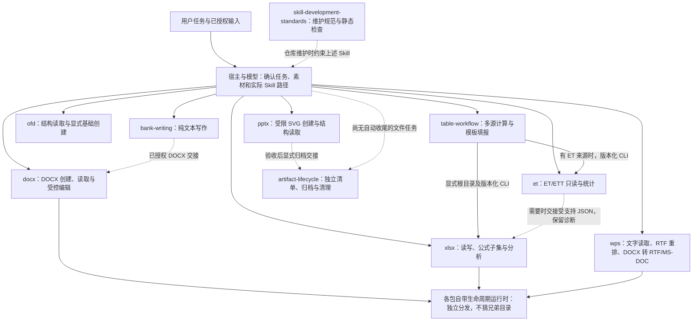
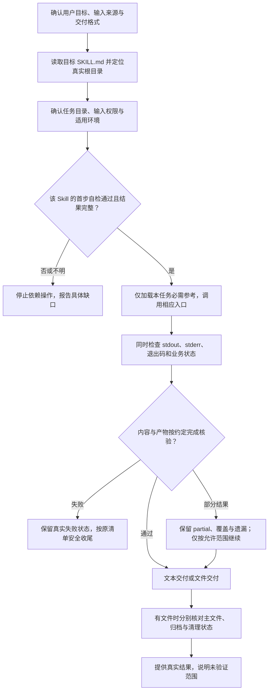

# PSL-SKILLS 架构与功能文档

本文档集逐一说明仓库中的 10 个 Skill：功能范围、实际模块、执行流程、输入输出、依赖、失败与部分结果边界。架构图描述当前实现与任务交接，不表示存在统一的自动路由服务。

## 阅读基线

- 仓库：[JohnParken/PSL-SKILLS](https://github.com/JohnParken/PSL-SKILLS)。
- 源码基线：[14bfafe55d58fd04069a78d5196b82bfbf8f67c6](https://github.com/JohnParken/PSL-SKILLS/commit/14bfafe55d58fd04069a78d5196b82bfbf8f67c6)，读取于 2026-11-05 UTC；对应当时的 `main`。
- 覆盖依据：该提交下所有 `skills/*/SKILL.md`，不将历史分发 ZIP、测试夹具或参考文件当作额外 Skill。
- 本目录是仓库维护文档，链接相对于当前 Markdown 文件。不是新的 Skill 入口，也不改变各 Skill 的主入口、版本、运行时依赖或授权要求。
- 图表使用 Mermaid。支持 Mermaid 的 Markdown 阅读器可直接显示；不支持时，代码块仍保留完整结构与连线说明。

## 按 Skill 阅读

| Skill | 基线版本 | 文档内容与核心边界 |
| --- | --- | --- |
| [bank-writing](skills/bank-writing.md) | 20261102.1954.3193 | 银行材料起草、改写、整合、摘要、仿写与审校；仅交付文本，明确需要 DOCX 时交接。 |
| [docx](skills/docx.md) | 20261105.1717.1148 | DOCX 创建、DOCX/DOTX 读取与受控编辑；自动命名、静态核验与收尾，不生成 DOTX。 |
| [xlsx](skills/xlsx.md) | 20261105.1736.5039 | 电子表格读取、创建、受控编辑、公式子集及分析；不直接读取 ET/ETT。 |
| [wps](skills/wps.md) | 20261105.1717.1148 | 受支持文字读取、RTF 创建与内容重排、从 DOCX 导出 RTF/MS-DOC；默认 `.wps` 后缀不是金山原生格式。 |
| [et](skills/et.md) | 20261105.1717.1148 | ET/ETT 的 BIFF8/OOXML 保存值读取、表头与统计；不重算公式、不写回办公文件。 |
| [ofd](skills/ofd.md) | 20261105.1644.0317 | OFD 1.0/1.1/1.2 结构与存储文字读取；明确请求时基础 OFD 1.0 创建，不渲染或验签。 |
| [pptx](skills/pptx.md) | 20261105.1644.0317 | 受限 SVG 到原生 PPTX、文本/备注读取及结构验证；不任意编辑现有演示文稿。 |
| [table-workflow](skills/table-workflow.md) | 20261105.1717.1148 | 多源聚合、维表补列、业务勾稽与既有 XLSX 模板填报；显式依赖 XLSX，ET 来源另依赖 ET。 |
| [artifact-lifecycle](skills/artifact-lifecycle.md) | 20261105.1644.0317 | 显式临时清单、已验收产物归档、封存与受控清理；不生成或验收业务内容。 |
| [skill-development-standards](skills/skill-development-standards.md) | 20261105.1556.4829 | Skill 维护规范与静态检查器；结构检查不能替代真实业务、视觉或宿主验收。 |

## 整体架构图

- 实线表示当前调用、能力组合或入口选择；虚线表示条件性交接或维护约束。连线不是无条件自动执行，也不扩张用户授权。
- `table-workflow` 当前默认通过公开 CLI 能力调用提供方；不能把保留的兼容接口或参考中的函数名误读为默认跨包私有导入。
- DOCX、XLSX、WPS 的自带生命周期模块与公共技能有受控复用关系；安装包自包含，不等于运行时必须安装公共技能并重复收尾。具体来源和差异见各篇。
- OFD 自身为独立标准库实现；图中没有给它虚构业务运行时依赖。若需要额外文件交付/归档，由宿主按明确契约组织。

## 共同任务流程图

下图是阅读各 Skill 的共同检查顺序，具体命令、状态字段和退出码以对应主入口为准，不能统一套用。

## 阅读时容易混淆的边界

1. **自检与内容验收不同。** 解释器可用、目录可写或内存样例导出成功，不代表用户文件已验收。静态包结构检查也不代表办公软件视觉显示、分页或跨平台兼容通过。
2. **退出码不能跨入口通用解释。** 例如 DOCX runner 的退出 3 是清理未完成，WPS 不同操作对 `partial` 有不同退出契约；应同时读取该命令的 JSON/诊断。
3. **有界视图不是完整数据。** 概况、分页、前几行或有限表格预览用于定位。完整统计必须基于声明的完整区域，并保留截断和数据质量信息。
4. **格式识别不是完整支持。** WPS、ET、OFD、PPTX 都声明格式子集或读取边界。存储文字不一定可见，缓存不一定最新，文件后缀不一定等于内部格式。
5. **发布、归档、清理分别报告。** 主文件成功但归档失败时保留主文件；不能通过重复生成掩盖收尾问题，不删除未知历史文件。
6. **版本与契约版本不同。** 时间戳 Skill 版本用于发布追溯，CLI 的 schema/protocol 用于接口兼容检查，二者不可互换。

## 已有资料及本次核验

- [自检与宿主回传契约](check-execution.md)：保留原有记录，注意其中日期和历史版本。
- [Linux 发布验收清单](linux-release-acceptance.md)：既有待执行方案，不因新增本组文档而自动变成通过报告。
- [本次文档核验记录](skill-docs-validation.json)：记录逐 Skill 覆盖、源码身份、链接、Mermaid 语法解析及渲染可用性。它只证明本组文档检查，不声称运行全部业务测试。
- 该记录的原字段保留文档包生成环境的核验结果；本机落地核验另列于 `local_application_check`。本机核对源码、链接与图中模块及流程，未安装 Mermaid 解析器、未重新渲染图形，也未重跑业务测试。
- 各篇末尾列出实际主入口、核心模块和参考契约。源码内部仍沿用各 Skill 的路径占位符规则；本文相对链接只用于仓库浏览。

本次仅增加仓库级说明，不更改 Skill 定义、业务代码、既有验收文件或历史发布包。发现参考与实现不一致时在对应篇目中标注，不据文档任务擅自修补业务实现。
