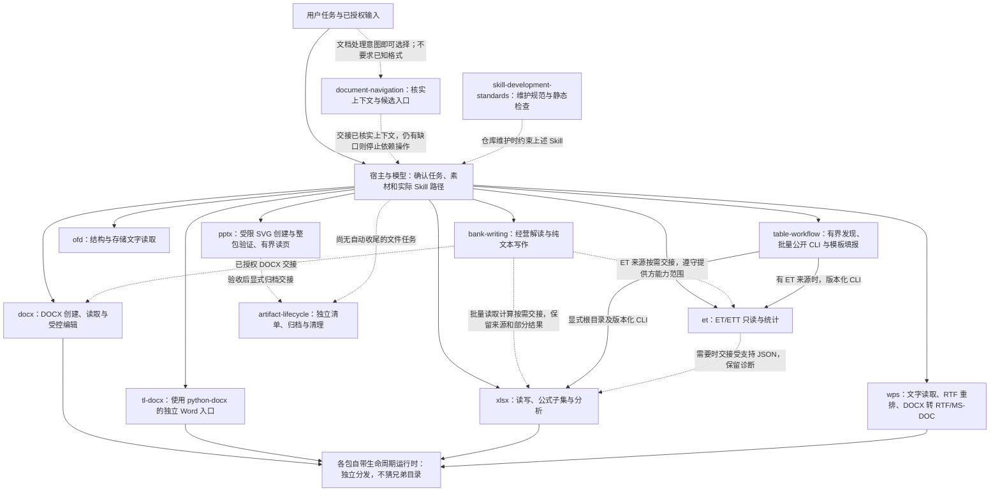
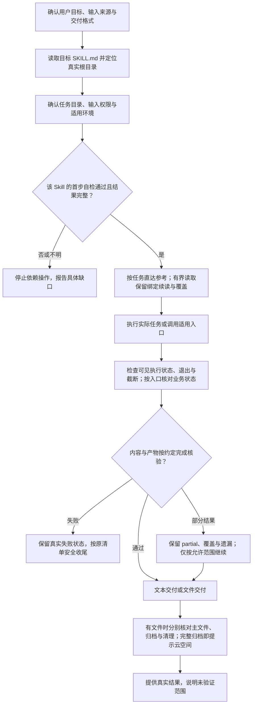

# PSL-SKILLS 架构与功能文档

运行检查按任务区分：仅读只做指定最小自检，输入可读即读；实际写入才检查写入能力，纯指导不执行环境检查。不主动倾倒挂载/系统信息，不以根目录只读推断任务目录不可用，安全检查保留。详见[说明](minimal-runtime-checks.md)。

本文档集逐一说明仓库中的 12 个 Skill：功能范围、实际模块、执行流程、输入输出、依赖、失败与部分结果边界。架构图描述当前实现与任务交接，不表示存在统一的自动路由服务。

当前输出契约：业务交付只接收裸文件名，固定写任务根目录 `./`，不接受 `./文件名` 或任何输出目录。输入、内部归档和受控临时工作区不变；详见各技能当前入口与 [输出契约和迁移](output-filenames.md)。裸文件名迁移曾发布至 `9fcf9fc`；旧日期验收记录不代表当前测试。

宿主返回的 `/large_tool_results/` 仅由宿主 `read_file` 按实际 schema 读取；不可用或不完整时报告缺口并停止依赖，不把结果引用交给执行器或猜路径。普通业务文件仍遵循各自约定。

## 组件依赖政策

项目中以 `tl-` 开头的 Skill 允许按需使用第三方组件，不限于 Python 标准库；实际使用范围、版本、部署与自检条件以各 Skill 当前声明为准。非 `tl-` Skill 的原有依赖限制不变；独立运行、路径和交付约束仍适用。当前 `tl-docx` 使用 `python-docx==1.2.0`，这不是所有 TL 技能的统一依赖。详见 [项目约定](../AGENTS.md#tl-系列-skill-的组件依赖) 与 [运行包说明](packaging.md)。

## 阅读基线

- 2026-11-12 新增纯指导 `document-navigation`，保留其他 Skill 独立入口；[本轮记录](maintenance/document-navigation/validation-20261112.md) 单列实际测试与真实 DeepAgents 宿主尚未验证的条件，不改写以下历史基线。
- 同日按用户建议将导航选择条件扩为通用文档处理意图，无需格式或位置已知；[更新验证](maintenance/document-navigation/intent-trigger-20261112.md) 保留前版记录。
- 仓库：[JohnParken/PSL-SKILLS](https://github.com/JohnParken/PSL-SKILLS)。
- 当前源码基线：`fb6cdff0161a137ebb0e64ebc64d09d11534d6d2` 加本轮工作区变更，核对日期 2026-11-12（UTC）；本轮整理 ET 容错读取、文档导航与归档展示契约，实际核验见 [分批提交记录](maintenance/commit-preparation/validation-20261112.md)。历史裸文件名迁移验证见 [当时记录](output-filenames-validation.json)，不代表当前版本的全量重测。
- 此前对全部 10 个 Skill 进行运行包与维护材料分离；当时验收基于 `e86522e` 加当时变更，记录于分批提交前。当前源码版本以表中为准，历史包与验收以各自记录和 Git 历史为准；详情见 [项目结构和运行包](packaging.md)。
- DOCX 字体编辑路由、独立差异保护与相关历史回归见 [DOCX 说明](skills/docx.md#已有文档字体修改与格式保留)；历史记录的基线、平台和范围不能自动推广到当前版本。
- 覆盖依据：当前工作树中所有 `skills/*/SKILL.md`，不将历史分发 ZIP、测试夹具或参考文件当作额外 Skill。
- 本目录是仓库维护文档，链接相对于当前 Markdown 文件。不是新的 Skill 入口，也不改变各 Skill 的主入口、版本、运行时依赖或授权要求。
- 图表使用 Mermaid。支持 Mermaid 的 Markdown 阅读器可直接显示；不支持时，代码块仍保留完整结构与连线说明。

- [Python 文件行数规范与拆分](python-file-limit.md) 保留当时的维护与验收基线；历史发行记录不作为当前版本验收。

## 按 Skill 阅读

| Skill | 基线版本 | 文档内容与核心边界 |
| --- | --- | --- |
| [document-navigation](skills/document-navigation.md) | 20261114.2127.4001 | 通用文档处理意图即可匹配，无需先说明格式；确认附件和目录，再选择工具技能。无脚本，不能保证先加载或创造宿主映射。 |
| [bank-writing](skills/bank-writing.md) | 20261114.2206.4931 | 银行材料写作与独立月报分析/比较/创建；贡献、质量、机会验证，纯摘要与新增判断分流；仅交付文本，表格计算按需交接。 |
| [docx](skills/docx.md) | 20261114.2127.4001 | DOCX 创建、DOCX/DOTX 读取与受控编辑。全量或按章节读取正文、文本框、合并表格、图表缓存及图片引用。报告续读可复用解析结果。 |
| [tl-docx](skills/tl-docx.md) | 20261114.2127.4001 | 基于 python-docx 的独立 Word 入口。普通读取默认内容优先，`--full` 获取完整记录；支持继承标题、表格/图表缓存、报告导出、Profile、分节尺寸、模板替换与受控编辑。 |
| [xlsx](skills/xlsx.md) | 20261114.2127.4001 | 电子表格读取、创建、受控编辑、公式子集及分析；不直接读取 ET/ETT。 |
| [wps](skills/wps.md) | 20261114.2127.4001 | 读取文字、表格分组和合并、文本框、内嵌 PNG 及部分二进制图表缓存，创建或重排 RTF，从 DOCX 导出 RTF/MS-DOC。 |
| [et](skills/et.md) | 20261114.2127.4001 | ET/ETT 的 BIFF8/OOXML 保存值与视图读取、有限数字格式与富文本解释、BIFF8 批注与超链接只读元数据、表头预览与统计；不重算公式、不写回办公文件。 |
| [ofd](skills/ofd.md) | 20261114.2127.4001 | OFD 1.0/1.1/1.2 默认按页读取标题、文字与页码，明确要求时读取结构；支持模板/页面文字筛选及长段游标续读；创建、生成和编辑服务暂不提供。 |
| [pptx](skills/pptx.md) | 20261114.2127.4001 | 受限 SVG 到原生 PPTX、文本/备注读取及结构验证，数学结构丢失按页诊断；不任意编辑现有演示文稿。 |
| [table-workflow](skills/table-workflow.md) | 20261114.2127.4001 | 多源聚合、维表补列、业务勾稽与既有 XLSX 模板填报；显式依赖 XLSX，ET 来源另依赖 ET。 |
| [artifact-lifecycle](skills/artifact-lifecycle.md) | 20261114.2127.4001 | 显式临时清单、已验收产物归档、封存与受控清理；不生成或验收业务内容。 |
| [skill-development-standards](skills/skill-development-standards.md) | 20261114.2127.4001 | Skill 维护规范与静态检查器；结构检查不能替代真实业务、视觉或宿主验收。 |

## 整体架构图

- 实线表示当前调用、能力组合或入口选择；虚线表示条件性交接或维护约束。连线不是无条件自动执行，也不扩张用户授权。
- 导航是可选的指导步骤；图中的交接由宿主与模型完成，没有新增调度程序。具体选择见 [导航说明](skills/document-navigation.md)，格式 Skill 保留原有自检和独立执行能力。
- `table-workflow` 当前默认通过公开 CLI 能力调用提供方；不能把保留的兼容接口或参考中的函数名误读为默认跨包私有导入。
- bank-writing 的表格连线表示宿主按实际能力组织的可选交接，纯文本分析无需安装提供方；没有新增自动调用接口、私有导入或表格写入授权。
- DOCX、XLSX、WPS 的自带生命周期模块与公共技能有受控复用关系；安装包自包含，不等于运行时必须安装公共技能并重复收尾。具体来源和差异见各篇。
- OFD 自身为独立标准库实现；图中没有给它虚构业务运行时依赖。若需要额外文件交付/归档，由宿主按明确契约组织。

## 共同任务流程图

下图是阅读各 Skill 的共同检查顺序，具体命令、状态字段和退出码以对应主入口为准，不能统一套用。

## 阅读时容易混淆的边界

1. **自检与内容验收不同。** 解释器可用、目录可写或内存样例导出成功，不代表用户文件已验收。静态包结构检查也不代表办公软件视觉显示、分页或跨平台兼容通过。
2. **退出码不能跨入口通用解释。** 例如 DOCX runner 的新建、编辑或恢复路径在业务未失败但清理未完成时退出 3；归档状态仍须另行检查。WPS 不同操作对 `partial` 有不同退出契约；应同时读取该命令的 JSON/诊断。
3. **有界视图不是完整数据。** 概况、分页、前几行或有限表格预览用于定位。完整统计必须基于声明的完整区域，并保留截断和数据质量信息。
4. **格式识别不是完整支持。** WPS、ET、OFD、PPTX 都声明格式子集或读取边界。存储文字不一定可见，缓存不一定最新，文件后缀不一定等于内部格式。
5. **发布、归档、清理分别报告。** 主文件成功但归档失败时保留主文件；不能通过重复生成掩盖收尾问题，不删除未知历史文件。
6. **版本与契约版本不同。** 时间戳 Skill 版本用于发布追溯，CLI 的 schema/protocol 用于接口兼容检查，二者不可互换。

## 最新实现中的读取与协作

- DOCX compact 表格摘要默认仅前两行；完整表格用 rows 模式或原全文接口。DOCX、ET/WPS 与 PPTX 的可选字节预算计算实际 UTF-8 JSON（含元数据、游标及换行），不是 token 计量；块/页放不下明确失败。
- 新续读按各接口绑定源身份和选择条件。ET 分析保留全区域统计、质量分母和源 partial；PPTX 有界输出仍验证整包。旧默认和兼容游标不等于新接口，按对应页面核对。
- table-workflow 的 names 通过公开元数据能力发现名称；typed_values、address_many、evaluate_many 批量处理键、地址和舍入。能力显式协商，缺失停止；基础 Skill 独立包不猜相邻安装布局。
- XLSX 写入索引仅活在一次操作内，不缓存跨任务数据；既有错误与非目标保护保持。维护基准中的耗时、字节和计划读取场景不等于真实宿主轨迹或 token 节省。
- 完整归档成功即提示“🎉 文件归档成功，请到云空间查看。 ☁️✨”，不等待宿主映射确认，也不声明已验证上传或展示时效；部分/失败/跳过/未知分别报告。

## 已有资料及本次核验

- [月报分析路由与增长分析增强](maintenance/bank-writing/monthly-analysis-20261110/validation.md)：当前 bank-writing 的判断分流、贡献/质量/机会流程与独立虚构请求执行，实际验证与宿主自动选择、真实月报等未验证项分开记录。
- [2026-11-10 描述与读取路径优化](maintenance/skill-review/optimization-451-20261110.md)：ET/XLSX 按需加载、七项描述、PPTX 数学结构缺口诊断；本机回归与未验证范围单独记录，不代表真实宿主选路或 token 节省。
- [自检与宿主回传契约](check-execution.md)：保留原有记录，注意其中日期和历史版本。
- [Linux 发布验收清单](linux-release-acceptance.md)：既有待执行方案，不因新增本组文档而自动变成通过报告。
- [2026-11-07 文档核验记录](skill-docs-validation-20261107.json)：当时的基线、版本、链接、图表核验、相关回归和未验证范围；不冒充当前全部业务重测。
- [2026-11-05 文档基线证据](skill-docs-validation.json) 原样保留，其中 Mermaid 12.3.0 解析结果和本机落地检查只对应旧文档。
- [文档防漂移检查](../tools/check_project_docs.py) 复核版本、覆盖及仓库内链接；该自动检查不证明图意、示例运行或业务语义。
- 各篇末尾列出实际主入口、核心模块和参考契约。源码内部仍沿用各 Skill 的路径占位符规则；本文相对链接只用于仓库浏览。

2026-11-07 的文档核验仅维护仓库级说明与文档检查工具，不更改 Skill 定义、业务代码、既有验收文件或历史发布包；后续 DOCX 运行包维护范围见上方单独记录。发现参考与实现不一致时在对应篇目中标注，不据文档任务擅自修补业务实现。

## 2026-11-09 路径契约维护验证

本轮明确 Skill 读取路径与执行器路径空间及映射的确认要求，保留任务数据边界；修复受控清理对安全 `./` 保护输入的处理，并同步 DOCX、XLSX、WPS 与公共生命周期的受控副本和来源哈希。历史验收和基线快照保留原记录，不作为本轮结果。

在 macOS 27.2 arm64、Python 3.13.12、Expat 2.6.3 上，`tools/run_all_tests.py` 运行 2444 项，0 失败、0 跳过；仓库级测试 327 项通过，含 11 个独立只读包与跨技能测试。在同机 Python 3.12.12 上，真实生成 XLSX 和 RTF 的测试在修复前复现带 configs 的 `./` 输入错误，修复后各自的 delivery 测试分别为 30/30 和 21/21；核对了输入不变、临时文件清理、无 configs 成功及危险路径拒绝。

未运行 Linux、Windows 或真实 DeepAgents 验证；Pylint 未安装，未执行。ET 和 WPS 源码目录的严格检查因先前已有缓存警告未通过；独立包严格检查通过。本机测试及静态检查不证明未测平台或真实宿主行为。

归档回复展示边界已统一：内部回执用于核验，最终回复及下载链接不得带出归档地址；实际主文件引用仍可交付。范围、检查证据与未验证项见 [归档展示复核](maintenance/artifact-lifecycle/archive-reply-privacy-20261112.md)。
