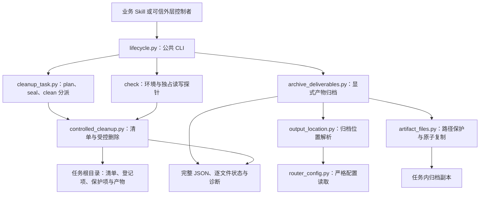
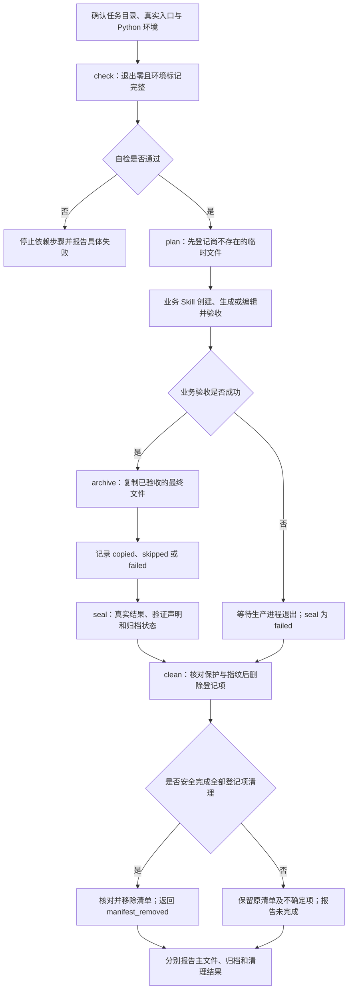

# artifact-lifecycle：显式归档与受控清理

> 源码基线：[`14bfafe55d58fd04069a78d5196b82bfbf8f67c6`](https://github.com/JohnParken/PSL-SKILLS/tree/14bfafe55d58fd04069a78d5196b82bfbf8f67c6)；Skill 版本：`20261105.1644.0317`。本文描述固定基线的实际实现，不是清理任意目录的操作授权。

## 功能与职责

`artifact-lifecycle` 面向尚未接入自动收尾的文件任务，提供显式临时项登记、已验收产物归档、任务结果封存和受控清理。它只处理调用方指定的清单，不扫描历史文件，不按扩展名删除文件，不执行任意生产脚本，也不生成或验收业务内容。

业务 Skill 负责生成、编辑和格式验收；本 Skill 负责将最终文件复制到配置指向的归档位置，并清理本轮创建且可以安全确认的登记项。主文件成功、归档结果和清理结果是三种独立状态。归档不是上传、分享或宿主下载能力。

纯对话和仅读 stdout 不需要清单。DOCX/XLSX 已有自动收尾路径时继续使用原 runner，直接核对其结果，不为同一批文件再调用本 Skill。

## 代码架构

### 主要模块与入口

| 模块 | 主要入口 | 实际职责 |
| --- | --- | --- |
| [lifecycle.py](../../skills/artifact-lifecycle/scripts/lifecycle.py) | `main`、`environment_check` | 统一 `check`、`archive`、`plan`、`seal`、`clean`；打印 JSON 并返回对应退出码 |
| [archive_deliverables.py](../../skills/artifact-lifecycle/scripts/archive_deliverables.py) | `archive_outputs`、`finalize_delivery`、`choose_delivery_output` | 输入保护、显式归档列表、逐文件复制及 SHA-256 校验；归档失败不改写调用方业务成功状态 |
| 同上 | `archive_user_message`、`archive_user_notice` | 分别保留机器文案和不暴露内部路径的用户提示 |
| [artifact_files.py](../../skills/artifact-lifecycle/scripts/artifact_files.py) | 内部路径检查、别名检查、原子复制原语 | 拒绝越界与符号链接，保护输入和其他交付物，默认独占发布归档 |
| [router_config.py](../../skills/artifact-lifecycle/scripts/router_config.py) | `read_environment_parameter`、`get_common_parameter` | 读取原始环境值，严格解析参数；命名字符串值去掉两端空白，不负责文件路径策略 |
| [output_location.py](../../skills/artifact-lifecycle/scripts/output_location.py) | `resolve_output_location` | 验证 `questionId`，返回相对归档位置或 fallback 原因 |
| [controlled_cleanup.py](../../skills/artifact-lifecycle/scripts/controlled_cleanup.py) | `TaskFiles`、`plan_cleanup`、`seal_cleanup`、`finalize_cleanup` | 以目录描述符约束访问，登记不存在路径，封存指纹，删除未变登记项，最后移除清单 |
| 同上 | `finalize_failed_cleanup` | 给已退出生产进程的可信调用者使用，按失败结果封存并清理 |
| [cleanup_task.py](../../skills/artifact-lifecycle/scripts/cleanup_task.py) | `main` | 保留来源兼容 CLI；公共使用优先走 `lifecycle.py` |

`choose_delivery_output` 只选择当前未占用的名称，可尝试递增“第 N 版”后缀，不预留路径、不提供并发锁。`controlled_cleanup.cleanup_task` 是内部清理阶段，保留清单回执；公开最终收尾应使用 `finalize_cleanup` 或 CLI `clean`，后者才继续核对并移除清单。

## 任务流程

创建顺序是安全边界：必须在临时文件出现前 `plan`，不能事后补登已有未知文件。失败后不为潜在重试保留本轮中间文件；重新生成应从原始输入建立新任务。恢复清理只能使用原清单，不重新发现删除目标。

## 输入与命令契约

运行前由实际读取 `SKILL.md` 的真实路径确定 Skill 根目录，并替换 [运行入口](../../skills/artifact-lifecycle/SKILL.md) 中的 `<skill-root>` 占位符。命令在宿主确认的业务任务目录执行，不能切换到 Skill 安装目录生成任务文件。

| 命令 | 输入 | 结果与退出码 |
| --- | --- | --- |
| `check` | 当前任务目录和平台能力 | 成功 JSON：`status=environment-ok`、`task_writable=true`、`check_kind=environment`、`artifact_validation=not_run`；退出 0。受控失败 JSON 为 `status=error`，退出 1 |
| `plan MANIFEST` | 重复 `--file`、`--protect`、`--deliverable` | 新清单及临时项必须是任务根目录内的单一文件名；`--directory` 仍可解析但新登记会拒绝；成功为 `status=planned` |
| `archive OUTPUT...` | 最终文件列表、重复 `--protect-input`、可选 `--replace-existing` | 退出 0 为 `copied`，3 为 `skipped`，1 为 `failed`；均须读取完整 JSON |
| `seal MANIFEST` | `--outcome`、可选 `--verified`、`--archive-status`、`--retain PATH REASON` | 成功为 `status=sealed`；成功结果要求非空交付物、验证声明和有效归档状态，但程序不验证业务声明真实性 |
| `clean MANIFEST` | 原清单 | 最终核对和清理；查看 `cleanup_complete`、`manifest_removed`、`deleted`、`retained`、`failed`、`deliverables_unchanged` |

`plan/seal/clean` 的退出码为：0 成功、3 保留、1 失败/阻止/受控错误。所有子命令的 argparse 参数错误为退出 2，不能假定这种错误也输出正常结果 JSON。宿主须保留同次调用的 stdout、stderr、真实退出码和调用标识；截断 JSON、超时或无真实退出码的结果不能当成完整结果。

清单路径使用规范化相对文件名，例如 `task.cleanup.json`、`worker.py`，而不是带 `./` 的清单成员字符串。新临时项不能放子目录；保护输入、交付物和旧清单恢复仍按其真实契约处理。内部清单 schema 保留 `docx_cleanup_v1` 兼容名称，不表示只能清理 DOCX。

### 归档配置

`ROUTER_CONFIG_VARIABLES` 支持含 `commonParam` 的对象或命名参数列表；`commonParam` 可为列表或其 JSON 字符串。`questionId` 经裁剪后须为非负整数或 1–128 位 ASCII 字母、数字、下划线、短横线字符串，并拒绝布尔、路径和保留设备名。重复 JSON 键、NaN、重复目标业务参数和错误结构拒绝。

配置缺失或无效时，归档 `skipped`，主文件位置保持不变。有效配置把产物按 basename 平铺复制到任务目录内的 `output/{questionId}/`；这是实现路径，不是可直接交付用户的外部链接。默认关闭配置调试；显式启用时只输出配置是否存在和已脱敏的布尔字段，不记录参数原文。

## 安全、partial 与失败边界

### 归档

- 默认不覆盖同名归档；冲突项返回 `error_code=archive_conflict`，汇总 `archive_status=failed`，主文件和旧归档保留。仅明确授权覆盖所列文件后才传 `--replace-existing`，该选项不绕过输入保护。
- 拒绝批内忽略大小写后的同名、目录组件符号链接、越界路径及指向输入/其他交付物的别名或硬链接。
- 新副本先在任务根目录独占暂存，写入、flush/fsync 和设置权限后，以同文件系统硬链接独占发布；显式覆盖才用原子替换。硬链接或跨文件系统条件失败时不降级覆盖，也不换暂存目录。
- 每个新复制成功项在发布后核对来源和副本 SHA-256，返回 `archive_verified=true`。`already_archived` 是独立状态，不能据此推断完成了新复制或同样的重新校验。
- 多文件不是整批事务，可能一些文件成功、另一些失败。必须检查 `files`，不能因汇总 `status=completed` 就认定归档成功。已经成功的副本不回滚。
- 错误区分 `archive_cross_device`、`archive_permission_denied`、`archive_storage_full` 等；可能返回 `temporary_residuals`。归档失败不重跑业务生成来掩盖问题。

### 清理

- `TaskFiles` 依赖描述符相对操作及 `O_NOFOLLOW`、`O_DIRECTORY`；不具备安全能力时停止，不降级为路径扫描删除。
- 清单限制为 2 MiB，登记项上限 2048；单文件内容指纹上限 128 MiB。交付物、临时项超出指纹能力或状态无法确认时，应按失败/保留结果处理，不能提高权限绕过。
- 清理前后核对交付物指纹，并以受保护输入和交付物身份避免删除别名。登记项修改、链接数变化、归属不明、非空目录或删除受阻时保守保留并报告。
- `cleanup_complete=true` 且 `cleanup_scope=registered_entries_only` 只证明原登记范围完成，不证明目录内没有其他残留。强杀可能留下创建函数未及清理的内部暂存，不扫描删除未知项。
- 原清单只供一个可信控制者串行使用。普通 `plan/seal/clean` 没有生产进程锁、完整创建事务、自动重试状态机或对同权限恶意并发写者的隔离保证。
- `retry` outcome 仅为旧协议兼容而保留，会保留登记项；不是新任务失败策略。生产临时 Python 尚未退出时不得清理自身。
- 清单移除失败、部分删除或回执更新失败都应报告清理未完成，不能把 `seal` 或退出 0 当成业务成功证明。

## 独立 Skill、DOCX 来源与其他包的自包含副本

以下部署关系必须分开理解：

1. **独立 artifact-lifecycle 包**：带齐同级运行时文件，通过本包 CLI 或明确 Python 接口使用；运行时不导入 DOCX 或仓库公共目录。缺失时报告能力不可用，不猜相邻安装路径。
2. **DOCX 原有实现**：保留自己的 runner 和 CLI。公共包是显式提取的分发副本，五个文件要求逐字节一致；`archive_deliverables.py` 仅共享 `def main(argv=None)` 之前的部分，去掉 DOCX 专属 CLI 依赖。来源和哈希记录在 [upstream.json](../../skills/artifact-lifecycle/references/upstream.json)。
3. **XLSX 自包含副本**：在其 `_artifact_runtime` 下携带六个模块；[lifecycle-upstream.json](../../skills/xlsx/references/lifecycle-upstream.json) 记录源哈希、安装哈希及添加 future annotations、改用包内相对导入的转换。这不是运行时调用独立 artifact-lifecycle 安装包，也不意味着副本与来源逐字节相同。
4. **WPS 自包含副本**：在 `_wps_artifact_runtime` 下携带相同六个公共模块；其 [lifecycle-upstream.json](../../skills/wps/references/lifecycle-upstream.json) 同样记录来源、哈希和导入转换。WPS 的业务流程与收尾由自身入口负责，公共副本不是对相邻 Skill 安装目录的隐式依赖。

仓库级 [test_artifact_lifecycle_parity.py](../../tests/test_artifact_lifecycle_parity.py) 对比 DOCX 来源、公共副本和记录哈希；[test_xlsx_lifecycle_parity.py](../../tests/test_xlsx_lifecycle_parity.py) 与 [test_wps_lifecycle_parity.py](../../tests/test_wps_lifecycle_parity.py) 则核对相应转换后的副本及双端哈希。XLSX 另有 [test_xlsx_archive_sync.py](../../skills/xlsx/scripts/test/test_xlsx_archive_sync.py) 检查归档行为与独立安装。源码一致性检查不等于行为测试；两者均不自动同步代码，也不能以只更新哈希代替审阅语义差异。公共包自身合成测试不要求 DOCX 存在。

## 依赖与验证限制

- [requirements.txt](../../skills/artifact-lifecycle/requirements.txt) 声明 Python ≥3.10、仅标准库，保持 `-I -S -B`，不安装第三方组件或调用外部办公软件。
- `check` 会创建、读回并清理本次独占探针，检测清理所需平台能力；它不解析归档配置、不创建归档目录，也不证明内容正确、归档可用或可下载。
- [test_lifecycle.py](../../skills/artifact-lifecycle/scripts/test/test_lifecycle.py) 提供合成测试，包括配置裁剪、完整 CLI、输入与链接保护、同名冲突、失败后清理、指纹变化、平台能力缺失、损坏清单和 stdout JSON。测试是维护代码，生产流程不得调用。
- [reuse.md](../../skills/artifact-lifecycle/references/reuse.md) 中的测试数量与 macOS 记录是历史证据，不代表本轮重跑，更不能替代 Linux、Windows、生产云存储或真实宿主回传验收。
- 本轮是源码审阅与仓库文档编写，未运行归档、删除、全量测试、独立发布包测试或跨平台验收。

## 可追溯源码

- [固定基线的 artifact-lifecycle 目录](https://github.com/JohnParken/PSL-SKILLS/tree/14bfafe55d58fd04069a78d5196b82bfbf8f67c6/skills/artifact-lifecycle)
- [Skill 主入口](../../skills/artifact-lifecycle/SKILL.md)、[命令与失败恢复契约](../../skills/artifact-lifecycle/references/contract.md)
- [复用与验证说明](../../skills/artifact-lifecycle/references/reuse.md)、[来源清单](../../skills/artifact-lifecycle/references/upstream.json)
- [统一 CLI](../../skills/artifact-lifecycle/scripts/lifecycle.py)、[归档实现](../../skills/artifact-lifecycle/scripts/archive_deliverables.py)、[清理实现](../../skills/artifact-lifecycle/scripts/controlled_cleanup.py)

## 归档提示更新（2026-11-07）

以下仅适用于本次版本 20261107.1943.5370，其余架构说明仍为上述历史基线。

归档成功即提示“🎉 文件归档成功，请到云空间查看。 ☁️✨”，无需等待宿主云空间映射确认，不宣称已验证上传完成或展示时效。失败、部分成功、跳过、待交接和未知分别如实报告，不套用全部成功；业务与清理状态独立，主业务失败不称生成成功。隐藏归档路径、目录、ID及原始日志，保留真实主文件链接，不虚构下载。
