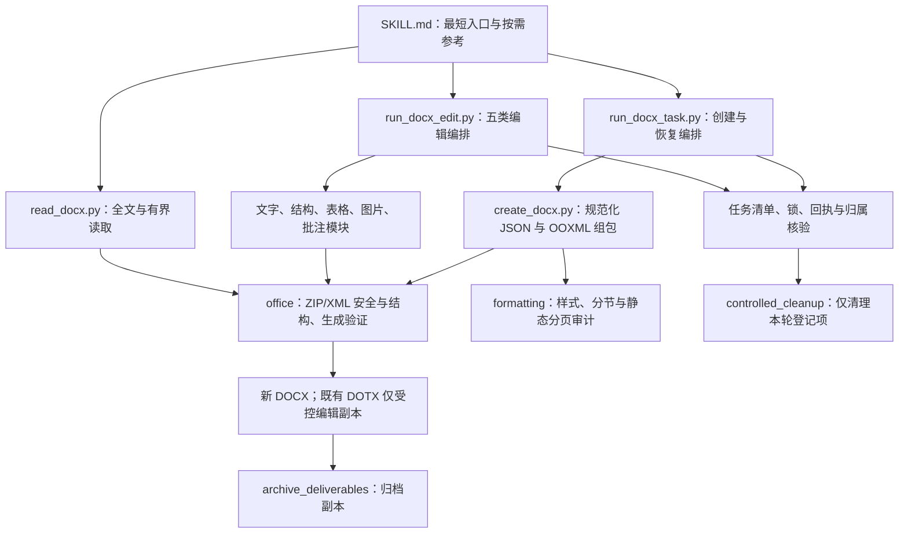
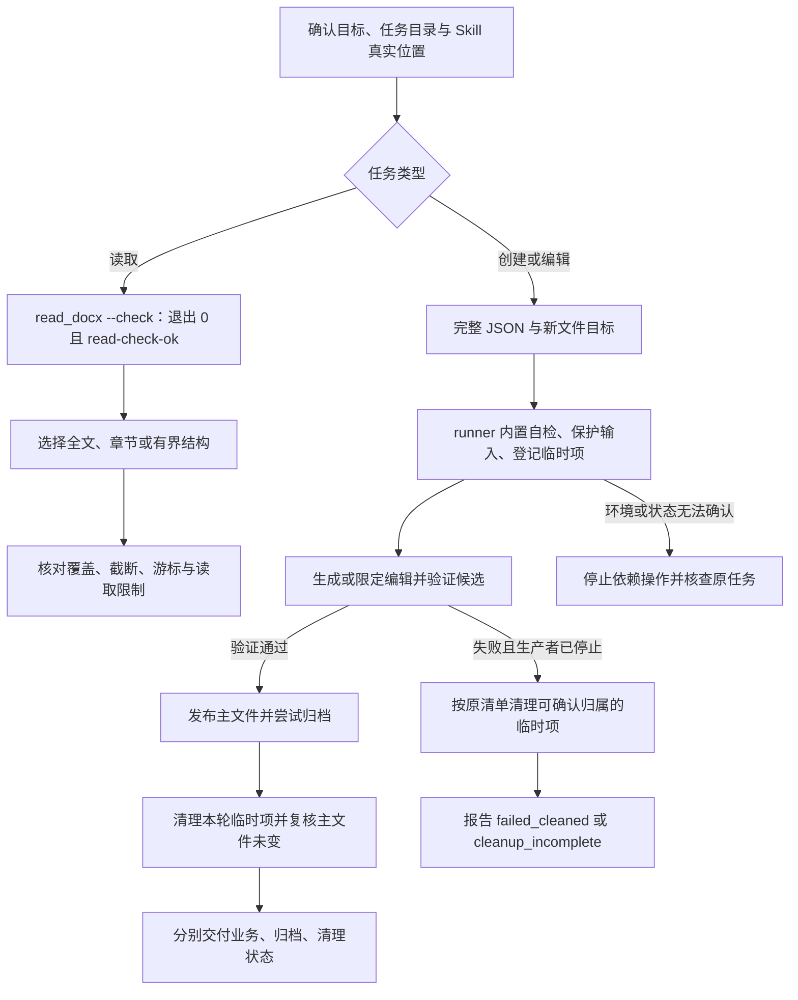

# DOCX：标准库文档生成、读取与受控编辑

> 源码基线：[14bfafe55d58fd04069a78d5196b82bfbf8f67c6](https://github.com/JohnParken/PSL-SKILLS/tree/14bfafe55d58fd04069a78d5196b82bfbf8f67c6)；Skill 版本：`20261105.1717.1148`。本文是仓库级说明，不替代 [SKILL.md](../../skills/docx/SKILL.md) 的运行约束，也不表示本次运行过办公任务或业务测试。

## 功能与适用范围

DOCX Skill 用 Python 标准库构建 OOXML 文档包，适合公文、通知、报告、简单表格及声明式排版。它同时提供只读内容提取和严格限定的已有文档修改。

- **创建**：有序 JSON `blocks` 转为 `.docx`。基础块为标题、副标题、1–4 级标题、正文、列表、表格和分页；专项能力包括 PNG/JPEG 图片、富文本、合并表格、编号、目录、分节及交叉引用。复杂需求按主入口直达相应参考，不需预读全部资料。
- **读取**：原生 `.docx/.dotx` 的全文、标题、段落范围、章节、概览、精简结构或显式 OOXML 结构。可选读取页眉、页脚、脚注、尾注和批注；修订视图不修改原文档。
- **编辑**：普通文字节点替换、受控段落插入及 run 格式、规则表格数据行增删、同格式图片替换、有限批注事务。输出新文件，保留原件。
- **不提供**：旧二进制 DOC、WPS 专有格式转换、PDF 生成、任意无损编辑、完整修订接受/拒绝或真实视觉分页验证。CFB 内容即使伪装成 `.docx` 也拒绝并指向 WPS 读取能力；电子表格最终由 ET Skill 处理。

默认 `theme=official`，用户指定格式优先。未明确要求另起页时采用自然分页，不因一级标题自动插入分页或分节。标题 `keep_with_next` 是排版意图，不保证最终页码。目录、页码和交叉引用域需要阅读器更新。

## 架构图



运行时、编辑器及生命周期工具均随 DOCX 包分发，不需要从相邻 Skill 导入业务实现。图中 `office` 是本包 Python 模块目录，不是 Microsoft Office 服务。

## 主要模块与公开入口

| 入口或模块 | 职责与关键契约 |
| --- | --- |
| [run_docx_task.py](../../skills/docx/scripts/run_docx_task.py) | 常用入口 `create`，stdin 接收 JSON；内置环境检查、独占任务文件、固定子进程、验证回执、归档及清理。`resume` 核对原任务状态，`retry` 仅用于仍存在且满足条件的原清单，不是盲目重生成。 |
| [create_docx.py](../../skills/docx/scripts/create_docx.py) | `_validate_spec`、`_package_parts` 构建规范化规格与 ZIP 部件；`create_document_delivery()` 默认验证并归档。低层 `create_document()` 默认 `verify=False`，不能据此假定完成标准交付闭环。 |
| [read_docx.py](../../skills/docx/scripts/read_docx.py) | `read_docx()` 文本、`read_docx_structure()` 显式结构、`read_docx_compact()` 有界内容视图；CLI 默认文本，`--format json` 与 `--compact-json` 是不同契约。 |
| [run_docx_edit.py](../../skills/docx/scripts/run_docx_edit.py) | `text/structure/tables/image/comments` 五类写操作，stdin 接收操作规格；批注 `list` 应使用原只读入口，不走此写入编排。 |
| [edit_docx.py](../../skills/docx/scripts/edit_docx.py)、[edit_structure.py](../../skills/docx/scripts/edit_structure.py) | 文字精确匹配与次数校验；段落索引及 `expected_text` 双重定位；拒绝受保护或复杂锚点。 |
| [edit_tables.py](../../skills/docx/scripts/edit_tables.py)、[replace_image.py](../../skills/docx/scripts/replace_image.py)、[manage_comments.py](../../skills/docx/scripts/manage_comments.py) | 分别处理规则数据行、已知媒体及关系、经典/现代批注的有限动作。各自保留独立保护与验证范围。 |
| [office/archiveio.py](../../skills/docx/scripts/office/archiveio.py)、[office/xmlio.py](../../skills/docx/scripts/office/xmlio.py) | 受限 ZIP/XML 访问、解析预算与外来内容安全边界，不执行宏、域或文档内指令。 |
| [office/validate.py](../../skills/docx/scripts/office/validate.py)、[validate_layout.py](../../skills/docx/scripts/validate_layout.py) | OPC/显式结构检查与静态版式风险审计；不执行 XSD 或阅读器渲染。 |
| [archive_deliverables.py](../../skills/docx/scripts/archive_deliverables.py)、[controlled_cleanup.py](../../skills/docx/scripts/controlled_cleanup.py)、[docx_task_state.py](../../skills/docx/scripts/docx_task_state.py) | 文件保护、冲突命名、归档状态、身份与内容指纹、清单和回执校验；归档与清理分别报告。 |

## 任务流程图



常用创建只需主入口，不重复预跑 preflight；单独读取先做只读自检。调用始终在宿主确认的任务目录中，脚本位置由本轮实际读取 `SKILL.md` 的路径确定，不能把当前工作目录当成 Skill 安装目录。下例只说明调用形态，`<skill-root>` 必须替换为真实根目录；本次文档工作未执行该示例。

```sh
python -I -S -B "<skill-root>/scripts/run_docx_task.py" create "工作情况说明.docx" --compact-receipt <<'JSON'
{"theme":"official","blocks":[{"type":"title","text":"工作情况说明"},{"type":"paragraph","text":"本期工作有序开展。"}]}
JSON
```

## 输入、输出与 partial 边界

### 创建和编辑

创建 stdin 必须是完整 JSON；runner 限制自动任务 JSON 为 2 MiB。`blocks` 保持内容顺序，单行 `text` 不含真实换行或换页控制字符，正文分段须使用多个块。图片等任务资源相对任务目录，不写入 Skill 安装目录。

标准回执中，创建成功核对 `status=verified`，编辑成功核对 `status=edited`；二者再检查 `task_status`、实际 `output`、非空主文件及返回的 `warnings`。成功创建的检查项包括 ZIP CRC、结构、内容覆盖与静态排版意图；`visual_validation=false`、`xsd_validation=false` 是明确限制。冲突时 runner 可选择带“第 N 版”的新文件名，消费方必须使用返回路径，不能固定猜测请求名称。

`--compact-receipt` 只投影完整成功结果，且要求归档 `copied`、清理完成；错误、归档未完成或清理未完成会保留完整诊断。它不省略实际验证工作。

| 入口 | 退出码及结果含义 |
| --- | --- |
| 创建/编辑 runner | `0`：业务未失败且无 `cleanup_incomplete`；仍须检查归档状态及警告。`1`：`status=failed`。`3`：业务未失败但 `task_status=cleanup_incomplete`。参数解析失败通常为 `2`。 |
| `read_docx.py` | 成功 `0`、读取/安全检查失败 `1`、参数错误 `2`。不采用 WPS 的通用 `partial/3` 契约；有界结果须看截断及覆盖字段。 |
| `validate_layout.py` | 结构正常默认 `0`，可同时有风险警告；结构失败 `1`；显式 `--strict-pagination` 遇分页风险 `2`。该 `2` 不表示真实出现空白页。 |

错误优先看 `error_code`、`next_action` 与真实退出码。失败后若已成为 `failed_cleaned`、原清单已删除，纠正规格后建立新任务，不再对旧清单 `retry`。超时或发布状态不明时先检查原状态；安全或环境失败不能通过降低检查、切换路径或原样重试规避。

### 读取结果

- `--summary` 是概览，不含全文；最多返回 100 个标题，超出以 `headings_truncated` 标示。
- `--paragraph-range` 的索引为 **1-based 且两端包含**，只计正文级段落，不计表格单元格或附加部件。章节要求精确标题，重复标题使用 `--section-occurrence` 消歧。
- `docx-compact` 是有损只读视图；表格默认只预览前两行。需要完整表格可用全文文本，或 `--compact-json --tables rows` 结合 `next_block` 续读。`truncated/total_blocks` 必须保留。
- 精简 JSON 默认上限 12,000 字符，允许设置 128–2,000,000；按完整块分页，单块超限失败。文本截断带显式标记，全结构 JSON 超预算则失败，不交付半截 JSON。
- `docx-structure` 的 `schema_version=1` 描述显式 XML；未知元素以 opaque 节点保留。样式继承、自动编号、域结果和页面顺序未计算，不能直接作为生成器输入或无损编辑格式。
- `--revisions accepted/original/all` 只控制读取视图，不能表述为已保存净稿。

详见 [读取契约](../../skills/docx/references/inspection.md) 与 [读取实现](../../skills/docx/scripts/read_docx.py)。

## 编辑保护范围

| 操作 | 可修改范围 | 主要拒绝条件与保留约定 |
| --- | --- | --- |
| 文字替换 | 单个普通 `w:t` 内文字，精确 `count`；默认正文，可明确选页眉页脚部件 | 不跨 run、字段、修订、超链接、批注范围或未知复杂容器；次数不足、过多、重叠或 XML 值无法保真时停止。 |
| 结构编辑 | 正文直属段落前后插入、普通 run 的有限格式 | 段落/run 索引为 **0-based**，核对原文；不是读取范围的 1-based 索引。复杂段落、节属性、范围锚点等拒绝。 |
| 表格数据行 | 有显式网格的规则矩形表中增删数据行 | 不支持合并、嵌套或复杂单元格；保护已标记的重复表头，不删除最后一条数据行。 |
| 图片替换 | 已知 PNG/JPEG 媒体的同格式替换 | 必须给出原 SHA-256、关系条数及实际引用次数；共享引用须明确同意全部替换。不改变尺寸、裁剪或布局，不解码像素。 |
| 批注 | 查询、严格锚点新增、更新/删除及有限现代一级回复 | 现代四部件需一致；经典批注不自动升级为现代线程。复杂元数据、任意云线程、提及和解决状态不在范围内。 |

受控写入拒绝数字签名包，不删除签名绕过限制。非目标 ZIP 成员内容字节可按对应操作保留；修改过的 XML 进行节点与属性值保真检查，**不承诺整份 ZIP 字节不变或任意文档无损编辑**。见 [文字编辑](../../skills/docx/references/ooxml-editing.md)、[结构编辑](../../skills/docx/references/structure-editing.md)、[表格与图片](../../skills/docx/references/table-media-editing.md)、[批注](../../skills/docx/references/comments-management.md)。

## 依赖、归档与验证限制

- [requirements.txt](../../skills/docx/requirements.txt) 声明 Python ≥3.10、标准库 zlib、Expat ≥2.6.0，不安装第三方包或 Office/转换器。使用 `-I -S -B`。
- 自动任务控制依赖 `fcntl`/POSIX 锁、`dir_fd` 和不跟随链接的安全文件操作；能力缺失即停止，不能从“仅标准库”推导为所有平台可运行。默认归档发布需要同文件系统硬链接。
- [归档](../../skills/docx/references/delivery.md) 是主文件之外的受控副本，不是移动原件。分别看 `archive_status` 和文件明细；归档失败保留主文件，只重试获准的归档步骤，不重跑生成。
- 清理需核对 `cleanup_complete`、`manifest_removed`、`deliverables_unchanged`。只处理创建前登记且身份、内容归属可核实的本轮临时项；未知或变化文件保留并报告，不按扩展名扫描清空目录。
- `validate_layout` 的分页风险是静态推断。字体名称只写入样式，不安装或嵌入字体；真实字体替代、页数、跨页表格和阅读器表现仍须实际客户端验证。历史参考中的验收记录不能自动扩展为本次测试结果或跨平台保证。

本页依据固定提交的代码与引用契约编写。本次仅做源码审阅和文档一致性核对，未生成/修改 Office 文档、未运行业务自检或全量测试、未做 Word/WPS/LibreOffice 客户端验收。

## 源码追溯

- 固定基线：[DOCX 源目录](https://github.com/JohnParken/PSL-SKILLS/tree/14bfafe55d58fd04069a78d5196b82bfbf8f67c6/skills/docx)。
- 入口和创建闭环：[SKILL.md](../../skills/docx/SKILL.md)、[run_docx_task.py](../../skills/docx/scripts/run_docx_task.py)、[create_docx.py](../../skills/docx/scripts/create_docx.py)、[生成核心规范](../../skills/docx/references/generation-core.md)。
- 安全与验收：[office/xmlio.py](../../skills/docx/scripts/office/xmlio.py)、[StructureValidator](../../skills/docx/scripts/office/validators/structure.py)、[生成验证](../../skills/docx/scripts/office/validators/generation.py)、[分页治理](../../skills/docx/references/pagination-governance.md)。
- 状态与恢复：[受控流程](../../skills/docx/references/controlled-flow.md)、[run_docx_edit.py](../../skills/docx/scripts/run_docx_edit.py)、[controlled_cleanup.py](../../skills/docx/scripts/controlled_cleanup.py)。
