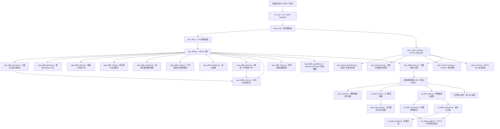
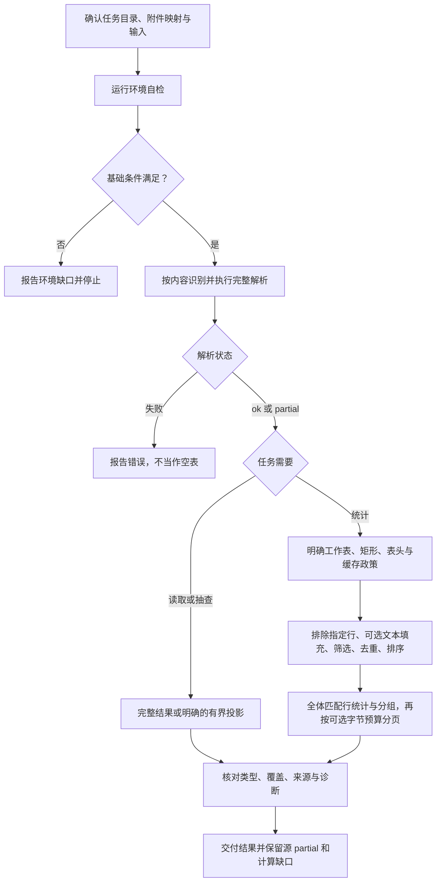

# ET：WPS 表格只读提取与统计

核对日期：2026-11-12。本文历史源码参考基线 [`9fcf9fca339dd0f6491f7e64e4777f9dc57e61a7`](https://github.com/JohnParken/PSL-SKILLS/tree/9fcf9fca339dd0f6491f7e64e4777f9dc57e61a7)，当前 Skill 版本为 `20261113.2302.5108`（内容优先容错重构）。这是仓库级架构与接口说明，不替代业务执行前必须读取的 [SKILL.md](../../skills/et/SKILL.md)。

本 Skill 默认只向 stdout 输出结果；完整读取可用 `--output <裸文件名>` 在任务根目录独占创建 JSON 文件并只在 stdout 返回 `et_output_manifest_v1` 清单。授权交接或另存结果时只指定裸文件名，交付文件固定在任务根目录 `./`；输入与仓库维护目标路径保持原规则。

Python 模块拆分及文件行数规则见 [行数规范与重构记录](../python-file-limit.md)；该记录保留其验收时的历史基线，不等同于当前版本重测。运行能力和安全边界不因拆分扩大。

宿主返回的 `/large_tool_results/` 是结果引用，仅使用宿主 `read_file` 和实际 schema 补读并核对覆盖；不交给 execute、cat、Shell 或 Python，不猜映射或使用路径掩码。读取工具缺失或结果不完整时报告缺口并停止依赖。普通业务文件和 Skill 资源仍遵循各自路径规则。

## 功能与适用范围

ET Skill 离线读取 `.et/.ett` 中的工作表、单元格保存值和公式缓存，并对明确指定的矩形区域进行预览、筛选、排序、去重、列统计和分组汇总。它按内容识别格式，不根据扩展名推断 WPS 版本或内部结构。

- 二进制分支：读取 CFB 容器内的 `Workbook` / `Book` 流（多个候选时选首条通过 BIFF8 globals BOF 校验者并记 issue），在统一容错策略下解析受支持的 BIFF8 记录子集。
- ZIP 分支：按安全 OPC 关系识别并读取受支持的 OOXML 电子表格子集；未知关系只记录不读取，外部目标不跟随。原生 XLSX 业务任务仍按入口约定交给 XLSX Skill。
- 输出分支：run 完整读取默认 64 MiB JSON（`--max-json-bytes` 1–256 MiB），可用 `--compact` 精简、`--output` 写文件清单；有界视图/预览/分析另走投影契约。
- 分析分支：使用已读取的类型化保存值生成派生 JSON，不修改原表或输入提取对象。
- 跨表计算后填入另一份 XLSX 模板由 `table-workflow` 编排；ET 只提供原始完整提取结果及诊断；名称发现可使用仅元数据接口。

不提供新建、编辑、办公格式转换、版面恢复、公式重算、宏执行或外链访问。读取统一采用内容优先的容错策略：容器头差异、记录分帧尾、非单元格元数据、扩展关系或输出预算问题降级为 partial + issues + 原始证据；安全硬边界（加密、记录帧无法继续、无法安全建立基础分配表、ZIP/XML 安全、资源上限、输入变化）仍拒绝。CFB 容器识别、BIFF8 子集读取和完整 WPS 兼容是三个不同层次；未知容器、原生私有格式和未解码记录不能被当作已支持。

## 架构



标准入口、跨 Skill 接口及分析 CLI 共用 `read_et.read_bytes()`。OOXML 电子表格解析使用 `wps_ooxml.py` 提供的 ZIP 和 XML 校验。

本轮兼容修复：损坏图表在明确工作表记录处恢复，合法 SERIESDATA 缓存不进入表格，歧义边界保留覆盖风险；重复 OOXML 数据段/行读取不同坐标，冲突采用首个可读值并标 partial。普通统计与预览不因重叠合并终止，歧义填充或表头重建仍拒绝。已确认只影响展示的元数据错误不再一律标成值丢失；AutoFilterInfo 先校验再更新状态。

概况诊断超过预算时可显式汇总条目数和代码样本，保留源风险与省略说明；逐格分页和完整 read/metadata 协议仍保留诊断。完整文件清单按含换行的实际字节计算 SHA-256，文件上限仍为256 MiB。精简输出用 `output_projection` 明示原始证据缺失。当前验收与限制见 [兼容读取补强记录](../maintenance/et/compatibility-recovery-20261111.md)。

### 主要模块与入口

| 源码 | 主要职责 |
|---|---|
| [et_cli.py](../../skills/et/scripts/et_cli.py) | `run` 兼容原读取 CLI；`capabilities` 查询接口；`read/metadata` 从 stdin 接收协议请求 |
| [read_et.py](../../skills/et/scripts/read_et.py) | `read_bytes` / `read`、环境检查、容器识别、原始 JSON 编码与状态退出码 |
| [wps_access.py](../../skills/et/scripts/wps_access.py) | 受限文件读取、容器策略和错误上下文 |
| [wps_cfb.py](../../skills/et/scripts/wps_cfb.py) | CFB 容器读取；头部/尾缀/未引用分配等非值差异记 issue，基础分配表无法安全建立仍拒绝；流链异常保留已验证前缀并报告覆盖风险；用户流上限 32 MiB |
| [wps_biff8.py](../../skills/et/scripts/wps_biff8.py) | BIFF8 入口、资源上限、结果装配；容错实现分布在下列模块 |
| [wps_biff8_globals.py](../../skills/et/scripts/wps_biff8_globals.py)、[wps_biff8_sheet.py](../../skills/et/scripts/wps_biff8_sheet.py) | 容错 Globals / 工作表子流：未知与坏记录保留原始证据并继续，工作表偏移异常记 issue |
| [wps_biff8_cells.py](../../skills/et/scripts/wps_biff8_cells.py)、[wps_biff8_result.py](../../skills/et/scripts/wps_biff8_result.py) | 单元格/公式缓存解码（单条坏记录跳格+omissions）与工作表定位、结果装配 |
| [wps_biff8_drawing.py](../../skills/et/scripts/wps_biff8_drawing.py)、[wps_biff8_drawing_notes.py](../../skills/et/scripts/wps_biff8_drawing_notes.py)、[wps_biff8_retain.py](../../skills/et/scripts/wps_biff8_retain.py) | 绘图/对象/图表有界 opaque 保留、已确认 Note 批注文字/作者/单元格读取及共享原始证据助手；不执行、不渲染 |
| [wps_biff8_hyperlinks.py](../../skills/et/scripts/wps_biff8_hyperlinks.py) | HLink/HLinkTooltip 有界只读元数据（ref/display/target/location/tooltip）；目标不解析、不跟随、不联网 |
| [wps_ooxml_sheet.py](../../skills/et/scripts/wps_ooxml_sheet.py) | OOXML 包/关系/内容类型/样式入口；未知关系忽略、外来扩展属性允许、诊断聚合 |
| [wps_ooxml_worksheet.py](../../skills/et/scripts/wps_ooxml_worksheet.py)、[wps_ooxml.py](../../skills/et/scripts/wps_ooxml.py) | 值承载工作表与单元格容错解析，及有界 ZIP/XML 安全原语 |
| [wps_ooxml_text.py](../../skills/et/scripts/wps_ooxml_text.py)、[wps_ooxml_escape.py](../../skills/et/scripts/wps_ooxml_escape.py) | OOXML 保存文本的 `_xHHHH_` 单次解码、字面保护、编码证据与统一保留文字预算 |
| [wps_result.py](../../skills/et/scripts/wps_result.py) | 完整 JSON 预算（默认64 MiB/上限256 MiB）、一次自动精简、`--output` 清单写入 |
| [wps_diagnostics.py](../../skills/et/scripts/wps_diagnostics.py)、[wps_read_view.py](../../skills/et/scripts/wps_read_view.py) | 提取评估、遗漏诊断、绑定来源的有界输出 |
| [et_read_view.py](../../skills/et/scripts/et_read_view.py) | ET 概况超预算时显式汇总诊断；组合公共投影，逐格分页不降级诊断 |
| [analyze_et.py](../../skills/et/scripts/analyze_et.py) | 分析或预览 CLI；查询文件读取和源文件 SHA-256 |
| [et_output_page.py](../../skills/et/scripts/et_output_page.py) | 预览/分析结果的可选 UTF-8 字节预算分页；保留完整统计和源诊断 |
| [et_table_data.py](../../skills/et/scripts/et_table_data.py) | schema、选区、表头、类型、缓存策略与合并区域处理 |
| [et_table_analysis.py](../../skills/et/scripts/et_table_analysis.py) | `analyze(result, query)`、类型化过滤、稳定排序、统计和分组 |
| [et_table_preview.py](../../skills/et/scripts/et_table_preview.py)、[et_table_quality.py](../../skills/et/scripts/et_table_quality.py) | 物理网格预览及有界位置样本、统计分母、缓存缺口 |

BIFF8 读取器调用 [记录分帧模块](../../skills/et/scripts/wps_biff8_records.py) 做有界分帧（无法成帧的尾缀单独保留，负载 >8224 字节仍硬拒绝），再由 `wps_biff8_globals.py` / `wps_biff8_sheet.py` / `wps_biff8_cells.py` / `wps_biff8_drawing.py` / `wps_biff8_drawing_notes.py` / `wps_biff8_hyperlinks.py` / `wps_biff8_result.py` 按容错策略解码或保留原始证据，[表头模块](../../skills/et/scripts/wps_biff8_headers.py) 重建指定区域表头。数值、字符串和 SST 解码由 `wps_biff8_values.py` 提供，异常类别由 `wps_biff8_errors.py` 提供。OOXML 值承载解析在 `wps_ooxml_worksheet.py`；完整输出预算与文件清单在 `wps_result.py`。`wps_biff8.py` 保留读取和表头入口及资源上限，所需模块随同一运行清单分发。

## 任务流程



表头不明确时先预览小矩形；预览不自动发现表头、合计行或业务口径。隐藏行和已筛选行仍属于物理选区，不自动排除。需要排除重复表头或总计行时，由任务明确 `exclude_rows` 中的原始行号。

完整读取的 `visibility` 提供可解释的保存行高 `height_pt` 与列宽 `width_chars`。预览的 `display_text` 来自数字解释，`formula_text` 来自 OOXML 保存文本或受支持的 BIFF8 公式转写。数值与统计使用精确的保存值，公式缓存继续带缓存状态。

BIFF8 和 OOXML 完整读取的 `sheets[].views` 按保存窗口报告冻结行数 `freeze_row`、冻结列数 `freeze_col`、活动窗格 `active_pane` 以及当前单元格 `selected_cell`。视图数据仅供查看，预览和分析仍由调用方明确给出范围及所需表头行。 [保存视图字段](../../skills/et/references/saved-visibility.md#保存的工作表视图)

## 输入、输出与公开契约

### 常用入口

以下 `<skill-root>` 须由本轮实际读取 ET `SKILL.md` 的路径定位；执行前确认读取后端与执行器的路径映射，并以执行器可访问的路径整体替换；无法确认映射或任务工作目录时停止。相对读取路径先按宿主确认的基准解析。脚本路径使用已确认的安装根，数据路径相对宿主任务工作目录。无法定位时停止，不切换到 Skill 安装目录执行。

```console
python -I -S -B "<skill-root>/scripts/et_cli.py" run --check
python -I -S -B "<skill-root>/scripts/et_cli.py" run ./input.et
python -I -S -B "<skill-root>/scripts/et_cli.py" run ./input.et --max-json-bytes 134217728 --compact
python -I -S -B "<skill-root>/scripts/et_cli.py" run ./input.et --output result.json
python -I -S -B "<skill-root>/scripts/analyze_et.py" --check
python -I -S -B "<skill-root>/scripts/analyze_et.py" ./input.et --sheet "数据" --range A1:D8 --preview
python -I -S -B "<skill-root>/scripts/analyze_et.py" ./input.et --sheet "数据" --range A1:D100 --header-rows 1 --query ./query.json
```

CLI 的读取和分析结果默认写入 stdout；参数错误及诊断仍按各入口契约使用 stderr。它不写回 ET。run 完整读取默认 JSON 上限 64 MiB，可用 `--max-json-bytes`（1–256 MiB）调整、`--compact` 精简；需要完整逐格 JSON 时用 `--output <裸文件名>`，脚本在任务根目录独占创建新文件并在 stdout 只返回 `et_output_manifest_v1` 清单。有界视图与 `--output` 不能同时使用；纯 stdout 任务不建立无用归档清单。

### 不同结果不能互换

| 结果 | schema | 消费约束 |
|---|---|---|
| BIFF8 原始完整提取 | `biff8_readonly_v1` | 按 `type` 使用 `value`，保留缓存、覆盖、诊断 |
| OOXML 原始完整提取 | `ooxml_spreadsheet_readonly_v1` | 同上；不能据读取成功推断完整格式支持 |
| 完整 JSON 文件输出清单 | `et_output_manifest_v1` | 仅清单（文件名、字节数、SHA-256、状态），完整 JSON 在任务根目录新文件中；不能把清单当数据 |
| 概况或单元格分页 | `wps_read_view_v1` | 输出投影；保留原 schema、遗漏字段和源状态，不能代替原始提取 |
| 矩形物理网格预览 | `et_table_preview_v1` | 含空位、保存值与合并锚点，可选数字显示文本和 OOXML 原公式文本 |
| 统计结果 | `et_table_analysis_v1` | 派生结果；`rows`、`groups` 是预览，统计覆盖全部匹配行 |

原始提取中的数字及分析输出必须保留精度，文本编号 `"001"` 不转为数字；`blank`、`missing`、空文本和布尔分别处理。`numeric_interpretation` 是格式解释，不能替换原始保存值。

BIFF8 数字格式在父样式引用有效且保存 ID 一致时会返回继承依据。两种格式的数字解释均支持受限科学计数、分数、可选小数、位置段颜色和明确日期格式。格式冲突或超出解释范围的样式返回 `unknown`。 [数字解释范围](../../skills/et/references/numeric-interpretation.md)

完整读取提供被引用的共享富文本分段，OOXML 还可返回内联富文本。BIFF8 `CondFmt/CF` 的保存证据可包含常量比较和仅含填充的格式信息。 [BIFF8 读取范围](../../skills/et/references/biff8-readonly.md) · [OOXML 读取范围](../../skills/et/references/ooxml-spreadsheet.md)

公式默认 `formula_policy=exclude`：展示保存值，但排除出计算并报告缺口。显式采用 `cached` 才使用可用保存缓存；缓存未验证是否最新，错误或缺失缓存不当作零。分析采用 Decimal；均值使用 34 位有效数字和 `ROUND_HALF_EVEN`，并报告舍入，不承诺复现 Excel 二进制运算。

分析顺序为选区/表头、显式排除行、可选 `fill_text` 合并标签填充、过滤、去重、稳定排序、统计/分组、预览分页。`fill_text` 仅传播普通非公式文本锚点到许可范围内的缺失/blank 位置，记录来源；不会填充数字、公式或覆盖已有正文。`quality_report` 提供统计分母、类型/缓存分布和有界位置样本，不给业务正确性评分。

### 跨 Skill 接口

[CLI 契约](../../skills/et/scripts/docs/cli-contract.md) 定义 `psl_capabilities_v1`、`interface_version=1`、`operations=[read,metadata]`，接口版本与 Skill 时间戳版本分开管理。

- `read` 请求含 `raw: bytes`、`source: str` 及可选 `compatibility`；`compatibility` 仅为兼容接受、不改变行为并附 `compatibility_option_ignored`。`source` 只是标签，不会触发文件扫描；raw 传输上限 64 MiB、读取器输入预算 32 MiB。
- 响应 `result.extraction` 是原生产者编码的完整 UTF-8 JSON 字节，另有 `exit_code`；read 不自动精简，按128 MiB帧扣除封装并计算 Base64 开销后的预算（略低于96 MiB）编码。超限返回结构化 resource_limit、退出1；metadata 与错误诊断也核验最终帧，诊断不得不省略时明确标记 diagnostics_omitted。不能只检查协议层 ok。
- `metadata` 接受与 `read` 相同的输入，执行完整解析与安全/结构校验，但**不再序列化完整提取结果**；返回 `workbook_metadata_v1` 的原序表名（1–128 个合法唯一名）、源状态/诊断/覆盖及 `exit_code`，不传输单元格。未知 schema 或不完整解析标记拒绝，不能用名称元数据统计。
- 编码器 [et_cli_protocol.py](../../skills/et/scripts/et_cli_protocol.py) 保留 Decimal、bytes、tuple 和字典类型；禁用浮点字面量、重复键和对象执行式反序列化。
- 消费方先查询能力，再核对协议、请求 ID、schema、退出码和 partial。分页、预览及分析结果不能冒充原始工作簿。

## partial、拒绝与资源边界

| 状态 / 退出码 | 处理方式 |
|---|---|
| `ok` / 0 | 声明范围内完成，允许空工作表；不等于格式认证 |
| `partial` / 3 | 保留可靠结果及 `issues`、`reading_assessment`、源诊断；分析不得升级为完整成功 |
| 读取或分析失败 / 1 | 停止依赖操作，不将失败当作空表；失败状态可能细分原因 |
| 参数错误 / 2 | 常规 usage 与 stderr，不能假定有业务 JSON |

文件 API、读取 CLI 及程序协议统一使用内容优先的容错策略；旧 `--compatibility` / `--salvage-unknown-metadata` / `--chart-policy` 仅为 no-op 并附 issue，失败后不切换策略。非单元格元数据（部分条件格式、批注绘图分片、数据验证、表样式、行列表、视图、合并、公式组、DXF、图表等）校验失败时保留有界原始证据并报告 partial；已确认 Note 批注文字/作者与 HLink/HLinkTooltip 元数据分别返回在 `sheets[].comments` / `sheets[].hyperlinks`，不应用到保存值，也不表示完整规则语义、打印布局、批注显示或链接目标已验证。单条值承载记录损坏时跳过该记录/单元格并设置 `omissions_affect_cell_values=true`；未知记录使覆盖不确定时标记 `unverified_due_to_best_effort_salvage` 与源 partial。未知容器的结构无法建立、加密、记录帧无法继续、无法安全建立基础分配表、ZIP/XML 安全禁止项、输入变化和资源耗尽仍拒绝。

CFB 文件头 FAT 数量为 0 时，可从 DIFAT 明确列出的 FAT 扇区推导数量；通过扇区、分配链、目录和 BIFF8 校验后返回 `partial`（退出 3）并附 `cfb_zero_fat_count_recovered`，索引缺失导致分配无法建立仍失败。完整扇区前缀通过目录、分配链和声明长度校验后，不足一扇区的尾缀（全零或非零）被忽略并保留尾缀诊断；头 CLSID/minor/保留字节/未引用分配/不可达目录项/非法流名等非值差异同样降级为 issue。流级分配链循环/交叉引用、指针越界或声明长度不符会停止问题链并保留已验证前缀及诊断；基础 FAT/DIFAT 无法安全建立时仍拒绝。

对受支持的静态内部 `NAME` 容忍隐藏位以及规范要求读取时忽略的保留字段，保留原始记录及 `defined_name_passive_header_fields_ignored` 并返回 `partial`；已识别名称继续校验作用域和重复。不受支持的名称表达式、宏标志名称及不可解释的调色板保留原始记录，覆盖不确定。宏存储只读不加载、宏/图表/对话框子表跳过并附 issue，不执行宏。外部工作簿与加载项的链接记录按原 SupBook/XTI 顺序保留，仅验证并解析内部引用；外部缓存不参与单元格赋值，公式继续使用 Workbook 内未核验的保存缓存。条件格式、数据验证及嵌入图表保留有界语义证据并降级为 partial。

关键预算包括：输入文件 32 MiB、CFB 用户流 32 MiB、CFB 聚合 32 MiB；完整 JSON 默认 64 MiB（`--max-json-bytes` 1–256 MiB）、协议帧 128 MiB、raw 传输 64 MiB；查询 64 KiB；分析矩形最多 200000 个位置、256 列；最多 10000 组；读取视图默认字符预算 65536、`--max-output-bytes` 512..64 MiB。分析行/组预览默认各 100，物理网格预览默认 10 行、最多 50 行及 10000 个位置。完整边界以 [格式边界](../../skills/et/references/format.md#预算与输出)、[表格分析](../../skills/et/references/table-analysis.md) 和源码常量为准。

[有界读取](../../skills/et/references/bounded-reading.md) 在完整解析后投影，每页都会重新读取和解析输入，不是底层流式读取或缓存快照。游标绑定来源 SHA-256、选项和投影修订；源变化须重启。截断 JSON、单元格或诊断超预算均不能假报完整成功。旧矩形预览采用 offset，须核对各页 `source_sha256` 一致；新增游标模式进一步绑定来源及查询。

### UTF-8 字节预算与续读

- 读取视图 `--max-output-bytes`（512..67108864）与默认字符预算 65536 同时生效；真实 JSON、转义和末尾换行都计入。仅指定字节预算也启用视图；`has_more` 与 `next_cursor` 一致，概况无后续页不表示已返回全部值。字符/字节都不是 token。
- `analyze_et.py` 的分析和 `--preview` 同样接受 `--max-output-bytes` 与 `--cursor`，保留原 schema，增加 `output_page_revision=1`、coverage、has_more/next_cursor。只传游标时预算默认 12000；无新参数时旧 CLI/API 不变。
- 游标绑定源 SHA-256、完整查询、范围、表头与模式；续读可调整预算，不能更改统计口径。每次仍完整解析并计算全部匹配数据，只有 rows/groups 分页，profiles/totals/质量报告及源 partial 不裁剪。limit/group_limit 是每页上限；0 表示不请求该结果流。
- 逐整行/整组输出，行优先、组可后续返回；顶层 `has_more=false` 才结束所请求的全部流。不可省略的元数据或单行/组放不下时明确 `output_view_error`/退出1，不切开值、不返回无法推进的空成功页。有效字节预算也约束失败 JSON。

详见 [读取预算](../../skills/et/references/bounded-reading.md)、[分析续读](../../skills/et/references/table-analysis.md#可选字节预算与续读) 和 [预览](../../skills/et/references/table-preview.md)。BIFF 未解释绘图对象仍保留诊断并传播源 partial，不因输出投影或统计完成升级为完整支持。

## 依赖、验证与维护限制

- [Edge 新增八份公开 ET 审计（2026-11-12）](../maintenance/et/edge-real-samples-20261112.md)：五个政府发布方，599 个非空保存值（含 83 个缓存）、712 个空白、102 处合并和 31 个富文本字符串核对一致；621 项源码测试通过。原始审计发现宁夏资金表 cUse=0 共享公式组缺口，后续已按 [ShrFmla cUse=0 兼容修复](../maintenance/et/shared-formula-zero-use-20261112.md) 保留组定义、恢复值覆盖完整，并保留 metadata-only 未指定诊断；当前全量 643 项通过。仅 macOS，均为 BIFF8，非 WPS 原生 OOXML 验收。
- [requirements.txt](../../skills/et/requirements.txt)：Python 3.9+、仅标准库；OOXML 分支另需 Expat 2.6+。禁止安装包、运行时联网或调用外部办公软件。
- 自检必须退出 0 且包含 `environment-ok`。OOXML 还须 `ooxml-sheet=available`；基础自检成功不代表输入可读或产物正确，`artifact_validation=not_run` 必须保留。
- 运行输入、查询和结果位于确认的任务目录，保护原件和安装目录；宿主须回传完整 stdout、stderr 和真实退出码，不能分析截断响应。
- [真实 ET/ETT 验证记录](../maintenance/et/et-real-validation.md) 包含固定来源、哈希、独立保存值预期和历史平台范围。容错重构后四份固定原件均 partial 成功（198 个冻结保存值一致，Schedule.ett 343 格/12 缓存/1 图表）；5 份真实 xlsx 资产 partial 可读；真实 WPS 原生 OOXML `.et` 仍未验证。
- 真实保存值一致性不证明公式重新计算、缓存新鲜度、WPS/Excel 渲染或完整私有流语义。参考中的早期 Linux 记录不能替代后续仅在 macOS 运行的迭代验收；本轮重构的云端 Linux 与 Pylint 检查未验证。
- 本文初版只审阅固定基线源码与引用契约；后续实际自检、业务读取和回归以各次维护记录为准。已有测试文件的存在和历史记录不能替代当前运行证据；办公软件视觉验证仍未执行。

## 延伸源码与说明

- [任务入口与范围](../../skills/et/SKILL.md)
- [ET/ETT 格式说明](../../skills/et/references/et-ett-readonly.md)
- [表格分析及统计口径](../../skills/et/references/table-analysis.md)
- [公开能力与编码契约](../../skills/et/scripts/docs/cli-contract.md)
- [结果预算编码](../../skills/et/scripts/wps_result.py)
- [字节预算与分页定点回归](../../skills/et/scripts/test/test_et_output_budget.py)、[元数据回归](../../skills/et/scripts/test/test_metadata_api.py)
- [源码测试目录](../../skills/et/scripts/test/)（不随业务运行包分发）

## 归档提示更新（2026-11-07）

本节与全文均按 2026-11-07 的上述源码基线核对；历史测试记录不代表本轮重跑。

纯文本或仅 stdout 不归档；文件交接继承提供方已验证的归档状态与用户提示，成功即提示去云空间查看，非成功如实报告，不虚构文件链接或暴露内部归档信息。

本轮字节预算/分析分页合成回归的命令、数量和结果见 [文档核验记录](../skill-docs-validation-20261107.json)，不替代真实 ET 样本或全量回归。

## 执行结果与大结果读取说明更新（2026-11-09）

本轮仅更新结果判读与续读说明，不改执行路径、首步自检或 CLI 行为。工具调用成功、进程退出与业务 JSON 分别核对；允许宿主合并 stdout/stderr 并附状态文字，不要求不存在的字段或固定分隔符，退出码未知不补成0。保留非零退出的结果、partial、诊断以及业务/归档/清理边界；状态不明不盲目重跑写操作。

宿主外置预览与已截断捕获分别处理。结果引用按真实 `read_file` schema 逐段读取并核对覆盖，不作为 Shell 路径；已丢弃内容不能靠读取不完整文件恢复。业务投影按实际游标和来源绑定续读，末页只证明所选投影取完，不消除遗漏或源 partial。详见 [有界读取](../../skills/et/references/bounded-reading.md#宿主大结果与业务分页分开处理)。本轮说明依据 CLI 与本机 Deep Agents 源码核对；真实目标宿主回传、Linux 容器和客户端验收仍需独立验证。

执行调用维护：业务脚本示例使用宿主的 `execute(command=...)`，执行前核对完整命令、stdin、路径及结果；这不改变 CLI 或协议，不代表真实宿主链路已经验收。


## 2026-11-10 描述与读取路径优化

本轮入口保留定位、自检、常用命令、partial、公式缓存与安全边界。CFB/NAME/DXF 等详细记录诊断移至 [高级路由](../../skills/et/references/advanced-spreadsheet-routing.md#默认读取诊断与容器恢复)；显示、行列尺寸和保存视图只在对应任务读取 [显示与保存视图](../../skills/et/references/advanced-spreadsheet-routing.md#显示与保存视图)。本轮未改变读取器策略或退出码。

当前变更基于 `65bff45`；本轮实际验证与未验证范围见 [维护记录](../maintenance/skill-review/optimization-451-20261110.md)。上文日期化记录继续代表各自历史基线。

## 2026-11-11 内容优先容错重构

本轮把读取器重构为统一的“内容优先容错”策略（Skill 版本 `20261112.0626.4896`），不再需要 strict/legacy 兼容开关：

- **容器**：头 CLSID、minor、保留字节、未引用分配、不可达目录项、非法流名与任意尾缀降级为 issue；用户流上限由 8 MiB 提高到 32 MiB；FAT/MiniFAT 链冲突、越界、加密仍拒绝。
- **BIFF8**：未知记录与 Continue 保留原始证据；非单元格元数据 fatal 改为 partial；结构化 Row/ColInfo 使用独立预算；单条坏单元格跳格并置 `omissions_affect_cell_values`；XF 索引无效回退样式 0；宏存储只读不加载；图表/宏/对话框子表跳过；缺 Date1904/WsBool/CodePage 容错；`0x00EC` 按声明长度拼接；诊断超限截断。实现拆分为 `wps_biff8_globals.py`、`wps_biff8_sheet.py`、`wps_biff8_cells.py`、`wps_biff8_result.py`、`wps_biff8_drawing.py`、`wps_biff8_retain.py`。
- **OOXML**：允许 `mc/xr/x14/x14ac` 外来属性与元素；未知工作簿/工作表关系忽略不读；外部目标不跟随；未知工作表元素 issue 后继续；诊断聚合；SST 200000、合并 65536、XML 预算提升；模板主类型接受；单格容错。值承载解析拆分到 `wps_ooxml_worksheet.py`。
- **输出**：完整 JSON 默认 64 MiB、`--max-json-bytes` 1–256 MiB、`--compact`、`--output <裸文件名>` + `et_output_manifest_v1`；`metadata` 不再全量序列化；读取视图默认字符预算 65536。

实测（由重构维护会话报告）：ET 全量 570 项 `test_*.py` 通过；4 份固定 ET/ETT 的 198 个冻结保存值通过（Schedule.ett 现在默认 partial，343 格/12 缓存/1 图表）；2 份真实 Excel-97 零尾 BIFF8 原件 partial 可读；5/5 真实 xlsx 资产 partial（420/26546/401035/68495/1399 格）；3/3 真实 ET 默认 `--summary` 可用。**未验证**：云端 Linux 容器、真实 WPS 原生 OOXML `.et`、Pylint；执行平台与解释器未在交接中逐项记录。维护记录见 [ET 验证方法](../maintenance/et/validation.md#内容优先容错重构验证) 与 [真实 ET/ETT 记录](../maintenance/et/et-real-validation.md#default-tolerance-acceptance)。

### 2026-11-12 公式字面量、XF 槽位与覆盖状态

修复三个已复现问题：BIFF8 PtgStr 字符串字面量现在有界转写为 Excel 公式文本，外层加双引号、内部 `"` 双写；malformed XF 记录保留不可用占位槽和 raw，后续 XF 索引不前移，引用坏槽的单元格保留值、标记 `xf_slot_invalid` 并按 General 回退；BIFF/OOXML 的缺失公式缓存与覆盖状态改为显式解析状态，不再从可能截断的诊断列表反推，因此 `issues_truncated=true` 时不会误报完整覆盖。新增四项回归（公式转义、XF 槽位、两种读取器截断下的覆盖率）。ET 607 项通过；check_skill/文档/运行包/维护探针/跨表 pipeline 通过；198 个冻结保存值、零尾 BIFF8 与 5 份真实 xlsx 保持既有结果。无真实 WPS 公式字符串/坏 XF 原件对照；Pylint 未执行。详见 [维护记录](../maintenance/et/coverage-escaping-xf-20261112.md)。

### 2026-11-12 批注与超链接读取

在既有容错读取上新增 BIFF8 内容兼容：已确认 note 链的批注文字/作者/单元格关联返回 `sheets[].comments`（`kind='biff8_note'`），HLink/HLinkTooltip 返回 `sheets[].hyperlinks`（ref、display、target、location、tooltip 等），目标只记录不解析、不跟随、不联网；OLE moniker 与无法安全继续的字段保留有界 raw。两者都不并入单元格值；原始 note 记录和 `note_drawings` 证据继续保留。新增 `wps_biff8_hyperlinks.py`（`scripts/`）并加入运行清单；相关参考、CLI/消费说明与版本同步。合成回归新增 8 项，ET 全量 603 项通过；4 份固定 ET/ETT 的 198 个冻结保存值、2 份零尾 BIFF8、check_skill/文档检查/运行包回归通过。仅合成批注/超链接，无真实 WPS 原件对照；OLE moniker 目标、客户端显示、Linux/Windows、真实宿主和 Pylint 未验证。详见 [维护记录](../maintenance/et/comments-hyperlinks-20261112.md)。

### 2026-11-12 规范扫描修复

read 协议改为按真实封装和 Base64 开销约束完整结果；超限及错误诊断异常返回结构化失败。同步流链降级边界、旧策略和资源限制提示，保留 run 自动精简契约；本次594项ET、177项跨表及独立包回归通过。详见 [规范修复记录](../maintenance/et/standards-fixes-20261112.md)。后续已明确Mixin计数器初始化契约，595项ET回归通过；Pylint全量113文件Error/Fatal均为0，仍有W/C/R诊断，未宣称全量合规；其他系统及真实宿主仍未验收。

### 2026-11-12 文本解码、覆盖与缓存契约修复

针对外部复核复现的问题修复三处读取正确性并统一文字预算：

- OOXML 保存文本按 `_xHHHH_` 单次解码，共享字符串、内联字符串、富文本和单元格文本值统一处理；`_x005F_` 保护的字面序列不再被误解，代理对合并，孤立代理项保留字面转义并附 issue。单元格 `text_encoding` 与工作簿 `shared_string_encoding` 保留原始编码证据；共享、内联、富文本和 `t="str"` 的保留文字统一按 Unicode 代码点计费，超限返回前缀并标记 `text_truncated`/`text_budget`，覆盖状态随不确定文字变为不完整。
- BIFF8 声明工作表偏移不匹配、偏移重叠或 BOF 无效时，不再返回“空骨架 + 完整覆盖”；每张表增加 `read_status`，结果增加 `sheet_coverage`，未读表显式设置 omissions 与覆盖不确定。
- 统计/预览消费端接受读取器已合法返回的空文本公式缓存 `unverified_empty_string`，同时保留其与 `missing`、错误缓存、未知编码的区别。

该轮新增 14 项回归（7 项 OOXML 文本、3 项跳表/缺 EOF 覆盖、1 项文字预算、1 项空缓存消费、1 项空缓存契约拒绝、1 项诊断截断保存值不变量），ET 全量 621 项通过；4 份固定 ET/ETT 的 198 个冻结保存值、2 份零尾 BIFF8、5 份真实 xlsx 保持既有结果；check_skill/文档检查/运行包/维护探针/跨表 pipeline 通过。独立生成器（XlsxWriter 3.2.9）样本复现了修复前的错误文本，修复后值正确。无真实 WPS 原生 OOXML `.et` 语义对照；云端 Linux、Windows、客户端视觉与 Pylint 未验证。详见 [维护记录](../maintenance/et/reading-correctness-20261112.md)。

### 2026-11-12 共享公式 cUse=0 兼容

Edge 扩样中的宁夏资金分配表包含两条 `ShrFmla` 声明 `cUse=0` 但实际有成员的 WPS 变体。修复按“异常字段保留、成员一致性与保存值覆盖分开”处理：其余结构检查通过时保留组定义、标 `use_count_unspecified`，成员按范围和共享标志关联，使用次数只作为 metadata-only 诊断；不把 0 当正常值。真实原件当前仍为 447 个保存单元格、211 个非空值、79 个公式缓存，值覆盖恢复完整，组语义/缓存新鲜度仍未认证。新增 3 项组回归，ET 全量 624 项通过；详见 [专项记录](../maintenance/et/shared-formula-zero-use-20261112.md)。

### 2026-11-12 元数据损坏与值覆盖分离

继续 cUse=0 的原则，把已知非值元数据损坏与保存单元格值覆盖分开：BIFF8 合并、公式组定义、条件格式/验证组、孤立规则、绘图外 Note、HLink/HLinkTooltip，以及 OOXML 合并数量上限，损坏时只保留 issue 和 partial，不再单独设置值遗漏，`cell_value_coverage` 可保持完整。未知 BIFF 记录、未知 OfficeArt/对象、图表、值承载记录、跳表、缺 EOF 和文字截断仍保守标记不确定，未放宽安全边界。

新增 `test_et_metadata_value_coverage.py` 8 项回归；ET 全量 632 项通过。Edge 8 份公开 ET 重读保存格数全部匹配且 8/8 值覆盖完整，固定 4 份 ET/ETT 的 198 冻结值/33 缓存不变。无专门包含这些元数据损坏的真实 WPS 原件；`complete` 仅表示已读保存值未因元数据失败而缺失，不表示元数据语义已验证。详见 [维护记录](../maintenance/et/metadata-value-coverage-20261112.md)。

### 2026-11-12 展示预算拆分与 RString 读取

BIFF8 单元格值文字与展示文字改为独立预算：值上限 8Mi UTF-16 单位，自定义格式/批注/链接展示上限 2Mi，格式文本按 number-format id 去重；OOXML 自定义格式也使用独立展示预算并按 numFmtId 去重。展示超限只省略格式/链接/批注展示字段并附诊断，保存值继续返回；`output_text_budget` 明确两套预算。修复前 32,897 个 Number 共用 255 字符格式会耗尽值预算并 `resource_limit` 整本失败；修复后全部 32,897 格返回，`display_units=255`。OOXML 自定义格式也使用独立展示预算并按 numFmtId 去重。

新增 BIFF8 `RString (0x00D6)` 纯文字与有界 run 读取：run 尾部异常保留文字并作为 metadata-only 诊断；文字本体损坏才设置值遗漏。新增 11 项回归，ET 全量 643 项通过。详见 [维护记录](../maintenance/et/display-budget-rstring-20261112.md)。

本轮统一归档回复边界：完整/精简回执只供内部核验，正文及链接目标均不得暴露归档路径或任务 ID；保留主文件真实引用与失败/部分结果说明。能力范围、CLI 与内部机器字段未改；本轮核验见 [归档展示复核](../maintenance/artifact-lifecycle/archive-reply-privacy-20261112.md)。

### 最终交付入口边界

显式最终导出优先直接调用 `execute(command="python -I -S -B \"该 Skill 根目录/scripts/et_cli.py\" run ./input.et --output 读取结果.json --delivery")`（归档需 Python 3.10+）。`--delivery` 必须与 `--output` 同用，不接受概况/分页或自检；写后核对文件字节数和 SHA-256，再保护原件并归档。stdout 清单包含 `final_deliverables`、`output_written` 和 `delivery`；读取 partial/退出 3 保留，归档状态独立检查。缺失 questionId 或归档失败仍保留已写 JSON，不重跑读取覆盖文件，改用显式归档入口重试。未加 `--delivery` 的 `--output` 仅为内部交接文件，不能把它交给用户后省略归档。分析器 stdout 另存最终文件也须验收后显式归档。
