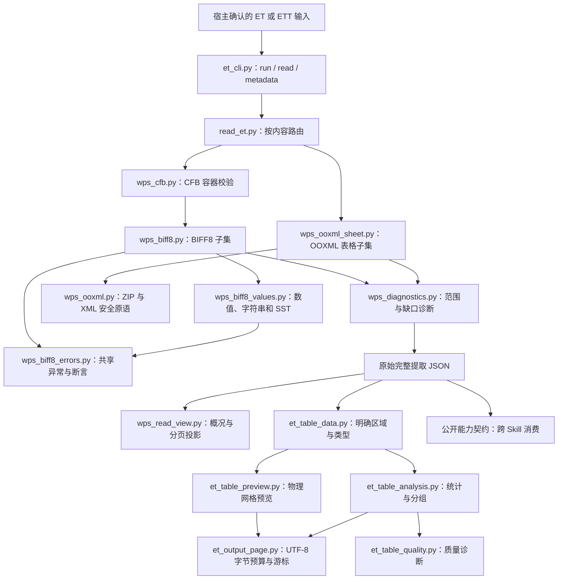
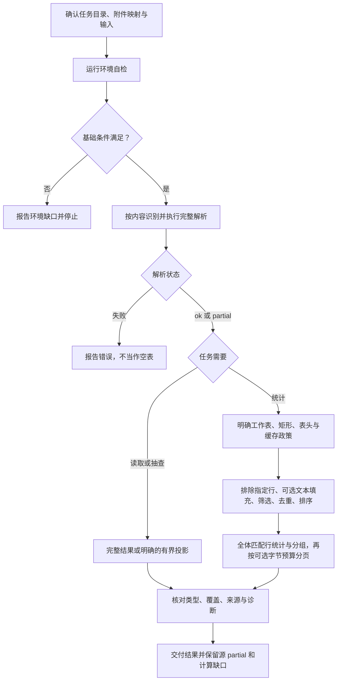

# ET：WPS 表格只读提取与统计

核对日期：2026-11-07。本文历史源码参考基线 [`9fcf9fca339dd0f6491f7e64e4777f9dc57e61a7`](https://github.com/JohnParken/PSL-SKILLS/tree/9fcf9fca339dd0f6491f7e64e4777f9dc57e61a7)，当前 Skill 版本为 `20261110.0051.1813`。这是仓库级架构与接口说明，不替代业务执行前必须读取的 [SKILL.md](../../skills/et/SKILL.md)。

本 Skill 本身无业务文件输出。授权交接或另存结果时只指定裸文件名，交付文件固定在任务根目录 `./`；输入与仓库维护目标路径保持原规则。

Python 模块拆分及文件行数规则见 [行数规范与重构记录](../python-file-limit.md)；该记录保留其验收时的历史基线，不等同于当前版本重测。运行能力和安全边界不因拆分扩大。

## 功能与适用范围

ET Skill 离线读取 `.et/.ett` 中的工作表、单元格保存值和公式缓存，并对明确指定的矩形区域进行预览、筛选、排序、去重、列统计和分组汇总。它按内容识别格式，不根据扩展名推断 WPS 版本或内部结构。

- 二进制分支：读取 CFB 容器内唯一的 `Workbook` / `Book` 流，解析受支持的 BIFF8 记录子集。
- ZIP 分支：识别并读取受支持的 OOXML 电子表格子集。原生 XLSX 业务任务仍按入口约定交给 XLSX Skill。
- 分析分支：使用已读取的类型化保存值生成派生 JSON，不修改原表或输入提取对象。
- 跨表计算后填入另一份 XLSX 模板由 `table-workflow` 编排；ET 只提供原始完整提取结果及诊断；名称发现可使用仅元数据接口。

不提供新建、编辑、办公格式转换、版面恢复、公式重算、宏执行或外链访问。CFB 容器识别、BIFF8 子集读取和完整 WPS 兼容是三个不同层次；未知容器、原生私有格式和未支持的记录不能被当作已支持。

## 架构



标准入口和跨 Skill 接口复用 `read_et.read_bytes()`，不是两套解析器。分析 CLI 也先调用同一读取器，再进入区域分析。`wps_ooxml.py` 虽含其他历史格式辅助逻辑，ET 的公开路由只选择电子表格，不能据模块内容扩大产品能力。

### 主要模块与入口

| 源码 | 主要职责 |
|---|---|
| [et_cli.py](../../skills/et/scripts/et_cli.py) | `run` 兼容原读取 CLI；`capabilities` 查询接口；`read/metadata` 从 stdin 接收协议请求 |
| [read_et.py](../../skills/et/scripts/read_et.py) | `read_bytes` / `read`、环境检查、容器识别、原始 JSON 编码与状态退出码 |
| [wps_access.py](../../skills/et/scripts/wps_access.py) | 受限文件读取、容器策略和错误上下文 |
| [wps_cfb.py](../../skills/et/scripts/wps_cfb.py)、[wps_biff8.py](../../skills/et/scripts/wps_biff8.py) | CFB 流校验及 BIFF8 记录、单元格、缓存和元数据子集 |
| [wps_ooxml_sheet.py](../../skills/et/scripts/wps_ooxml_sheet.py)、[wps_ooxml.py](../../skills/et/scripts/wps_ooxml.py) | OOXML 表格解析及有界 ZIP/XML 读取 |
| [wps_diagnostics.py](../../skills/et/scripts/wps_diagnostics.py)、[wps_read_view.py](../../skills/et/scripts/wps_read_view.py) | 提取评估、遗漏诊断、绑定来源的有界输出 |
| [analyze_et.py](../../skills/et/scripts/analyze_et.py) | 分析或预览 CLI；查询文件读取和源文件 SHA-256 |
| [et_output_page.py](../../skills/et/scripts/et_output_page.py) | 预览/分析结果的可选 UTF-8 字节预算分页；保留完整统计和源诊断 |
| [et_table_data.py](../../skills/et/scripts/et_table_data.py) | schema、选区、表头、类型、缓存策略与合并区域处理 |
| [et_table_analysis.py](../../skills/et/scripts/et_table_analysis.py) | `analyze(result, query)`、类型化过滤、稳定排序、统计和分组 |
| [et_table_preview.py](../../skills/et/scripts/et_table_preview.py)、[et_table_quality.py](../../skills/et/scripts/et_table_quality.py) | 物理网格预览及有界位置样本、统计分母、缓存缺口 |

内部拆分将基础数值、字符串和 SST 解码放入 `wps_biff8_values.py`，稳定异常类别放入 `wps_biff8_errors.py`；原 `wps_biff8.py` 继续导出旧入口，BIFF8 元数据及资源限制不变。三个模块随同一运行清单分发。

## 任务流程



表头不明确时先预览小矩形；预览不自动发现表头、合计行或业务口径。隐藏行和已筛选行仍属于物理选区，不自动排除。需要排除重复表头或总计行时，由任务明确 `exclude_rows` 中的原始行号。

## 输入、输出与公开契约

### 常用入口

以下 `<skill-root>` 须由本轮实际读取 ET `SKILL.md` 的路径定位；执行前确认读取后端与执行器的路径映射，并以执行器可访问的路径整体替换；无法确认映射或任务工作目录时停止。相对读取路径先按宿主确认的基准解析。脚本路径使用已确认的安装根，数据路径相对宿主任务工作目录。无法定位时停止，不切换到 Skill 安装目录执行。

```console
python -I -S -B "<skill-root>/scripts/et_cli.py" run --check
python -I -S -B "<skill-root>/scripts/et_cli.py" run ./input.et
python -I -S -B "<skill-root>/scripts/analyze_et.py" --check
python -I -S -B "<skill-root>/scripts/analyze_et.py" ./input.et --sheet "数据" --range A1:D8 --preview
python -I -S -B "<skill-root>/scripts/analyze_et.py" ./input.et --sheet "数据" --range A1:D100 --header-rows 1 --query ./query.json
```

CLI 的读取和分析结果默认写入 stdout；参数错误及诊断仍按各入口契约使用 stderr。它不写回 ET，也没有通用 `--output` 参数。保存结果应由宿主使用尚不存在的文件名安全写入；纯 stdout 任务不建立无用归档清单。

### 不同结果不能互换

| 结果 | schema | 消费约束 |
|---|---|---|
| BIFF8 原始完整提取 | `biff8_readonly_v1` | 按 `type` 使用 `value`，保留缓存、覆盖、诊断 |
| OOXML 原始完整提取 | `ooxml_spreadsheet_readonly_v1` | 同上；不能据读取成功推断完整格式支持 |
| 概况或单元格分页 | `wps_read_view_v1` | 输出投影；保留原 schema、遗漏字段和源状态，不能代替原始提取 |
| 矩形物理网格预览 | `et_table_preview_v1` | 含空位、保存值与合并锚点；不计算统计，不推断表头 |
| 统计结果 | `et_table_analysis_v1` | 派生结果；`rows`、`groups` 是预览，统计覆盖全部匹配行 |

原始提取中的数字及分析输出必须保留精度，文本编号 `"001"` 不转为数字；`blank`、`missing`、空文本和布尔分别处理。`numeric_interpretation` 是格式解释，不能替换原始保存值。

公式默认 `formula_policy=exclude`：展示保存值，但排除出计算并报告缺口。显式采用 `cached` 才使用可用保存缓存；缓存未验证是否最新，错误或缺失缓存不当作零。分析采用 Decimal；均值使用 34 位有效数字和 `ROUND_HALF_EVEN`，并报告舍入，不承诺复现 Excel 二进制运算。

分析顺序为选区/表头、显式排除行、可选 `fill_text` 合并标签填充、过滤、去重、稳定排序、统计/分组、预览分页。`fill_text` 仅传播普通非公式文本锚点到许可范围内的缺失/blank 位置，记录来源；不会填充数字、公式或覆盖已有正文。`quality_report` 提供统计分母、类型/缓存分布和有界位置样本，不给业务正确性评分。

### 跨 Skill 接口

[CLI 契约](../../skills/et/scripts/docs/cli-contract.md) 定义 `psl_capabilities_v1`、`interface_version=1`、`operations=[read,metadata]`，接口版本与 Skill 时间戳版本分开管理。

- `read` 请求含 `raw: bytes`、`source: str`、可选兼容策略；`source` 只是标签，不会触发文件扫描。
- 响应 `result.extraction` 是原生产者编码的完整 UTF-8 JSON 字节，另有 `exit_code`；不能只检查协议层 `ok`。
- `metadata` 接受与 `read` 相同的输入，仍完整解析并执行原 16 MiB 结果预算校验；返回 `workbook_metadata_v1` 的原序表名、源状态/诊断/覆盖及 `exit_code`，不传输单元格。未知 schema 或不完整解析标记拒绝，不能用名称元数据统计。
- 编码器 [et_cli_protocol.py](../../skills/et/scripts/et_cli_protocol.py) 保留 Decimal、bytes、tuple 和字典类型；禁用浮点字面量、重复键和对象执行式反序列化。
- 消费方先查询能力，再核对协议、请求 ID、schema、退出码和 partial。分页、预览及分析结果不能冒充原始工作簿。

## partial、拒绝与资源边界

| 状态 / 退出码 | 处理方式 |
|---|---|
| `ok` / 0 | 声明范围内完成，允许空工作表；不等于格式认证 |
| `partial` / 3 | 保留可靠结果及 `issues`、`reading_assessment`、源诊断；分析不得升级为完整成功 |
| 读取或分析失败 / 1 | 停止依赖操作，不将失败当作空表；失败状态可能细分原因 |
| 参数错误 / 2 | 常规 usage 与 stderr，不能假定有业务 JSON |

默认 `data` 策略可保留有明确结构边界的非单元格元数据并报告 partial，例如部分条件格式、批注绘图分片和数据验证记录；这些内容不应用到保存值，也不表示完整规则语义、打印布局或批注正文均已理解。有严格帧边界的未知 OfficeArt atom 或 FtCmo/FtEnd 对象在 data 策略下可保留原始证据，但其值影响未知，标记 `unverified_due_to_best_effort_salvage`、`omissions_affect_cell_values=true` 和源 partial；strict 仍拒绝。这不表示自动启用独立 salvage 入口。其余未知数据、加密、结构错误和资源超限仍按拒绝契约处理。Salvage 不是自动失败回退，只有明确请求最大限度部分读取时才按高级参考使用独立 BIFF 入口。

关键预算包括：原输入 64 MiB、原结果 JSON 16 MiB；协议帧 128 MiB；查询 64 KiB；分析矩形最多 200000 个位置、256 列；最多 10000 组。分析行/组预览默认各 100，物理网格预览默认 10 行、最多 50 行及 10000 个位置。完整边界以 [表格分析](../../skills/et/references/table-analysis.md) 和源码常量为准。

[有界读取](../../skills/et/references/bounded-reading.md) 在完整解析后投影，每页都会重新读取和解析输入，不是底层流式读取或缓存快照。游标绑定来源 SHA-256、选项和投影修订；源变化须重启。截断 JSON、单元格或诊断超预算均不能假报完整成功。旧矩形预览采用 offset，须核对各页 `source_sha256` 一致；新增游标模式进一步绑定来源及查询。

### UTF-8 字节预算与续读

- 读取视图新增 `--max-output-bytes`（512..16777216），与原字符预算同时生效；真实 JSON、转义和末尾换行都计入。仅指定字节预算也启用视图；新增 `has_more` 与 `next_cursor` 一致，概况无后续页不表示已返回全部值。字符/字节都不是 token。
- `analyze_et.py` 的分析和 `--preview` 同样接受 `--max-output-bytes` 与 `--cursor`，保留原 schema，增加 `output_page_revision=1`、coverage、has_more/next_cursor。只传游标时预算默认 12000；无新参数时旧 CLI/API 不变。
- 游标绑定源 SHA-256、完整查询、范围、表头与模式；续读可调整预算，不能更改统计口径。每次仍完整解析并计算全部匹配数据，只有 rows/groups 分页，profiles/totals/质量报告及源 partial 不裁剪。limit/group_limit 是每页上限；0 表示不请求该结果流。
- 逐整行/整组输出，行优先、组可后续返回；顶层 `has_more=false` 才结束所请求的全部流。不可省略的元数据或单行/组放不下时明确 `output_view_error`/退出1，不切开值、不返回无法推进的空成功页。有效字节预算也约束失败 JSON。

详见 [读取预算](../../skills/et/references/bounded-reading.md)、[分析续读](../../skills/et/references/table-analysis.md#可选字节预算与续读) 和 [预览](../../skills/et/references/table-preview.md)。BIFF 未解释绘图对象仍保留诊断并传播源 partial，不因输出投影或统计完成升级为完整支持。

## 依赖、验证与维护限制

- [requirements.txt](../../skills/et/requirements.txt)：Python 3.9+、仅标准库；OOXML 分支另需 Expat 2.6+。禁止安装包、运行时联网或调用外部办公软件。
- 自检必须退出 0 且包含 `environment-ok`。OOXML 还须 `ooxml-sheet=available`；基础自检成功不代表输入可读或产物正确，`artifact_validation=not_run` 必须保留。
- 运行输入、查询和结果位于确认的任务目录，保护原件和安装目录；宿主须回传完整 stdout、stderr 和真实退出码，不能分析截断响应。
- [真实 ET/ETT 验证记录](../maintenance/et/et-real-validation.md) 包含固定来源、哈希、独立保存值预期和历史平台范围。近期模板迭代中已记录的七文件探测均为 partial；初始模板调查中的其余失败不能据此视为解决。
- 真实保存值一致性不证明公式重新计算、缓存新鲜度、WPS/Excel 渲染或完整私有流语义。参考中的早期 Linux 记录不能替代后续仅在 macOS 运行的迭代验收。
- 本文编写只审阅固定基线源码与引用契约，未执行 ET 自检、业务读取、维护回归或办公软件视觉验证；已有测试文件的存在和历史记录不是本轮通过证据。

## 延伸源码与说明

- [任务入口与范围](../../skills/et/SKILL.md)
- [ET/ETT 格式说明](../../skills/et/references/et-ett-readonly.md)
- [表格分析及统计口径](../../skills/et/references/table-analysis.md)
- [公开能力与编码契约](../../skills/et/scripts/docs/cli-contract.md)
- [结果预算编码](../../skills/et/scripts/wps_result.py)
- [字节预算与分页定点回归](../../skills/et/scripts/test/test_et_output_budget.py)、[元数据回归](../../skills/et/scripts/test/test_metadata_api.py)
- [源码测试目录](../../skills/et/scripts/test/)（不随业务运行包分发）

## 归档提示更新（2026-11-07）

本节与全文均按 2026-11-07 的上述源码基线核对；历史测试记录不代表本轮重跑。

纯文本或仅 stdout 不归档；文件交接继承提供方已验证的归档状态与用户提示，成功即提示去云空间查看，非成功如实报告，不虚构文件链接或暴露内部归档信息。

本轮字节预算/分析分页合成回归的命令、数量和结果见 [文档核验记录](../skill-docs-validation-20261107.json)，不替代真实 ET 样本或全量回归。

## 执行结果与大结果读取说明更新（2026-11-09）

本轮仅更新结果判读与续读说明，不改执行路径、首步自检或 CLI 行为。工具调用成功、进程退出与业务 JSON 分别核对；允许宿主合并 stdout/stderr 并附状态文字，不要求不存在的字段或固定分隔符，退出码未知不补成0。保留非零退出的结果、partial、诊断以及业务/归档/清理边界；状态不明不盲目重跑写操作。

宿主外置预览与已截断捕获分别处理。结果引用按真实 `read_file` schema 逐段读取并核对覆盖，不作为 Shell 路径；已丢弃内容不能靠读取不完整文件恢复。业务投影按实际游标和来源绑定续读，末页只证明所选投影取完，不消除遗漏或源 partial。详见 [有界读取](../../skills/et/references/bounded-reading.md#宿主大结果与业务分页分开处理)。本轮说明依据 CLI 与本机 Deep Agents 源码核对；真实目标宿主回传、Linux 容器和客户端验收仍需独立验证。
