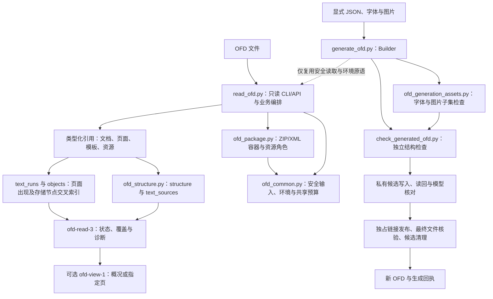
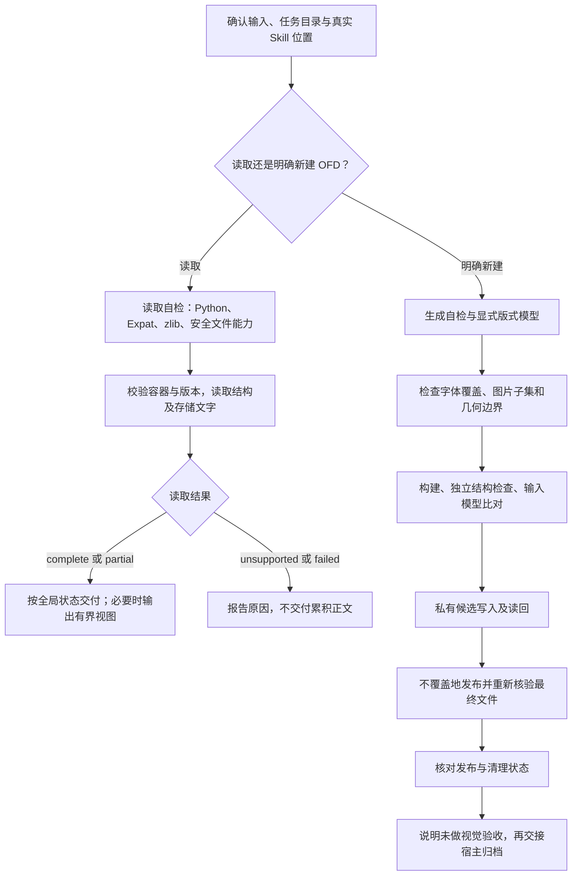

# OFD：结构读取与受限固定版式生成

文档核对日期：2026-11-07。本文历史源码参考基线 [`9fcf9fca339dd0f6491f7e64e4777f9dc57e61a7`](https://github.com/JohnParken/PSL-SKILLS/tree/9fcf9fca339dd0f6491f7e64e4777f9dc57e61a7)，当前 Skill 版本为 `20261109.1939.2825`。业务执行以 [SKILL.md](../../skills/ofd/SKILL.md) 及本轮所需参考为准；本文解释两条独立业务路径及其验收边界。

所有业务交付文件入口只接收裸文件名，脚本固定写入已确认任务根目录 `./`；`./文件名`、子目录、绝对/父目录及 Windows 路径均拒绝。输入路径、内部归档与受控临时工作区保持原规则，多产物分别提供不同裸文件名。旧带目录输出的 CLI/API 调用需迁移，不通过切换到输入或安装目录规避。

Python 模块拆分及文件行数规则见 [行数规范与重构记录](../python-file-limit.md)；该记录保留其验收时的历史基线，不等同于当前版本重测。运行能力和安全边界不因拆分扩大。

## 功能与适用范围

OFD Skill 同时提供只读提取和显式模型生成，但两者支持范围、schema 和成功含义不同。

- **读取**：读取 OFD 1.0、1.1、1.2 的 XML 逻辑结构、存储文字来源和页面文字出现记录，并保留页面、模板、资源、注释、签名等相关结构证据。
- **生成**：仅在用户明确指定 OFD 且要求新建时，接受 JSON 模型，生成 OFD 1.0 的 `fixed-layout-1` 子集。可包含多页、固定位置横排文字、线框、受限 PNG/JPEG 和显式矩形网格表格。
- **离线字体**：可显式选择随包朱雀仿宋原版，或明确指定自备静态 TrueType 字体；不扫描系统、不自动回退或下载安装。

不提供第三方 OFD 编辑、OCR、密码解密、验签、PDF 转换或页面渲染。读取器的逻辑表格解析尚未实现，`tables` 固定为空；生成器表格来自显式输入网格，不是从版面推断表格。读取 1.1/1.2 不表示可以生成这些版本。

## 架构



`read_ofd.py` 保留原 CLI/API 和兼容导出，`read_ofd()` 构建业务结果。共享限制、异常和安全文件读取位于 `ofd_common.py`；`ofd_package.py` 的 `Package` 管理 ZIP 成员、引用解析、XML 缓存、资源角色和累计预算；`ofd_structure.py` 的 `catalogue_structure()` 将 XML 存储与页面出现拆开，避免把同一复合对象的多次出现误当重复数据而删除。四个文件随同一包发布，必须一起安装；仍使用标准库和隔离启动，不将任务目录加入模块搜索路径。

读取器、生成器、独立检查器及所需静态资源随本包部署，不隐式依赖相邻 Skill 或仓库测试；公共归档另由宿主显式定位。生成器复用本包读取器的安全输入和环境检查，不复用其结果作为唯一验收依据。独立检查器不导入读取器或生成器，生成过程还将结果与显式输入模型比对；这种独立结构检查仍不是 OFD 客户端视觉验收。

### 主要模块与入口

| 源码 | 职责 |
|---|---|
| [read_ofd.py](../../skills/ofd/scripts/read_ofd.py) | 稳定只读 CLI/API、版本策略、页面与文字编排、输出投影和兼容导出 |
| [ofd_common.py](../../skills/ofd/scripts/ofd_common.py) | 共享限制与异常、环境自检、受限文件读取、包路径及 XML/文字原语 |
| [ofd_package.py](../../skills/ofd/scripts/ofd_package.py) | ZIP/XML 安全解析、预算、引用与不透明载荷角色 |
| [ofd_structure.py](../../skills/ofd/scripts/ofd_structure.py) | XML 存储目录、文字来源与页面出现交叉索引 |
| [generate_ofd.py](../../skills/ofd/scripts/generate_ofd.py) | JSON 输入约束、`Builder`、几何定位、资源组包、模型核对及安全发布 |
| [ofd_generation_assets.py](../../skills/ofd/scripts/ofd_generation_assets.py) | 静态 TrueType 的 cmap/度量/嵌入限制和受限 PNG/JPEG 检查 |
| [check_generated_ofd.py](../../skills/ofd/scripts/check_generated_ofd.py) | 独立 ZIP/XML 子集审计、ID、引用、边界、文字/字形计数和许可保留 |
| [package_ofd.py](../../tools/package_ofd.py) | 维护分发包；排除私人字体和缓存，使用新 ZIP 文件，不属于业务生成入口 |

## 任务流程



各阶段失败均停止依赖该结果的下一步；发布结果不确定时先核查文件身份和实际状态，不能通过重新生成掩盖失败。普通“生成文档”请求不默认走 OFD；读取或讨论 OFD 也不等于授权新建。

## 读取输入、输出与 partial

### CLI 与数据模型

命令中的 `<skill-root>` 必须从本次实际读取 OFD `SKILL.md` 的真实路径确定，相对路径先按确认的读取基准解析，再去掉文件名并整体替换。数据路径相对宿主任务目录，不相对参考文件目录；无法定位时停止。

```console
python -I -S -B "<skill-root>/scripts/read_ofd.py" --check
python -I -S -B "<skill-root>/scripts/read_ofd.py" ./input.ofd
python -I -S -B "<skill-root>/scripts/read_ofd.py" ./input.ofd --view summary
python -I -S -B "<skill-root>/scripts/read_ofd.py" ./input.ofd --view page-text --document 1 --page 1
```

读取结果写入 stdout，不产生磁盘结果或解包文件；参数错误等诊断仍按入口契约使用 stderr。输入必须是任务目录内普通文件，拒绝绝对路径、父目录段和所有层级符号链接，通过目录描述符逐级读取并核对变化。Python API 默认允许调用方已授权的绝对路径；显式 `task_root` 才启用同类边界，不能利用默认 API 绕过宿主限制。

[读取契约](../../skills/ofd/references/contract.md) 使用 `schema_version=ofd-read-3`：

- `structure`、`text_sources`：已读取 XML 逻辑结构及存储的 TextCode 来源；结构覆盖、命名空间解析和文字解释分别报告。
- `documents[].pages[].text_runs`：页面出现记录，保留来源、对象 ID、原始 TextCode、属性、模板标记、祖先及复合引用链。
- `pages[].objects[].storage_node` 对应同一 `source` 的 `structure.xml_parts[].nodes[].index`；文字对象的 `glyph_transform_nodes` 指向直接关联的 CGTransform 节点，原 Glyphs 子节点仍在结构目录。只是可追溯交叉索引，不解释字体映射或保证显示，诊断与 partial 必须保留。
- `resources`、`metadata`、`references`、`members`：资源和元数据登记、实际跟随引用及 ZIP 元信息；二进制载荷元信息不等于载荷解码或有效性证明。
- `status`、`diagnostics`、`text_assessment`、`coverage`、`sha256`：全局状态、缺口、来源指纹与声明范围。子状态不能覆盖全局 partial。

文字按 XML 内存储顺序保留；模板先于页面遍历，复合资源在引用位置按出现次数展开。这不是语义阅读顺序或绘制叠放顺序。坐标、CTM 等为原始局部属性，未合成变换、裁剪或字形；提取内容可能不可见或被遮挡，不可用来证明可见文字完整或已脱敏。

`raw_text` 是 XML 解析后的原 TextCode 字符数据，`text` 对四位十六进制转义作一次解释；不猜字形、不规范化 Unicode。注释 TextCode 单独登记，不混入页面正文。签名只保留结构与元数据，不验证身份、来源或文档完整性。

### 状态与退出码

| 状态 | 退出码 | 解释 |
|---|---:|---|
| `complete` | 0 | 声明的 XML/存储文字范围无已知缺口；不代表完整标准、视觉或语义支持 |
| `partial` | 3 | 返回可靠记录并保留诊断；空文本、图像、未知对象或资源缺口均不能隐藏 |
| `unsupported` | 4 | 明确不支持的版本、命名空间、类型、压缩或加密等 |
| `failed` | 1 | 安全、结构、资源、路径、环境或 I/O 失败；丢弃累积正文 |
| 参数错误 | 2 | argparse usage / stderr，不保证业务 JSON |

只有 `PublicRes`、`DocumentRes`、`PageRes` 索引成员确实缺失才可恢复：记录 `resource_gaps` 并返回 partial，保留独立可读的 XML/文字。现存但损坏的索引、缺失资源载荷、非法路径、必需文档/页面/模板引用失败仍拒绝，不能搜索替代文件。空文本永不判为完整，扫描图像仅提示 OCR 需求，不自动执行 OCR。

默认 `version-policy=known` 接受 1.0/1.1/1.2；显式 `compatible` 可尝试规定范围内未知 1.x 共同子集，但必须 partial。OFD-A 的存储读取不等于归档规范认证，详见 [兼容策略](../../skills/ofd/references/compatibility.md)。

[输出视图](../../skills/ofd/references/output-views.md) 使用 `ofd-view-1`，保留全局状态和诊断。概况不含正文，`page-text` 只含指定文档/页出现记录；可用 SHA-256 校验来源未变。视图超预算明确失败，不裁剪文字或诊断后假报完整；它不是完整结构模型。

## 生成输入、发布与失败边界

[生成契约](../../skills/ofd/references/generation.md) 接受 `schema_version=ofd-generate-1`，顶层为 `title`、`fonts`、`images`、`pages`。未知字段、重复 JSON 键、非有限数值和越界均失败。坐标单位为毫米，支持 `text`、`line`、`rectangle`、`image`、`table`；不自动换行、分页、缩字、截断或修复重叠。

```console
python -I -S -B "<skill-root>/scripts/generate_ofd.py" --check
python -I -S -B "<skill-root>/scripts/generate_ofd.py" ./layout.json new-document.ofd
```

输出必须是任务根目录内尚不存在的单个 `.ofd` 文件名，不接受输出子目录。生成路径为：内存构建与模型验证 → 独占私有候选 → 写入、fsync、读回及验证 → 硬链接建立新输出名 → 重新打开最终文件核对身份、长度、字节及变化 → 清理本次候选。不会覆盖原件，也不以替换式 rename 降级。

成功回执使用 `ofd-generation-result-1`、`status=generated`、退出 0，并包含产物哈希、页/字体/图像/表格记录与结构验收。`visual_validation` 和 `independent_client_validation` 均为 `not_performed`，不能随生成成功改成通过。

失败为同 schema、`status=failed`、退出 1，并附 `stage`、`diagnostics` 和可得的发布状态；参数错误退出 2。特别注意：

- `published_verification_failed`：文件已写出但核验失败，保留目标供检查，不合格交付，不自动删除或覆盖。
- `published_verified` 且清理失败：整体仍返回失败，主文件保留，分别报告主产物与清理结果。
- `publication_uncertain` / `output_written=null` 或 `inspect_before_retry`：先检查真实结果，不盲目重跑。
- 临时项仅按原登记和身份核对清理；强杀、权限变化或身份变化可能留下候选，不能扫描历史文件补认领。

### 资源及布局约束

- 生成最多 32 页、4 个字体和 8 张图片；源码另限定对象、字符和资源总量。单字体上限 10 MiB、单图 8 MiB、资产总计 24 MiB、产物 32 MiB。
- 字体限静态 TrueType/glyf，逐字核对 cmap、字形和度量并检查技术嵌入标志；不支持塑形、组合符、双向文字、emoji 等复杂路径。字体原字节完整嵌入，不子集化、不执行字体程序。技术标志不证明法律授权。
- 随包朱雀为明确 opt-in 资源并核对固定长度/哈希；自备字体可以是任务路径，或 `assets/user_fonts/` 内明确文件名。运行不扫描或修改安装目录，自备字体许可状态按实际报告，不伪造授权。
- PNG/JPEG 只接受契约列出的有限编码。PNG 校验块、CRC 和受限扫描线；JPEG 不完整解码熵数据，不能仅据头部检查保证显示。图像保持比例居中，不裁剪或重采样。
- 表格仅显式矩形网格和单行单元格，可设置有限对齐；无合并、跨页或公式。超出页面/单元格边界时拒绝，保守字体包围盒检查不等于实际像素布局证明。

## 依赖、交付与维护验证

[requirements.txt](../../skills/ofd/requirements.txt) 声明零第三方 Python 包、外部软件和网络依赖。读取需 Python 3.10+、Expat 2.6+、内置 zlib；生成需 Python 3.12.11+，并增加安全的描述符相对 link/unlink/stat 能力。保留 `-I -S -B`，缺能力停止，不安装组件或绕过安全检查。

读取自检须返回退出 0 与 `environment-ok Python>=3.10 Expat>=2.6.0 stdlib-only`；生成自检须 JSON `status=environment-ok`。二者均为环境检查，`artifact_validation=not_run`；生成自检也不证明目录可写，候选首次实写才检验本次写入能力。

读取预算与生成预算独立。读取器当前上限包括原文件 64 MiB、4096 成员、单成员 16 MiB、总展开 128 MiB、单 XML 2 MiB、XML 总量 32 MiB，以及页数、节点、深度、引用和输出预算。触发安全/资源上限不得以部分成功规避，详见 [边界说明](../../skills/ofd/references/boundaries.md) 与 `LIMITS`。

生成后的归档交由宿主通过已确认的公共生命周期入口处理，本包不猜安装位置、不自动上传。主文件、归档、清理及未验证项分别报告；公共归档不可用不应删除或重新生成主文件。维护分发使用仓库 `tools/package_skills.py`（或兼容入口 `tools/package_ofd.py`）排除私人字体，不能直接递归压缩安装目录泄露用户字体。

[验证记录](../../skills/ofd/references/validation.md) 和 [生成证据](../../skills/ofd/references/generation.md) 区分合成测试、固定 OFDRW 原件、独立文字预期、真实字体/图片核对和平台范围。JDK 字形/图片交叉检查属于历史维护工具，不是运行时依赖，也没有渲染 OFD 页面。近期生成及资源恢复记录主要来自 macOS，不能推断已完成 Linux、Windows、客户端或视觉验收。

本文只进行固定基线源码与契约审阅，未运行 OFD 自检、业务生成、样本读取、维护测试或客户端验收。测试存在于 [scripts/test](../../skills/ofd/scripts/test/)，不属于普通业务运行依赖；历史通过不等于本轮通过。

## 归档结果与用户提示

核对汇总 `archive_status=copied` 且完整、非空 `files` 清单全部为 `copied/already_archived` 后，保留 `archive_message` 并展示 `archive_user_notice`。归档成功即提示“🎉 文件归档成功，请到云空间查看。 ☁️✨”，无需等待宿主云空间映射确认，不宣称已验证上传完成或展示时效。失败、部分成功、跳过、待交接和未知分别如实报告，不套用全部成功；业务与清理状态独立，主业务失败不称生成成功。隐藏归档路径、目录、ID及原始日志，保留真实主文件链接，不虚构下载。
