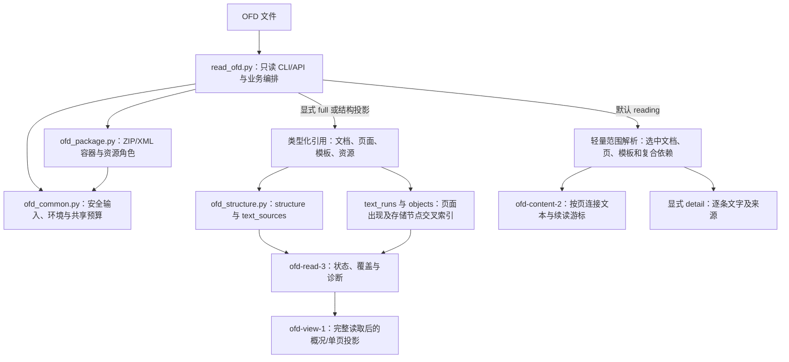
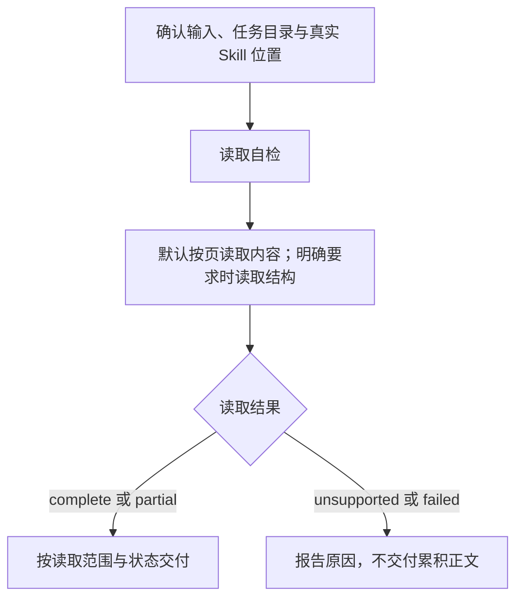

# OFD：默认文本读取

文档核对日期：2026-11-12。本文历史源码参考基线 [`9fcf9fca339dd0f6491f7e64e4777f9dc57e61a7`](https://github.com/JohnParken/PSL-SKILLS/tree/9fcf9fca339dd0f6491f7e64e4777f9dc57e61a7)，当前 Skill 版本为 `20261112.0721.3845`。业务执行以本轮所需 Skill 及参考为准；本文说明当前读取路径；OFD 写入服务暂不提供。

读取脚本只向 stdout 返回结果，不创建 OFD 或磁盘结果。若需要保存 JSON，由宿主在已确认任务根目录安全创建新文件，不覆盖已有文件。输入路径、内部归档与受控临时工作区按原规则处理。

Python 模块拆分及文件行数规则见 [行数规范与重构记录](../python-file-limit.md)；该记录保留其验收时的历史基线，不等同于当前版本重测。运行能力和安全边界不因拆分扩大。

使用宿主 `read_file` 读取 OFD Skill 时优先从 `.skill` 目录定位；具体位置和相对基准以宿主提示或已确认信息为准，无法定位或读取时报告并停止依赖操作。

宿主返回的 `/large_tool_results/` 是结果引用，仅使用宿主 `read_file` 和实际 schema 补读并核对覆盖；不交给 execute、cat、Shell 或 Python，不猜映射或使用路径掩码。读取工具缺失或结果不完整时报告缺口并停止依赖。普通业务文件和 Skill 资源仍遵循各自路径规则。

## 功能与适用范围

OFD Skill 当前仅提供只读提取。创建、生成与编辑服务暂不对外提供。

- **读取**：默认按页读取 OFD 1.0、1.1、1.2 的标题、正文和页码；明确要求时读取 XML 逻辑结构、存储文字来源和页面文字出现记录。支持页面/模板来源筛选及长段续读。默认响应仅保留标题、页文本及覆盖/续读/诊断；detail 可核对来源，范围读取不能替代完整结构检查。

不提供第三方 OFD 编辑、OCR、密码解密、验签、PDF 转换或页面渲染。读取器的逻辑表格解析尚未实现，`tables` 固定为空。

## 架构



`read_ofd.py` 的 CLI 和 `read_ofd()` 默认读取文本；`read_ofd_structure()` 和 `--view full` 保留原结构契约。`--capabilities` / `capabilities()` 返回接口版本2及默认行为，旧调用须按下文迁移。共享限制、异常和安全文件读取位于 `ofd_common.py`；`ofd_package.py` 的 `Package` 管理 ZIP 成员、引用解析、XML 缓存、资源角色和累计预算；`ofd_structure.py` 的 `catalogue_structure()` 将 XML 存储与页面出现拆开，避免把同一复合对象的多次出现误当重复数据而删除。四个文件随同一包发布，必须一起安装；仍使用标准库和隔离启动，不将任务目录加入模块搜索路径。

运行包只包含读取器及必要资源，独立安装不依赖相邻 Skill。生成代码及资源保留在源码，暂不进入运行包。

### 主要模块与入口

| 源码 | 职责 |
|---|---|
| [read_ofd.py](../../skills/ofd/scripts/read_ofd.py) | 只读 CLI/API、显式结构兼容入口、版本策略、页面与文字编排、输出投影和兼容导出 |
| [ofd_common.py](../../skills/ofd/scripts/ofd_common.py) | 共享限制与异常、环境自检、受限文件读取、包路径及 XML/文字原语 |
| [ofd_package.py](../../skills/ofd/scripts/ofd_package.py) | ZIP/XML 安全解析、预算、引用与不透明载荷角色 |
| [ofd_structure.py](../../skills/ofd/scripts/ofd_structure.py) | XML 存储目录、文字来源与页面出现交叉索引 |
| [package_ofd.py](../../tools/package_ofd.py) | 维护分发包；排除私人字体和缓存，使用新 ZIP 文件，不属于业务生成入口 |

## 任务流程



各阶段失败均停止依赖该结果的下一步。创建或编辑 OFD 的请求应说明服务暂不可用，不调用源码生成器或其他路径。

## 读取输入、输出与 partial

### CLI 与数据模型

命令中的 `<skill-root>` 必须从本次实际读取 OFD `SKILL.md` 的真实路径确定，相对路径先按确认的读取基准解析，再去掉文件名并整体替换。数据路径相对宿主任务目录，不相对参考文件目录；无法定位时停止。

```python
execute(command="python -I -S -B \"<skill-root>/scripts/read_ofd.py\" --check")
execute(command="python -I -S -B \"<skill-root>/scripts/read_ofd.py\" './input.ofd'")
execute(command="python -I -S -B \"<skill-root>/scripts/read_ofd.py\" './input.ofd' --page 2")
# 仅明确要求结构时
execute(command="python -I -S -B \"<skill-root>/scripts/read_ofd.py\" './input.ofd' --view full")
```

读取结果写入 stdout，不产生磁盘结果或解包文件；参数错误等诊断仍按入口契约使用 stderr。输入必须是任务目录内普通文件，拒绝绝对路径、父目录段和所有层级符号链接，通过目录描述符逐级读取并核对变化。Python API 默认允许调用方已授权的绝对路径；显式 `task_root` 才启用同类边界，不能利用默认 API 绕过宿主限制。

默认返回 `ofd-content-2`：可用文档标题、按页连接的文字，以及范围、来源指纹、状态、诊断和必要续读字段。`scope` 中含文档与页总数，`done` 仅指当前范围完成；调用方逐文档逐页核对覆盖。

显式完整结构的[读取契约](../../skills/ofd/references/contract.md) 保留 `schema_version=ofd-read-3`：

- `structure`、`text_sources`：已读取 XML 逻辑结构及存储的 TextCode 来源；结构覆盖、命名空间解析和文字解释分别报告。
- `documents[].pages[].text_runs`：页面出现记录，保留来源、对象 ID、原始 TextCode、属性、模板标记、祖先及复合引用链。
- `pages[].objects[].storage_node` 对应同一 `source` 的 `structure.xml_parts[].nodes[].index`；文字对象的 `glyph_transform_nodes` 指向直接关联的 CGTransform 节点，原 Glyphs 子节点仍在结构目录。只是可追溯交叉索引，不解释字体映射或保证显示，诊断与 partial 必须保留。
- `resources`、`metadata`、`references`、`members`：资源和元数据登记、实际跟随引用及 ZIP 元信息；二进制载荷元信息不等于载荷解码或有效性证明。
- `status`、`diagnostics`、`text_assessment`、`coverage`、`sha256`：全局状态、缺口、来源指纹与声明范围。子状态不能覆盖全局 partial。

文字按 XML 内存储顺序保留；模板先于页面遍历，复合资源在引用位置按出现次数展开。这不是语义阅读顺序或绘制叠放顺序。坐标、CTM 等为原始局部属性，未合成变换、裁剪或字形；提取内容可能不可见或被遮挡，不可用来证明可见文字完整或已脱敏。

`raw_text` 是 XML 解析后的原 TextCode 字符数据，`text` 对四位十六进制转义作一次解释；不猜字形、不规范化 Unicode。注释 TextCode 单独登记，不混入页面正文。签名只保留结构与元数据，不验证身份、来源或文档完整性。

### 状态与退出码

| 状态 | 退出码 | 解释 |
|---|---:|---|
| `complete` | 0 | 声明的 XML/存储文字范围无已知缺口；不代表完整标准、视觉或语义支持 |
| `partial` | 3 | 返回可靠记录并保留诊断；空文本、图像、未知对象或资源缺口均不能隐藏 |
| `unsupported` | 4 | 明确不支持的版本、命名空间、类型、压缩或加密等 |
| `failed` | 1 | 安全、结构、资源、路径、环境或 I/O 失败；丢弃累积正文 |
| 参数错误 | 2 | argparse usage / stderr，不保证业务 JSON |

默认 reading 对缺失且所选页未使用的模板成员保留正文并返回 partial，诊断为 missing_unselected_template；所选页实际引用该模板仍失败。模板引用路径、目录目标、重复 ID 和引用预算仍校验，full 仍拒绝缺失模板。

资源索引方面，只有 `PublicRes`、`DocumentRes`、`PageRes` 索引成员确实缺失才可恢复：记录 `resource_gaps` 并返回 partial，保留独立可读的 XML/文字。现存但损坏的索引、缺失资源载荷、非法路径、必需文档/页面/模板引用失败仍拒绝，不能搜索替代文件。空文本永不判为完整，扫描图像仅提示 OCR 需求，不自动执行 OCR。

默认 `version-policy=known` 接受 1.0/1.1/1.2；显式 `compatible` 可尝试规定范围内未知 1.x 共同子集，但必须 partial。OFD-A 的存储读取不等于归档规范认证，详见 [兼容策略](../../skills/ofd/references/compatibility.md)。

[输出视图](../../skills/ofd/references/output-views.md) 说明默认 reading 的范围契约：直接传文件先读第 1 文档第 1 页，按文档和页范围解析必要 XML。content-2 将同页文字连接，一条记录只含 `page,character_offset,text`；不猜段落、空格或表格。需要来源时显式使用 `--reading-format detail`，保留 `ofd-reading-1` 的逐条记录。默认预算12000字符，含最终JSON末尾换行；长页使用游标续读。同来源、同代码、同详情的重复诊断合并并附次数，仍保持 partial。`page` 文字层仅排除模板来源，不证明正文语义或可见性。

无视图参数 CLI 和 Python API 的默认值已经改变。结构消费方需使用 `--view full`、`read_ofd_structure()` 或 `read_ofd(..., view="full")`；显式结构 schema/字段未改变。旧 content-1 已升级到 content-2，页内偏移改为连接后页文本的偏移，旧 content 游标须从当前页重新开始；content/detail 之间也不混用游标。`summary`、`page-text` 和底层 `project_reading()` 的 detail 默认契约仍保留，前两者仍先做完整读取。

reading 不创建 XML 事件清单、节点交叉索引、祖先属性及完整对象/资源目录，不读取无关页、注释和签名 XML。全量 ZIP 安全检查及所选 XML 的事件、节点、字符、展开限制仍执行；实际文字记录预算替代只适用于结构导出的保守展开估算。没有文档属性标题时返回 null，页面上的标题仍保留在文字中。

### 执行回传与大结果消费

执行前置条件不变。取得结果后，先判断实际执行状态、退出码或未知状态、截断，再解析业务JSON；工具调用成功不等于业务成功。宿主若只有合并输出，不假设独立stdout/stderr字段。已核对的DeepAgents接口使用 `ExecuteResponse.output`、可为None的 `exit_code` 与 `truncated`；middleware可在模型文本追加状态/截断说明，工具 `status=success` 也可对应非零命令退出。包装文本不属于OFD JSON，须由宿主明确完整stdout边界后解析；回传边界不足时报告无法确认，不猜拆日志。

按任务选summary、整页page-text、精简reading或full。reading 支持页内游标；每次按原始SHA-256、文档/页范围及文字层校验，content 按页文本字符偏移续接，detail 按 TextCode 记录偏移续接；游标不能跨格式复用。仅当响应 `done=true` 才表示选中页范围文字已读完，不能据此声明全文件XML、安全内容、注释或签名已检查。reading 仍将整份输入字节与选中XML置于内存，不是全文件或单页流式读取。后端截断、模型预览及文件捕获不完整分别核对；单行JSON不能用head/tail假装分页。保留原始状态、来源、退出码和partial诊断，不省略错误。

展示时可省略已确认的独立页眉、页脚和水印。保留原读取记录，以用户确认、明确的结构角色或已提供的版面材料定位具体出现位置。重复文字、模板来源或局部坐标仅供核对，无法确认时继续展示。

正文任务遇到附属 XML 故障时，可改用 `reading` 独立读取目标页。遇到多页输出预算或可定位到个别页的故障，缩小范围重读，按来源指纹及页码核对后交付可靠文字，并标明缺页。文件级检查和所需公共依赖失败仍按读取契约处理。

这些说明不新增落盘、缓存或执行器能力。需要结果文件时，由宿主独占写入本轮受控任务文件，保留独立诊断与完整捕获证据；没有该能力时如实报告范围和阻塞。源码审阅、本地CLI捕获和真实宿主/模型回传是不同验证层，不相互替代。

## 写入服务暂不可用

创建、生成和编辑 OFD 暂停；运行包排除生成入口、相关参考与资源。源码及历史验收保留，旧 ZIP 不会自动更新，应停用旧包并使用新构建的运行包。源码保留的生成 CLI/API 本身仍可执行；直接部署整个源码目录不具备运行包的文件级隔离，不能视为已从部署环境移除入口。

需要恢复时，应先获得明确授权，审查保留的源码和字体许可，再把所需生成脚本、参考和资源逐项从清单排除项移回发布成员，并同步入口、文档、选路和验收；通过生成与读取、独立部署和目标环境回归后重新构建新包。不得直接恢复旧包或仅修改描述。

## 依赖、交付与维护验证

[requirements.txt](../../skills/ofd/requirements.txt) 声明零第三方 Python 包、外部软件和网络依赖。读取需 Python 3.10+、Expat 2.6+、内置 zlib。保留 `-I -S -B`，缺能力停止，不安装组件或绕过安全检查。

读取自检须返回退出 0 与 `environment-ok Python>=3.10 Expat>=2.6.0 stdlib-only`。这只是环境检查，`artifact_validation=not_run`。

读取器当前上限包括原文件 64 MiB、4096 成员、单成员 16 MiB、总展开 128 MiB、单 XML 2 MiB、XML 总量 32 MiB，以及页数、节点、深度、引用和输出预算。reading 依然完整读取输入字节并检查所有ZIP成员元数据，然后只解析所选文档、页及必要依赖；未读 XML 的内容、CRC和引用不属于验收范围。范围输入和选中页仍在内存，不是流式文件读取。触发安全/资源上限不得以部分成功规避，详见 [边界说明](../../skills/ofd/references/boundaries.md) 与 `LIMITS`。

维护分发使用仓库 `tools/package_skills.py`（或兼容入口 `tools/package_ofd.py`）。历史生成记录不代表当前服务可用。

此前固定基线文档整理只进行源码与契约审阅，未运行 OFD 自检、业务生成、样本读取、维护测试或客户端验收。测试存在于 [scripts/test](../../skills/ofd/scripts/test/)，不属于普通业务运行依赖；历史通过不等于本轮通过。

2026-11-09 本轮仅更新执行结果消费和大结果读取说明及版本，description经核对保持原适用范围；未修改CLI、执行路径、首步自检、依赖或业务实现。在macOS/Python 3.12.12/Expat 2.6.3使用 `-I -S -B` 实测读取自检通过，OFD严格结构检查通过；`python -I -S -B -m unittest discover -s skills/ofd/scripts/test -p 'test_*.py' -v` 共156项通过（含视图8项），另用独占临时合成文件验证20000字单页默认预算failed/1且无正文、显式100000预算完整返回42170字符JSON、cursor/offset参数usage/2、下一页越界与partial/3诊断保留。对该JSON模拟截取12000字符后解析失败，仅为截断模拟，不是实际DeepAgents回传测试。未执行Linux/Windows、真实宿主模型回传、OFD客户端视觉验收或新真实外部样本验收；未修改Python，因此未新增Pylint运行。

## 归档结果与用户提示

核对汇总 `archive_status=copied` 且完整、非空 `files` 清单全部为 `copied/already_archived` 后，保留 `archive_message` 并展示 `archive_user_notice`。归档成功即提示“🎉 文件归档成功，请到云空间查看。 ☁️✨”，无需等待宿主云空间映射确认，不宣称已验证上传完成或展示时效。失败、部分成功、跳过、待交接和未知分别如实报告，不套用全部成功；业务与清理状态独立，主业务失败不称生成成功。隐藏归档路径、目录、ID及原始日志，保留真实主文件链接，不虚构下载。


历史生成相关验收按当时版本保留，不代表本次服务可用；实际读取与分发验证以本次交付报告为准。

## 历史记录（不代表当前服务）

本次调用适配：宿主按 `execute(command=完整非空命令)` 执行，生成器新增 `--spec-stdin` 接收受限 UTF-8 JSON，原规格文件调用仍可使用。遵循 [生成参考](../../skills/ofd/references/generation.md) 的安全引用、完整性和结果判定；不修改宿主加载器。

验证记录（2026-11-10）：以远端主干 293a8ac 为基线，在 Linux/Python 3.12.14/Expat 2.8.3 和 macOS/Python 3.12.12/Expat 2.6.3 分别运行 OFD 严格结构检查、160 项 OFD 回归与 11 项独立包回归，均通过；示例使用已确认的 Python 路径执行，原生 Shell 环境未提供可用的 `python` 命令。覆盖旧文件参数、stdin 边界与错误、复杂中文引号和 Shell 字符、partial 以及截断模拟。不代表真实宿主或模型已验证参数与结果回传，也不代表客户端视觉验收。Pylint 在两台环境均未安装，本次未执行。


### 2026-11-11 默认文本重构

本轮接口迁移、合成回归、已有验收样本文字核对及未验证范围见 [默认文本重构记录](../maintenance/ofd/default-content-refactor-20261111.md)。旧历史记录保留原测试基线。

### 历史：2026-11-10 描述与读取路径优化

本轮 description 将随包字体用于基础制作与页面预览分开：可生成基础 OFD，但没有页面渲染或预览能力。仅提到“正式文档”不触发 OFD 生成，必须明确指定 OFD。

当前变更基于 `65bff45`；本轮实际验证与未验证范围见 [维护记录](../maintenance/skill-review/optimization-451-20261110.md)。上文日期化记录继续代表各自历史基线。
