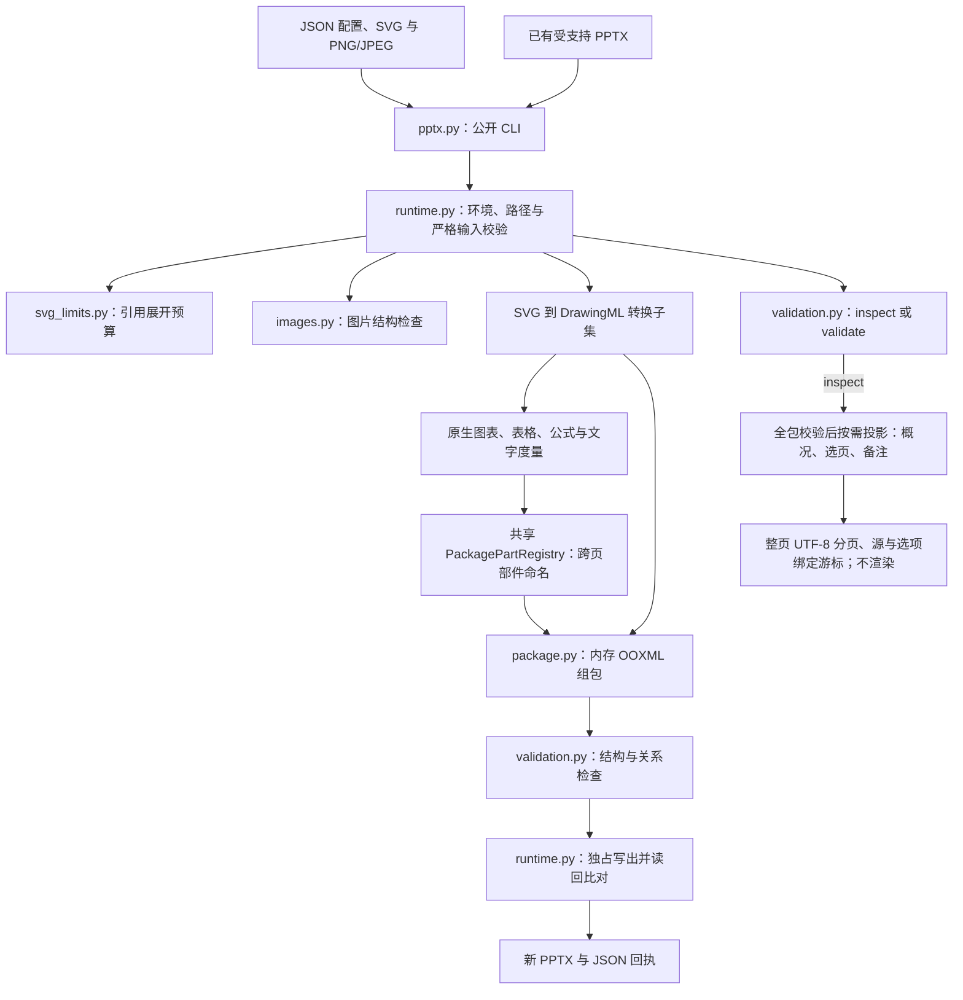
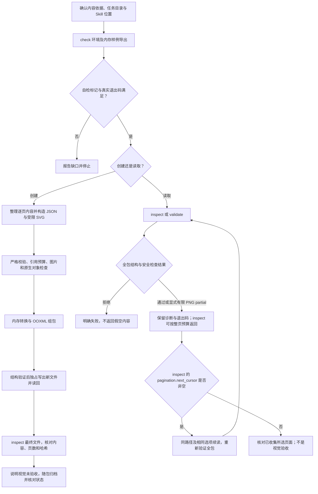

# PPTX：受限 SVG 到可编辑演示文稿

文档核对日期：2026-11-10。本文历史源码参考基线 [`9fcf9fca339dd0f6491f7e64e4777f9dc57e61a7`](https://github.com/JohnParken/PSL-SKILLS/tree/9fcf9fca339dd0f6491f7e64e4777f9dc57e61a7)，当前 Skill 版本为 `20261114.2127.4001`。这是仓库级实现说明，实际业务先读取 [SKILL.md](../../skills/pptx/SKILL.md)，创建时按需读取 [输入契约](../../skills/pptx/references/input-contract.md)，读取分页时使用 [有界读取契约](../../skills/pptx/references/bounded-reading.md)。本轮备注读取修复的结果和未验证范围见 [核验记录](../maintenance/pptx/reading-20261110.md)。

用户上传文件和待查交付物只在任务目录顶层发现；配置明确引用的 SVG 和图片可使用安全的任务相对路径。执行器可直接访问主入口真实路径时无需臆造路径映射；文件名含空格或中文须作为完整参数引用。

所有业务交付文件入口只接收裸文件名，脚本固定写入已确认任务根目录 `./`；`./文件名`、子目录、绝对/父目录及 Windows 路径均拒绝。输入路径、内部归档与受控临时工作区保持原规则，多产物分别提供不同裸文件名。旧带目录输出的 CLI/API 调用需迁移，不通过切换到输入或安装目录规避。

Python 模块拆分及文件行数规则见 [行数规范与重构记录](../python-file-limit.md)；该记录保留其验收时的历史基线，不等同于当前版本重测。运行能力和安全边界不因拆分扩大。

宿主返回的 `/large_tool_results/` 是结果引用，仅使用宿主 `read_file` 和实际 schema 补读并核对覆盖；不交给 execute、cat、Shell 或 Python，不猜映射或使用路径掩码。读取工具缺失或结果不完整时报告缺口并停止依赖。普通业务文件和 Skill 资源仍遵循各自路径规则。

## 功能与适用范围

PPTX Skill 将已确认内容与受限 SVG 页面转换为新 `.pptx`。文本、形状、图片、有限原生图表、语义表格和 Office 数学对象可在兼容客户端中继续编辑。JSON 负责稿件配置与备注，SVG 负责显式页面布局，转换器生成 DrawingML 并在内存组装 OOXML 包。

它还可读取受支持的现有 Transitional PPTX，提取标题、逐页文本、备注和对象计数，或仅检查包结构。备注的受支持文本形状和原生表格按对象及段落顺序返回，形状占位符按所选 MCE 分支过滤；不恢复表格行列结构。不提供任意现有 PPTX 导入、原位编辑、模板回填、无损转换、旧式 `.ppt`、OCR、PDF 导出或桌面页面渲染。

转换逻辑来自 PPT Master v6.8.0 的选定子集，不能将上游完整产品能力视为本 Skill 的能力。源码虽然包含形状和 SVG 辅助模块，公开入口仍只有 `check`、`create`、`inspect`、`validate`。

## 架构



`runtime.render_deck()` 为整稿共享 `PackagePartRegistry`，按页调用 `convert_svg_to_slide_shapes()`，再将转换结果交给 `build_presentation()`。转换中的诊断重定向到 stderr，避免污染 JSON stdout。随包的 pptx_core、_engine 与静态度量资源组成自包含运行时，不依赖相邻 Skill 或上游源码仓库；最终归档使用本包受追踪归档运行时，不依赖外部技能。SVG 以字符串在内存传递，创建、读取和转换不落业务中间文件；没有旧稿编辑入口。归档暂存先在进程内登记名称，再独占创建于任务根目录；写入探针也在根目录，归档目录不建立临时文件。清理前核对身份，变化或失败时保留并报告；强杀后内存登记丢失，核对与删除之间不具备原子绑定，不能保证抵抗任务目录中的恶意并发修改。外部工具的临时文件不受本包控制。

### 主要模块与入口

| 源码 | 职责 |
|---|---|
| [pptx.py](../../skills/pptx/scripts/pptx.py) | 参数分发、统一结果 schema 和错误 JSON；严格成功退出 0，有限 PNG 容错 partial 退出 3，失败退出 2 |
| [pptx_core/runtime.py](../../skills/pptx/scripts/pptx_core/runtime.py) | 环境与目录边界、严格 JSON/SVG 校验、资源准备、创建及读取编排、独占发布 |
| [pptx_core/svg_limits.py](../../skills/pptx/scripts/pptx_core/svg_limits.py) | 在展开 `use` 等引用前限制节点、深度和成本，拒绝循环/异常引用 |
| [pptx_core/images.py](../../skills/pptx/scripts/pptx_core/images.py) | 标准库 PNG/JPEG 验证，保留原始图像字节 |
| [_engine/svg_to_pptx/drawingml/converter.py](../../skills/pptx/scripts/_engine/svg_to_pptx/drawingml/converter.py)、[converter_slide.py](../../skills/pptx/scripts/_engine/svg_to_pptx/drawingml/converter_slide.py) | 前者保留兼容入口，页面转换在后者及其分发、分组和校验模块实现，将受支持 SVG 转为可编辑 DrawingML。 |
| [_engine/svg_to_pptx/native_objects](../../skills/pptx/scripts/_engine/svg_to_pptx/native_objects/) | 原生图表/表格、嵌入数据工作簿和有限公式转换 |
| [_engine/pptx_ooxml/package.py](../../skills/pptx/scripts/_engine/pptx_ooxml/package.py) | `PackagePartRegistry`，在整稿分配不冲突的图表等部件名 |
| [pptx_core/package.py](../../skills/pptx/scripts/pptx_core/package.py) | 幻灯片、母版、主题、备注、内容类型与关系的内存组包 |
| [pptx_core/inspection.py](../../skills/pptx/scripts/pptx_core/inspection.py) | 全包验证后的返回投影、整页 UTF-8 预算、源/选项绑定续读与 coverage |
| [pptx_core/validation.py](../../skills/pptx/scripts/pptx_core/validation.py) | ZIP/XML、媒体、关系、内嵌工作簿和受支持 PPTX 结构校验；MCE 分支选择及内容摘要 |

### 引擎文件行数与职责拆分

原 `drawingml/elements.py`、`utils.py`、`converter.py` 保留兼容导出，分别委托图片/形状/文本、几何/样式/字体度量、页面遍历/图表/表格职责模块。`native_objects` 的图表、表格、公式与 marker 模块同样保留旧入口，以显式模块导入共享实现；公式解析按参数、分隔符、环境和化学表达式分解。所有新增模块随同一运行包安装，不读取源码仓库。来源及许可证保留，派生路径在上游清单和 provenance 中追踪，不以第三方身份豁免 1000 行硬规范。

## 任务流程



自检通过后仍需对实际最终文件验收。布局修订从原始内容创建不同输出文件，不能称作任意原 PPTX 编辑。文件哈希与创建回执不一致时停止交付并调查变化，不用对象数量代替数据与文本核对。

## 输入与调用契约

命令中的 `<skill-root>` 从本轮实际读取 PPTX `SKILL.md` 的真实路径确定；相对路径先按宿主确认的读取基准解析，再去掉文件名并整体替换。业务工作目录始终是宿主确认的任务目录；无法定位安装根时停止，不猜路径。

```console
python -I -S -B "<skill-root>/scripts/pptx.py" check
python -I -S -B "<skill-root>/scripts/pptx.py" create presentation.json report.pptx
python -I -S -B "<skill-root>/scripts/pptx.py" inspect report.pptx
python -I -S -B "<skill-root>/scripts/pptx.py" inspect report.pptx --summary
python -I -S -B "<skill-root>/scripts/pptx.py" inspect report.pptx --slides 1-3,5 --notes omit --max-output-bytes 12000
python -I -S -B "<skill-root>/scripts/pptx.py" validate report.pptx
```

配置也可通过 `create - report.pptx` 的实际进程 stdin 传入。创建配置与读取 PPTX 是不同输入，现有 PPTX 不能当作创建配置或可编辑模板。

| 配置字段 | 约束 |
|---|---|
| `schema` | 固定 `psl.pptx.v1` |
| `title` | 默认 `Presentation`，最多 512 字符 |
| `width` / `height` | 默认 1280 × 720；每边 96–5376 px |
| `text_flow` | `preserve`、`reflow` 或 `split`；默认保留 SVG 布局意图 |
| `native_objects` | 默认 true；原生图表和表格要求开启 |
| `slides` | 1–200 页；每页必须且只能有 `svg` 或 `svg_path`，可有纯文本 `notes` |

未知字段、重复键、非法 Unicode、非有限数字和超过 64 层的 JSON 拒绝。每页 SVG 标准命名空间和 `viewBox` 必须与统一画布一致。配置、SVG 及其图片路径都相对任务工作目录，而不是配置或 SVG 所在目录；拒绝绝对路径、父目录、盘符、反斜杠与符号链接。

输出必须是尚不存在的 `.pptx` 裸文件名，固定写任务根目录。脚本不覆盖、不自动改名、不创建父目录；正常创建在内存完成转换和结构验证后，以独占方式写最终文件并读回字节比较。不得把这一过程描述成原文件原位修改或任意时点的原子整文件可见性保证。

### SVG 与原生对象子集

- 允许基本形状、路径、文本/tspan、组、图片、同文档引用、有限渐变、裁剪和标记等；采用元素及属性允许列表，不是浏览器 SVG 渲染器。拒绝 CSS 类、style 元素、filter、mask、事件、动画和外部图标库标记。
- 图片只支持 PNG/JPEG，保留原字节嵌入，尺寸/裁剪由 DrawingML 表达，不重编码或像素裁剪。拒绝 APNG、GIF、WebP、SVG/EMF 图片和 EXIF orientation 非 1 的 JPEG。PNG 检查 CRC 与展开扫描线，JPEG 不完整解码像素。
- 原生标记使用 `data-pptx-replace-with`，类型为 `chart`、`table`、`formula`，每个标记只能有一个受限 JSON 载体，不能嵌套。图表和表格须声明 JSON 为原生内容依据。
- 图表仅开放 column、bar、line、area、pie、doughnut、scatter，数据保存于内嵌工作簿，不接入外部数据源；不提供已有图表原位编辑。
- 表格使用 `ppt-master.semantic-table.v2`，上限 100 行、50 列、5000 个解析后单元格。合并覆盖格可有样式但必须没有独立正文，不静默丢弃被遮盖内容。
- 公式转换成原生 Office 数学对象，LaTeX 最多 8192 字符且只支持有限语法。备用显示由提供的 SVG 或行内文本形成，不自动绘制缺失预览，也不承诺任意 LaTeX 支持。
- 文字布局依赖随包字宽和字体度量数据，没有随包字体文件、系统字体扫描或外部字体塑形；客户端字体替代仍影响最终显示。

初次构造原生对象可参考 [四页配置示例](../../skills/pptx/assets/example.json)，具体字段以 [输入契约](../../skills/pptx/references/input-contract.md) 为准。示例覆盖不等于任意对象类型均支持。

## 输出、读取与失败边界

正常业务 stdout 是单个 `psl.pptx.result.v1` JSON。严格成功 `ok=true`、退出 0；显式有限 PNG 容错为 `ok=true`、`structural_validation=partial`、退出 3，不能仅凭 ok 判断完整成功；失败 `ok=false`、退出 2，并附 `error.code`、`error.message`，stderr 给出诊断。参数错误也经 JSON 契约处理；`--help` 为文本帮助，其成功不证明业务环境可用。

创建回执包含 `output`、`bytes`、`sha256`、`slide_count` 和 `structural_validation=passed`；`visual_validation=not_run` 与 `temporary_files` 报告的未清理暂存数量必须保留；强杀后状态未知不能据此断言无残留。创建入口自动调用随包归档运行时；归档状态与业务验收分别核对。

`inspect` 已执行结构验证，额外返回标题及逐页 `text`、`notes`、`objects`；只需要结构结论时使用 `validate`，无需为同一结论重复执行两种读取。二者均返回页数、部件数、画布及哈希，不渲染页面，不验证全部 OOXML 语义。

读取有以下重要限制：

1. 文本包括支持的段落、表格单元格和数学文本，但不返回完整图表数据、表格维度或数学树。分式 `12/15` 的拼接可能成为 `1215`，不能据摘要证明数学结构正确。
2. 对 MCE `AlternateContent` 只读取首个支持的 Choice，否则读取 Fallback，避免重复文本/计数；所有分支仍接受安全与关系检查。没有可读分支则失败，不是完整 MCE 解释器。
3. 宏、ActiveX、OLE、非 XLSX 嵌入对象、不支持的媒体、危险外部数据关系、损坏引用和资源超限明确失败。
4. `inspect --allow-png-zero-padding` 只容许每张 PNG 的 IEND 后至多 1024 个零字节，仍校验数据与 CRC，并返回 `structural_validation=partial`、逐文件 diagnostics 和退出码 3。非零尾随、超限或损坏仍拒绝。`create` 与 `validate` 保持严格；这不是通用错误恢复，也不证明非标准 PNG 可在客户端显示。

### inspect 的有界输出与整页续读

- 无新参数保持原完整结果。`--summary` 保留标题、包摘要及各页 `number/objects/text_paragraphs/notes_paragraphs`，不返回正文或备注原文。`--notes omit` 删除 notes 字段，不用空数组伪装不存在。
- `--slides` 使用 1 起算、两端包含、升序无重叠的页号/范围（如 `1-3,5`），拒绝重复、倒序、越界与空选择。选择只控制返回，**所有模式仍验证全包**，包括未选页、关系、媒体、内嵌工作簿及 MCE 分支；不承诺降低解析内存。
- `--max-output-bytes` 范围 512–67,108,864，计算整个 stdout JSON、外壳、诊断、游标和末尾换行的 UTF-8 字节。未设预算不保证输出大小；每次只返回完整幻灯片，不截断单页正文或长备注。
- `pagination.start/end` 是所选页列表的零起算半开位置，`total` 是所选页数；`complete` 只表示到达所选结果末尾，不是全演示文稿完整或结构完全通过。保留 `coverage.validation=all_package_parts`、所选页、内容及备注返回范围。
- 将 `pagination.next_cursor` 原样传给 `--cursor`，重复相同路径、summary、slides、notes、**相同预算**和 PNG 容错选项；每次重新读取并验证全包。源变化、选项变化、损坏游标拒绝。按位置拼接 slides，核对 sha256 一致，不把最后一页当全文。
- 单页、标题或完整诊断放不下则 `output_budget_too_small`、退出 2；移除 cursor 后提高预算重新开始，或缩小范围、省略备注、改用 summary。不得省略 partial 诊断来凑预算。
- 合法预算也限制错误 JSON：过长消息用 `message_truncated` 标记，完整诊断留在 stderr。非法预算或参数尚未解析完成不承诺预算。游标不是访问授权；宿主自身截断不等于合法分页。

详见 [有界读取契约](../../skills/pptx/references/bounded-reading.md)、[分页实现](../../skills/pptx/scripts/pptx_core/inspection.py) 和 [有界读取测试](../../skills/pptx/scripts/test/test_bounded_inspection.py)。测试源码覆盖整页拼接、源/选项变化拒绝、中文预算、未选页面安全校验和 partial 诊断，本轮实际执行范围见 [核验记录](../skill-docs-validation-20261107.json)，不代表全量回归或真实业务验收。

主要预算：配置 32 MiB、单页 SVG 8 MiB、全稿展开/原生预留保守预算 128 MiB；预计展开节点每页 20000、深度 128。单图 32 MiB、最大单边 32768 px、总像素 6400 万。读取 ZIP 上限 128 MiB、单成员 64 MiB；外层及内嵌包共用 256 MiB 展开和 5000 成员预算，单 XML 16 MiB、深度 128、节点 100000。预算是安全上限，不是进程峰值内存承诺；以源码和输入契约中的各阶段限制共同约束。

## 依赖、归档与验证限制

- [requirements.txt](../../skills/pptx/requirements.txt)：Python 3.10+、仅标准库，需 zlib、Expat 2.6+ 和 POSIX 描述符相对文件操作。当前目标为 Linux，Windows 不支持；不安装包、不调用外部程序或网络服务。
- `check` 必须实际退出 0，完整 JSON 含 `ok=true`、`status=environment-ok`、`in_memory_export=passed`。`check_kind=environment`、`artifact_validation=not_run` 表明这里只验内存样例，不是用户产物。
- 写入任务可用 `check --write-probe` 独占创建、读回并清理探针，要求 `write_probe=passed`；不接受输出子目录，纯读取无需探针。
- 执行结果按宿主真实 schema 与可见证据消费；stdout/stderr 可能合并并附状态说明，不假定固定外层字段。只解析边界明确且完整的业务 JSON；工具层 `status=success`、调用完成或存在 artifact 不等于业务成功。核对真实退出码与截断/转存提示，缺失、为空或不可判断时如实说明并停止依赖步骤，不伪造退出码。
- 转存引用（如 `/large_tool_results/`）只用宿主提供的 `read_file` 按真实 schema 补读，核对顺序、覆盖及结束；不能用 Shell/Python、换路径或复制绕过。缺工具、仍截断或无法确认完整性时报告缺口，不为补日志重复有副作用操作。补读不消除原结果的摘要、partial 或遗漏；本地捕获不能证明真实宿主回传已验证。 宿主转存补读与 PPTX 原生分页分别核对，不凭预览交付或重复创建。
- 业务验收后自动调用随包归档运行时，不依赖相邻 Skill；失败保留主文件，仅重试归档。归档与业务成功分别判断。
- [来源记录](../../skills/pptx/references/provenance.md) 固定 PPT Master v6.8.0 来源提交 `5e8856be0da8e6bc85c4aa28acc614478f7b7137`，记录保留的标准库适配、静态数据与 MIT/Apache 等许可。没有移植上游完整工作流、浏览器审查、渲染、任意模板导入或媒体流程。
- [源码测试](../../skills/pptx/scripts/test/) 不随业务运行包分发；它与仓库级来源清单属于维护证据。结构、合成对象、独立内容预期、真实业务样本、PowerPoint/WPS 显示、只读安装及宿主触发验收必须分别报告，不能相互替代。

本文按固定基线入口、核心实现及引用契约编写；本轮已执行的有界读取合成回归与限制见 [核验记录](../skill-docs-validation-20261107.json)。未对真实用户演示文稿执行创建/读取、全量回归或桌面视觉验收；源码中的步骤不等于全部已执行。

## 归档结果与用户提示

核对汇总 `archive_status=success` 且完整、非空 `files` 清单全部为 `copied/already_archived` 后，保留 `archive_message` 并展示 `archive_user_notice`。归档成功即提示“🎉 文件归档成功，请到云空间查看。 ☁️✨”，无需等待宿主云空间映射确认，不宣称已验证上传完成或展示时效。失败、部分成功、跳过、待交接和未知分别如实报告，不套用全部成功；业务与清理状态独立，主业务失败不称生成成功。隐藏归档路径、目录、ID及原始日志，保留真实主文件链接，不虚构下载。

执行调用维护：业务脚本示例使用宿主的 `execute(command=...)`，执行前核对完整命令、stdin、路径及结果；这不改变 CLI 或协议，不代表真实宿主链路已经验收。


## 2026-11-10 描述与读取路径优化

本轮为 inspect 检测到的 OMML 数学内容附加逐页 text_assessment：status=math_structure_not_preserved，诊断 math_text_flattened，并分别计数正文和备注中含数学标记的段落。分数 12/15 仍可能拼为 1215，上下标也不保留；文本、包结构状态及退出码保持原契约。概况、选页、分页和省略备注仍保留返回页的诊断，计数范围为投影前的所选语义分支；未检出不证明其他数学表达形式准确。向用户报告时须说明限制，不用拼接字符串精确转录或计算。详见 [有界读取](../../skills/pptx/references/bounded-reading.md#结果状态)。

当前变更基于 `65bff45`；本轮实际验证与未验证范围见 [维护记录](../maintenance/skill-review/optimization-451-20261110.md)。上文日期化记录继续代表各自历史基线。

本轮统一归档回复边界：完整/精简回执只供内部核验，正文及链接目标均不得暴露归档路径或任务 ID；保留主文件真实引用与失败/部分结果说明。能力范围、CLI 与内部机器字段未改；本轮核验见 [归档展示复核](../maintenance/artifact-lifecycle/archive-reply-privacy-20261112.md)。
