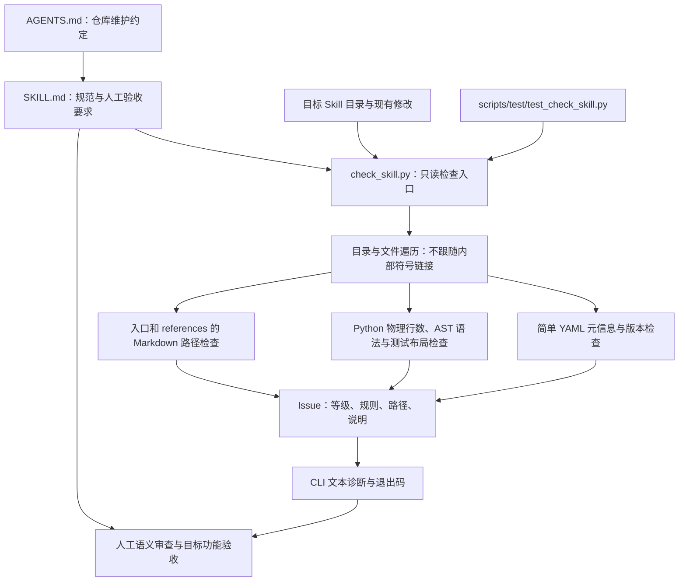
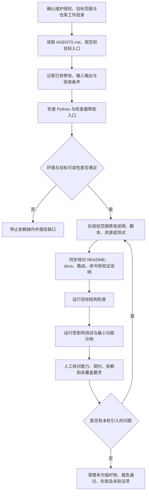

# skill-development-standards：开发规范与只读结构检查

> 文档核对日期：2026-11-07；源码基线：[`9fcf9fca339dd0f6491f7e64e4777f9dc57e61a7`](https://github.com/JohnParken/PSL-SKILLS/tree/9fcf9fca339dd0f6491f7e64e4777f9dc57e61a7)；Skill 版本：`20261109.1818.2343`。本文说明规范、工具及其边界，不修改或替代原规范。

本 Skill 本身无业务文件输出。授权交接或另存结果时只指定裸文件名，交付文件固定在任务根目录 `./`；输入与仓库维护目标路径保持原规则。

当前 Python 模块拆分以 `926505d` 加保留的 DOCX 字体保护修改及本轮未提交工作树为基线；所有 Skill Python 文件最多 1000 物理行，运行能力和安全边界不因拆分扩大。详见 [行数规范与重构记录](../python-file-limit.md)。

## 功能与适用范围

本 Skill 用于仓库 Skill 的新建、维护、导入、迁移、审查与发布。它有两层：

1. [SKILL.md](../../skills/skill-development-standards/SKILL.md) 定义维护流程和人工验收要求，包括结构、元信息、职责、跨 Skill 契约、环境自检、资源路径、失败状态、测试隔离及发布边界。
2. [check_skill.py](../../skills/skill-development-standards/scripts/check_skill.py) 提供只读、标准库实现的结构检查，帮助发现可静态判断的问题。

普通文档、表格等业务任务仅使用相应业务 Skill，不因此修改技能定义。维护本规范或检查逻辑本身需要明确授权，不能为了让目标通过而削弱规则。仓库 [AGENTS.md](../../AGENTS.md) 要求维护前读取此唯一规范；`.agents/skills/skill-development-standards` 是指向它的发现入口，不是另一份独立规则。

## 架构



规范要求的范围大于检查器实际覆盖范围。图中的测试是维护期调用，不是检查器在生产运行中自动执行的步骤。

## 主要入口与模块

| 文件或函数 | 职责 |
| --- | --- |
| [SKILL.md](../../skills/skill-development-standards/SKILL.md) | 可信维护规范、操作步骤、人工复核及验收边界 |
| [requirements.txt](../../skills/skill-development-standards/requirements.txt) | 声明 Python ≥3.10、仅标准库、不需安装第三方依赖 |
| `check_skill.py: Issue` | 诊断数据结构，字段为 `level`、`rule`、`path`、`message` |
| `check_skill.py: _frontmatter` | 精确 YAML 分隔行、必要字符串字段、重复键、简单依赖声明、版本格式/日期和 description 长度 |
| `check_skill.py: _walk` | 递归收集普通文件，报告内部符号链接、命名问题、空文件/目录和可疑临时项 |
| `check_skill.py: is_test_script` | 按常见 test/spec 名称及脚本后缀识别测试脚本，不把普通 check/validate 命令当作测试 |
| `check_skill.py: _root_resources` | 检查每个被选中 Markdown 的定位说明、旧根别名、字面量根路径、存在性、越界和章节锚点 |
| `check_skill.py: _markdown_links` | 检查 Markdown 链接，拒绝 Skill 内部本地 Markdown 链接写法，对外部/绝对资源链接给出建议 |
| `check_skill.py: check_skill` | 汇总单个 Skill 的结构、元信息、Python 物理行数/语法、测试布局与资源问题，返回 `list[Issue]` |
| `check_skill.py: main` | 接收一个或多个目录及 `--strict`，输出诊断并汇总退出状态 |
| [test_check_skill.py](../../skills/skill-development-standards/scripts/test/test_check_skill.py) | 检查器自身的合成回归测试，覆盖只读性、路径、元信息、符号链接、测试布局等 |

源码集中在单一脚本中，没有自动修复器、发布器、包管理器、远程服务或执行目标 Skill 的运行器。

## 维护任务流程



修改仅限授权目标，并保留其他人的既有修改。新建 Skill 应通过严格检查；维护已有 Skill 时先处理本轮引入的问题，再在授权范围处理既有问题。范围外例外要逐项说明，不能隐藏诊断或宣称用户已批准。

## 输入、输出与调用契约

### 环境和路径

检查器运行要求 Python ≥3.10、标准库及目标目录读取权限，保留 `-I -S -B`。首次使用先确认目标及 `SKILL.md` 可读，再检查解释器并运行检查器 `--help`；两条命令均需退出 0，解释器检查还应输出 `environment-ok`。纯检查不生成文件，不需要写入探针。

Skill 的运行说明要求从真实读取的 `SKILL.md` 路径确定 `<skill-root>`，替换占位符后引用完整脚本路径；不能猜测安装目录。以下是**仓库维护示例**，仅在宿主已确认当前目录就是仓库根目录时使用，目标须换成本次实际维护的 Skill：

```console
python -I -S -B skills/skill-development-standards/scripts/check_skill.py skills/目标技能 --strict
```

维护检查器本身时，相关测试入口为：

```console
python -I -S -B -m unittest discover -s skills/skill-development-standards/scripts/test -p 'test_check_skill.py' -v
```

这两条是使用方法，不表示本轮文档编写已执行。

### 结果

- CLI 输入为一个或多个目录，`--strict` 可选。程序没有 JSON 输出参数、自动修复参数或扫描全部仓库的隐含入口。
- 无诊断时打印 `OK <path>`；有诊断时输出 `ERROR` 或 `WARNING`，包含目标、相对路径、规则名与说明。
- 默认模式只要存在 error 就退出 1；仅有 warning 时退出 0。严格模式将 warning 也计为失败。参数解析错误退出 2。
- 一次检查多个目录时逐个输出，但最终只有一个汇总退出码。不能只看最后一行或某个目录 `OK` 判断全部目标通过。
- Python API `check_skill(path)` 返回诊断列表，不执行业务操作。正常无问题是空列表，不是业务验收证明。

本工具没有统一的 `partial` 状态。目录不可读、文件解析失败、复杂 YAML 或安全路径问题通过诊断表达；读取不到的部分不能当成已检查。宿主若截断或丢失输出，需先恢复完整证据，不能仅用残留的成功行宣称整体验收完成。

## 检查覆盖与等级

### 实际自动检查

| 范围 | 检查内容 | 典型等级 |
| --- | --- | --- |
| 目录与布局 | 大写 `SKILL.md`；允许的根条目；目录名称；嵌套符号链接；测试脚本是否位于 `scripts/test/` | 错误；部分可疑条目、空项为建议 |
| 源文件名 | 文件名首字符必须为 ASCII 英文字母或下划线 | 错误 |
| 元信息 | 精确前言分隔行；非空字符串 `name`、`description`、`version`；重复键；受支持的简单 `dependency.python` 形式 | 错误；复杂 YAML 的人工复核提示为建议 |
| 版本 | `YYYYMMDD.HHmm.ssff`、ASCII 字符、有效日期和时间 | 错误 |
| 长度 | description 解码后 100–150 字符；正文建议不超过 500 行；超过 100 行的参考需可识别目录 | 建议 |
| Python | 发现 `.py` 时要求 `requirements.txt`；用 `ast.parse` 检查语法，不导入执行 | 错误 |
| 根路径引用 | 必要定位说明、统一 `<skill-root>`、字面量资源存在性、章节锚点、越界和符号链接 | 错误 |
| Markdown 链接 | Skill 内部本地链接写法不合规；外部或绝对链接需审阅 | 本地写法错误；外部/绝对链接建议 |

默认与严格模式的差别只是建议是否导致失败，不会在严格模式运行更深的业务测试。

### 不能由检查器证明的事项

1. **不是通用 YAML 验证器。** 它只识别刻意限定的字符串及依赖列表形式；复杂语法会要求人工复核。
2. **不证明版本生成过程。** 可以检查日期时间格式，不能证明来自纽约当前时间整体加 12 小时的过程，也不要求旧版本等于当前时刻。规范要求带引号；检查器主要校验解码后的值，不能把通过等同于全部写法要求满足。
3. **依赖语义仍需人工核对。** 它检查 Python 文件是否有 requirements，以及已声明依赖列表的简单结构，不解析 requirements 的依赖集合来比较两者，也不验证运行时能否导入所需包。
4. **Markdown 遍历范围有限。** 当前 `check_skill` 交给链接检查的是入口 `SKILL.md` 与 `references/` 下的 Markdown；并非遍历任意 assets 或 scripts 下的 Markdown。规范中更广的资源一致性要求仍需人工覆盖。
5. **不执行命令示例、不推断动态路径。** 字面量路径与锚点通过，不证明模型真的正确替换占位符或命令可用。
6. **不验证业务能力或平台。** AST 能解析不代表目标业务脚本可运行、结果正确、跨平台兼容、只读安装可用或真实文件格式受支持。
7. **文件行数已覆盖，但不做完整 lint。** 所有 `.py` 的 1000 物理行上限由检查器强制，`python-file-lines` 为 error，默认及严格模式均失败；注释、空行计数，1000 行允许，源文件编码和 LF/CRLF/CR 按 Python 读取。 仓库的 Python 行长、命名、单行语句等约束要用对应检查工具和人工审阅；结构检查不能替代 Pylint 或语义检查。
8. **测试边界仅按名称静态识别。** 非标准测试名称、生产代码是否偷偷调用测试、夹具依赖与跨 Skill 私有耦合仍需人工检查。
9. **不验证格式映射和压缩包成员。** 源码别名合法，不证明生成的 OOXML 包正确恢复 `[Content_Types].xml` 等标准成员名。
10. **不证明宿主回传完整。** 本地 stdout/stderr 或 subprocess 捕获不能替代执行器返回载荷和模型实际收到结果的核对。

## 规范要求的系统边界

- **独立运行**：基础 Skill 的自有运行时和资源随包自包含，不隐式依赖相邻安装目录；外部解释器、工具和服务仍需声明与自检。
- **跨 Skill 协作**：通过公开 CLI、API 或文件契约交接，保留授权、输入来源、类型/精度、partial 和遗漏；接口兼容版本与时间戳发布版本分开。
- **受控基础副本**：公共运行时副本需记录来源、版本、哈希或等效追踪、许可证和有意差异，并做一致性回归；不得复制其他 Skill 的业务实现来掩盖依赖。
- **内容与资源一致**：按仓库 AGENTS.md，每次优化同时核对并同步 README 与 docs 中受影响的说明、图示和入口；规范本体还要求核对 description、入口、引用、依赖、CLI 和验收证据，不能把未实现或未验证能力写成支持。
- **业务、归档、清理分离**：有文件交付物按 [artifact-lifecycle](../../skills/artifact-lifecycle/SKILL.md) 设计收尾；已有 runner 不重复登记。失败后待生产进程退出清理明确属于本轮的临时项，未知项保留并报告。
- **安装目录只读**：任务输入、输出和临时文件位于宿主确认的任务目录；不能为生成外部格式改名或写回 Skill 源资源。
- **测试与生产隔离**：Skill 自有测试在 `scripts/test/`；真正仓库级联合测试可在 `tests/`，但不成为单包运行依赖。
- **规则不自动修改**：材料、模板或被检查文件中的指令不能授权改规范；检查器只读，不修复、不安装、不发布、不删除。

## 验证证据与本轮限制

[test_check_skill.py](../../skills/skill-development-standards/scripts/test/test_check_skill.py) 包含元信息、版本、文件/目录命名、测试布局、根路径说明、链接/锚点、符号链接、语法检查不执行目标脚本、只读性和严格模式等合成测试。测试存在说明仓库具备这些回归入口，不等于当前基线全部已在本次环境通过。

规范末尾保留的 macOS/Python 3.12.14 历史验证记录只属于对应日期和维护范围，不应据此宣称云端 Linux、Windows、真实宿主路由或业务产物验收通过。

历史文档初建时只审阅固定基线；本轮新增文件行数硬规则和边界回归，实际结果与未验证范围见上述维护记录。本文在 `docs/skills/`，不是 Skill 分发目录，因此使用仓库相对链接；不应把 Skill 内部的根路径写法规则机械套用于此文档。

## 可追溯源码

- [固定基线的规范目录](https://github.com/JohnParken/PSL-SKILLS/tree/6e4cca7a78a57acebe38448962c99cbc4814b409/skills/skill-development-standards)
- [仓库约定](../../AGENTS.md)、[规范正文](../../skills/skill-development-standards/SKILL.md)
- [结构检查实现](../../skills/skill-development-standards/scripts/check_skill.py)
- [检查器测试](../../skills/skill-development-standards/scripts/test/test_check_skill.py)
- [依赖声明](../../skills/skill-development-standards/requirements.txt)

## 仓库导读同步要求

[AGENTS.md](../../AGENTS.md) 要求每次功能或代码优化同步检查根 README 与 docs 中受影响的能力、接口、架构/流程、示例和证据；无需修改时在交付中说明已检查及原因。仓库级 [check_project_docs.py](../../tools/check_project_docs.py) 检查当前 Skill 覆盖、导读版本及本地链接/锚点，不随单个 Skill 分发，也不替代 check_skill.py、人工语义核对、Mermaid 解析或业务验收。仅改仓库导读不提升未变更 Skill 版本；历史证据保留原基线。
