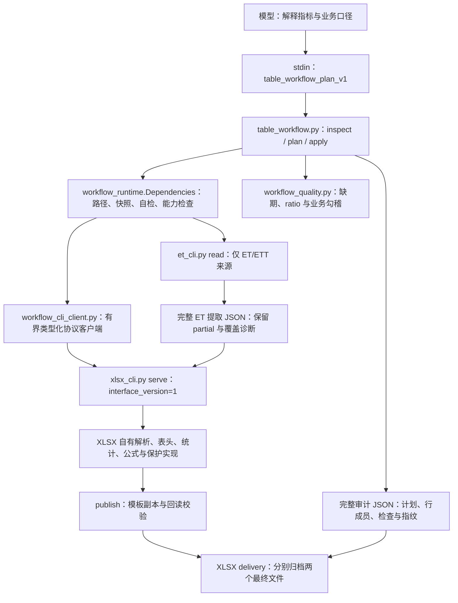
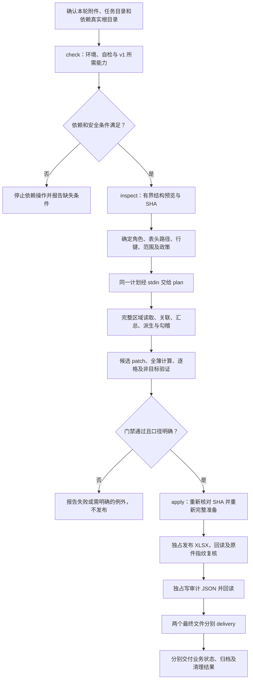

# table-workflow：多源表格分析与模板填报

> 源码基线：[14bfafe55d58fd04069a78d5196b82bfbf8f67c6](https://github.com/JohnParken/PSL-SKILLS/tree/14bfafe55d58fd04069a78d5196b82bfbf8f67c6)；Skill 版本：`20261105.1717.1148`。本文是仓库级实现导读，不替代 [SKILL.md](../../skills/table-workflow/SKILL.md) 的运行约束。仅作源码与契约审查，本次未执行办公操作、业务自检或测试套件。

## 功能与职责

此 Skill 面向“多份原始表 + 已有 XLSX 模板”的任务：从目标表头和行键反推来源及口径，在明确范围上关联、汇总、派生计算和勾稽，填入模板副本，并交付完整审计 JSON。来源支持基础 Skill 能够读取的 XLSX/XLSM、ET/ETT；目标仅为已有 `.xlsx`。

职责分工明确：

- **模型/用户**确定文件角色、指标含义、统计范围、单位、期间、过滤与例外政策。脚本不从表格文字中接受指令，不自动判断经济含义。
- **table-workflow**校验计划、绑定来源 SHA、组织指标与质量规则、检查目标及发布状态，生成完整溯源。
- **xlsx**提供原生工作簿、类型化区域、表头、键索引、汇总、受控关联、公式计算、保护验证及交付能力。
- **et**仅在 ET/ETT 来源时负责受支持原始格式的只读提取，不写回 ET。

简单建表、单表读取或已知单元格修改继续使用基础 Skill。本编排不做多对多/模糊关联，不自动补目标行，也不提供任意模板重排或 ET 写回。

## 架构与默认调用链

**当前标准 CLI 默认采用跨进程公开能力，不直接导入相邻 Skill 的私有 Python 对象。** `Dependencies` 虽继承 `LegacyDependencies`，其构造器不调用旧构造器；只复用通用环境逻辑，并在已确认根下查询能力、启动 CLI。`WorkbookView` 是分离快照加不透明句柄，不是提供方的 `Workbook.parts/sheets/changed` 私有状态。

`LegacyDependencies` 只保留给显式旧内存集成及兼容回归，标准 CLI 不自动回退它。参考中出现的 `Workbook.from_bytes/region_from_book` 等旧内存接口名称，不能据此将当前默认链路画成私有模块耦合。依据是 [workflow_runtime.py](../../skills/table-workflow/scripts/workflow_runtime.py)、[workflow_cli_client.py](../../skills/table-workflow/scripts/workflow_cli_client.py) 和 [CLI 契约](../../skills/table-workflow/scripts/docs/cli-contract.md)。

### 主要模块与入口

| 模块 | 责任 |
| --- | --- |
| [table_workflow.py](../../skills/table-workflow/scripts/table_workflow.py) | `check/inspect/plan/apply`；`Workflow.load/source_table/prepare/apply`；候选准备、逐格写入清单、完整审计与有界回执 |
| [workflow_runtime.py](../../skills/table-workflow/scripts/workflow_runtime.py) | 受限任务路径、不可变文件快照/SHA、stdin JSON 解析、写入探针、依赖自检与公开能力绑定；显式保留旧适配器 |
| [workflow_cli_client.py](../../skills/table-workflow/scripts/workflow_cli_client.py) | XLSX 会话启动、顺序请求、关联 ID/协议校验、超时与 stderr 诊断；公开 `WorkbookView`；批量筛选/公式求值 |
| [table_workflow_cli_protocol.py](../../skills/table-workflow/scripts/table_workflow_cli_protocol.py) | `psl_capabilities_v1` 的类型化 JSON 编解码；不承担业务 schema 或授权校验 |
| [workflow_quality.py](../../skills/table-workflow/scripts/workflow_quality.py) | 显式月份覆盖、ratio 的缺值/零分母政策，以及逐键/总计业务勾稽 |
| [XLSX CLI](../../skills/xlsx/scripts/xlsx_cli.py) | `open/extract/region/select_rows/lookup/summarize/evaluate_many/patch/calculate/verify/publish/delivery` 等受检能力的提供方 |

## 任务流程

1. **确认环境和路径。** 从实际读取的三个 `SKILL.md` 定位根目录；必传已确认的 `--xlsx-root`，ET/ETT 来源另传 `--et-root`。不猜相邻位置。任务输入/输出仅用任务目录下相对路径；拒绝绝对数据路径、父目录、符号链接。任务目录不能位于任一 Skill 安装目录内。
2. **自检。** `check` 要求退出 `0`、`status=environment-ok`；依赖 XLSX 自检为 `ready`，ET 自检为 `environment-ok` 且 OOXML 分支 available。写文件时加 `--write` 并要求 `task_writable=true`。每次 CLI 调用仍检查依赖；自检不是产物或归档验收。
3. **识别。** `inspect` stdin 只接明确的文件列表，可限定 sheet/range。默认每表前 4 行、8 列，每文件最多 8 表，保留 SHA、截断与遗漏计数。它不是计算输入；任何 ET 来源 partial 会使 inspect 同样 partial/退出 `3`。
4. **映射和试算。** 使用真实 SHA 构造计划，仅在歧义处询问。`plan` 在内存完整计算全部声明区域、生成候选并验证，不写文件。stdout 仅摘要，不能拿预览代替统计。
5. **填报。** 业务口径明确后，用同一计划执行 `apply --output ... --audit ...`。apply 会重新读取与核验 SHA、重新准备，不信任过期试算。只有两个最终文件落盘；不外包 runner 重算，也不重复生命周期登记。
6. **交付。** XLSX 发布回读、输入指纹复核、审计回读分别成功后，才按各自实际状态交付。归档通过 XLSX `delivery` 分别处理两个最终文件。

## 输入计划与输出

完整字段约束及示例见 [plan-contract.md](../../skills/table-workflow/references/plan-contract.md)；关联/质量扩展见 [quality-and-lookups.md](../../skills/table-workflow/references/quality-and-lookups.md)。示例范围与期间不是用户事实。

### 计划组成

| 字段 | 含义和主要门禁 |
| --- | --- |
| `schema_version` | 当前为 `table_workflow_plan_v1`；拒绝未知字段、重复键、非有限数字 |
| `sources` | 1–16 个具名区域；必须声明 path、sha256、sheet、range、header_rows、keys、unit、period、repeated_keys；可附筛选、物理排除行、公式/partial/期间政策 |
| `lookups` | 最多 16 个，按声明顺序；左侧为原始事实或既有 lookup，右侧仅原始维表；只支持 one_to_one/many_to_one |
| `metrics` | 1–64 个；`sum/count/min/max/mean`，必须有业务 basis；count 计事实行，其他指标需数值 measure；单位变更需显式正倍率 |
| `derived` | 最多 64 个；显式公式与 1–16 个地址绑定，或 ratio 专用形式；只能引用更早指标，不允许前向依赖/循环 |
| `checks` | 最多 64 项；equal/range，显式范围、容差与业务依据；最多 20000 个观察值 |
| `target` | 单个已有 `.xlsx` 的唯一行键、表头、范围及 1–64 个输出列；默认 `blank_only`，仅明确授权才用 `replace_values` |

关键数据规则：

- 行键为 1–8 个类型化组件；数字、文本、布尔严格区分，不自动去空格、去前导零或转数值。表头列用列 ID 或唯一多级路径，不能凭同名叶表头猜测。
- 来源重复键必须明确选择 `aggregate`；目标键始终唯一，额外来源组只记录未匹配诊断，不自动加目标行。
- 维表右键唯一，one_to_one 还要求左键唯一；空关联键、类型不一致或未匹配事实行一律拒绝。补入维表列仅作属性，不能当作金额 measure；核对事实行、类型、值及原始数值和守恒。
- 来源公式默认拒绝。cached 需明确接受，保留未验证警告且结果 partial；缺缓存/错误缓存拒绝。calculate 仅原生 XLSX/XLSM，从不可变文件快照新建独立内存候选，不污染同文件其他 cached 区域。ET 不重算。
- 隐藏/过滤行默认纳入；小计、重复表头及非明细行用显式物理行排除或范围/筛选处理。期间声明本身不筛选数据，必须用真实范围或条件落实。
- 聚合保持 Decimal 精度，最终目标按 0–12 位小数 `ROUND_HALF_UP` 舍入；目标最多 15 个有效数字、保守 Excel 数值量级。勾稽在舍入前执行，不能当作显示值或缓存勾稽。

**精度说明的现状差异：** 计划参考及审计 `arithmetic` 文字含“公式 34 位有效数字”，但此基线实际调用 [formula_engine.py](../../skills/xlsx/scripts/formula_engine.py) 的 `FORMULA_PRECISION=28`；34 位适用于 [xlsx_analysis.py](../../skills/xlsx/scripts/xlsx_analysis.py) 的均值。本文按实际代码与 [公式契约](../../skills/xlsx/references/formula-calculation.md) 区分，不把旧文字当作运行精度保证；本次未修改这些源文件。

### 输出层次

- `inspect`：`table_workflow_inspection_v1`，文件指纹与结构视图，`complete_data_for_computation=false`。
- `plan/apply` stdout：`table_workflow_receipt_v1`，状态、验证、写入计数及前 10 项预览、告警/检查摘要、公式报告等。stdout 最多 24000 字符，逐步缩减投影仍保留关键状态，不截断 JSON。
- apply 审计：`table_workflow_audit_v1`，完整计划、来源 SHA、依赖 Skill 指纹与能力接口、来源区域、表头、lookup 行对、事实守恒、分组物理行成员、每格未舍入/舍入值、业务检查和保护验证。
- apply 文件：独占创建的新 XLSX 与审计 JSON，已有路径拒绝。审计中的 plan 保留 JSON 数字/文本类型和十进制精度，可通过同一入口重放；其他 Decimal 统计输出沿用字符串约定。
- 审计是可复查计算和数据来源的记录，不是业务语义、视觉排版或 Excel 等价性认证。

## 对外契约、预算与依赖

### 公开能力链路

依赖必须声明 `interface_version=1`、协议 `psl_capabilities_v1`、匹配的 Skill 身份及全部所需 operations。XLSX 使用顺序 `serve` 会话，不逐行启动解释器；ET 使用 `et_cli.py read`，将完整提取 JSON 交给 XLSX `extract` 校验，不能以 ET 分析结果或预览替代。

协议保留 Decimal、bytes、tuple、复合 dict 键类型，使用明确 JSON 标签，不使用 pickle、动态类或远程代码执行。每帧最多 128 MiB、深度 64，拒绝浮点字面量、重复键及非有限值；业务 stdin 的十进制数字则由 `read_request` 直接解析为 Decimal，两者不是同一个报文 schema。

客户端逐次核对协议、关联 ID、`ok` 与业务结果，保留有界 stderr。会话请求超时为 120 秒，stderr 最多保留 8192 字节并标记截断；当前默认 `run_process` 的依赖自检/ET 调用也采用 120 秒，而旧计划参考仍写 60 秒。超时、损坏或未知结果按 uncertain/not_started 等实际状态停止，不自动回退旧 API 或重试有副作用的 publish/delivery。详见 [CLI 契约](../../skills/table-workflow/scripts/docs/cli-contract.md)。

### 资源上限

| 层级 | 当前限制 |
| --- | --- |
| 单来源文件 / 合计快照 | 64 MiB / 128 MiB；最多 16 个来源文件加 1 个模板 |
| stdin 计划 | 2 MiB、深度 32 |
| 每个声明区域 | 200000 个单元格 |
| 输出写入 | 最多 10000 格；不自动扩展模板 |
| lookup | 显式 max_rows 为 1–10000；补列后最多 200000 格；最多 32 个追加列 |
| 审计 JSON | 16 MiB |
| stdout | 24000 字符；默认最多 10 项写入预览，保留 omitted 计数 |

超限拒绝，而非缩小实际运算范围。摘要限制的是返回视图，不会减少底层全量解析/计算内存；JSON/base64 与跨进程往返还有额外开销，不承诺速度或 token 节省。

### 运行依赖

[requirements.txt](../../skills/table-workflow/requirements.txt) 声明 Python ≥3.12，维护参考版本 3.12.11，仅标准库；无需运行时网络、安装包或外部办公软件。必须另行安装兼容 XLSX；ET/ETT 来源再安装 ET，且 OOXML 分支要求 Expat ≥2.6。依赖通过宿主确认的真实根目录显式提供，单独复制 table-workflow 不会自动获得解析器。

文件快照要求 `O_NOFOLLOW/O_NONBLOCK` 等安全原语；缺少即停止，归档还继承 XLSX 的平台及硬链接条件。只读安装允许，但任务目录必须可按所需操作读写；这不是敌对并发写者沙箱。

## partial、失败与模板保护

| 状态/退出码 | 语义 |
| --- | --- |
| 退出 `0` | 本次命令完成；可能为 environment-ok、inspected 或 validated，归档 skipped 仍需如实说明 |
| 退出 `3` | 接受的 partial，或 `delivery_incomplete`；必须读完整 JSON 分辨原因 |
| 退出 `1` | 业务、结构、来源、能力或运行失败；保留具体诊断及已写文件状态 |
| 退出 `2` | argparse 参数错误，stderr usage；不是 XLSX 底层 incomplete 的含义 |

### 可以明确接受但必须保留 partial 的情况

- ET 源默认 partial 阻断；仅显式 `accept_partial=true`，且声明单元格覆盖完整、遗漏不影响值，或精确命中允许的 OOXML 样式元数据缺口，才能继续。未知遗漏或缺公式缓存不因 accept_partial 放行。
- 显式 cached 公式、空数值 `omit/blank`、未匹配目标 `blank`、缺期允许 partial、ratio 零分母 blank、业务检查失败/未核验允许 partial，均留下诊断并使最终结果 partial。
- `omit` 不把全空组变零；`blank` 不交付部分和；通用公式除零/不支持函数不兜底空值。需要向目标写任何空指标时，必须使用全簿无公式模板，避免将缺失按零重算。

### 始终拒绝或必须核验的情况

- 来源非数字金额、空/重复目标键、维表基数不符、未匹配事实、类型混合、未知字段、输入 SHA 变化或范围超限。
- `replace_values` 不授权修改公式、键或表头；默认只写空白非公式格。候选的逐格值与计算写入清单独立比较，并拒绝新增非目标单元格/包部件。
- 输入、键、表头、样式、非目标值和公式文本受保护；公式缓存允许受控重算。模板全部公式预检必须 `calculated_subset`，且 `retained_not_refreshed` 为空；不支持公式、错误、循环、特殊公式或未刷新图表/透视/外链缓存均阻断发布。不能静默清缓存后称完成填报。
- 主工作簿和审计不是事务性双文件发布。失败时检查 `output_written/audit_written/verification`：`false`、`true`、`incomplete`、`unknown` 各有不同含义，存在文件不等于完整验收。已有本轮最终文件保留供核查，不覆盖重跑。
- 无/无效归档配置为 skipped，实际复制失败为 delivery_incomplete；分别检查两份文件。归档失败保留主文件，不重新计算；有 `temporary_residuals` 即报告清理未完成。
- 正常执行不生成计划、脚本等中间文件，只有本次独占探针自行清理。若宿主必须另存辅助文件，先按已确认的公共生命周期入口事前登记；不扫描、认领或删除未知历史文件。

## 验证证据与本次未验证范围

维护证据入口为 [validation.md](../../skills/table-workflow/references/validation.md) 和 [CLI 契约的维护记录](../../skills/table-workflow/scripts/docs/cli-contract.md)。跨 Skill 测试位于仓库 `tests/test_table_workflow*.py`，不随该 Skill 单独运行，也不是普通成功任务的必读材料。

已有记录区分了合成 XLSX/BIFF/OOXML ET 后缀样例、公开银行 XLSX 样本及合成维表/模板；真实银行样本的期望采用独立 OOXML/Fraction 核对，不能据此声称多份真实 ET 附件验收。CLI 记录还包含 macOS/Python 3.12.11 上的公开能力传输、只读独立安装、空外部 PATH、归档及兼容回放。基准中 CLI 比 legacy 有额外序列化成本，不是性能提升证明。

这些是仓库原有记录，不是本次重跑结果。云端 Linux、Windows、真实 ET/ETT 生产者、Excel/WPS 视觉与语义、真实宿主结果回传/下载及强杀恢复不能由上述记录代替。ET 写回本来就不在支持范围。本次仅完成固定基线的源码/契约对照及文档整理，未运行跨表业务或全量测试。

## 源码追溯

- 运行总入口：[SKILL.md](../../skills/table-workflow/SKILL.md)、[table_workflow.py](../../skills/table-workflow/scripts/table_workflow.py)。
- 计划与质量：[计划契约](../../skills/table-workflow/references/plan-contract.md)、[质量政策](../../skills/table-workflow/references/quality-and-lookups.md)、[workflow_quality.py](../../skills/table-workflow/scripts/workflow_quality.py)。
- 默认依赖路径：[workflow_runtime.py](../../skills/table-workflow/scripts/workflow_runtime.py)、[workflow_cli_client.py](../../skills/table-workflow/scripts/workflow_cli_client.py)、[CLI 契约](../../skills/table-workflow/scripts/docs/cli-contract.md)。
- 格式所有方：[XLSX 公开 CLI](../../skills/xlsx/scripts/xlsx_cli.py)、[XLSX 能力契约](../../skills/xlsx/scripts/docs/cli-contract.md)、[xlsx 导读](xlsx.md)、[ET 主入口](../../skills/et/SKILL.md)。
- 证据边界：[validation.md](../../skills/table-workflow/references/validation.md)。

## 归档提示更新（2026-11-07）

以下仅适用于本次版本 20261107.1943.5370，其余架构说明仍为上述历史基线。

归档经稳定 CLI 复用 XLSX 内置实现；核对 delivery 中 XLSX 与核验 JSON 两项实际结果，两项均成功才提示“🎉 文件归档成功，请到云空间查看。 ☁️✨”；仅一项成功提示“部分文件归档成功，请到云空间查看已归档文件；其余文件归档未完成。”并说明另一项状态。两项均未成功按实际失败、跳过或未知报告；压缩回执保留每项 archive_user_notice，机器 archive_message 不变。归档失败保留主文件、不重跑。失败、部分成功、跳过、待交接和未知分别如实报告，不套用全部成功；业务与清理状态独立，主业务失败不称生成成功。隐藏归档路径、目录、ID及原始日志，保留真实主文件链接，不虚构下载。
