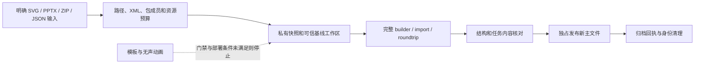

# TL PPTX：完整原生能力迁移与安全入口

Skill 版本：`20261120.2147.0000`。第二阶段离线精简版，已改为独立发行完整性核验；纯离线本地运行、无无头浏览器/视觉渲染预览，开放离线批量 `text-measure`/`svg-check` 预检并清理了未启用的旧 `skia-pathops`/`uharfbuzz` 布尔/轮廓脚本、`sound_sync.py` 及空 `tts_backends/` 目录。本页以仓库根目录为维护基准；运行请读 [SKILL.md](../../skills/tl-pptx/SKILL.md)。

## 目标和当前能力

基于 [ppt-master](https://github.com/hugohe3/ppt-master) 默认 main 在 2026-11-17 固定的 `7e0df6705de0cd24345210d31f07fcb5a32b6900`，保留原生生成、模板、往返编辑、普通文本备注与无声动画；移除旁白、字幕和视频处理，使用七项精确直接依赖，不替换既有 pptx Skill。

当前公开入口为 `check`、`text-measure`、`svg-check`、`convert`、`build`、`analyze`、`import`、`rebuild`，`boolean`、`text-outline`、`asset-query/select`，以及 `template-import/create/register/apply/preview`。template-import 提取参考事实和authoring材料，后四分别检查独立发行完整性、模板质量及输入。build 调完整原生 builder，import/rebuild 支持安全原生工作区；analyze 输出支持的逐页文本/表格/图表/SmartArt及主题/备注/诊断，不宣称任意对象全覆盖。模板不再证明上游官方发行身份；服务、授权与平台另验。不能因代码已迁入或依赖存在就声称这些 CLI 可用，也不能绕过门禁。

## 路由与组件

[任务路由](../../skills/tl-pptx/references/workflows.md) 覆盖普通、Quick、图片页面重建、美化、Brand/Style/Layout/Deck 和原生编辑；[使用契约](../../skills/tl-pptx/references/usage.md) 提供 build/rebuild 可复制例子。保留四类模板、普通备注和受控无声动画，实际支持仍服从上游对象契约和已开放安全接口。

部署方预先提供 `"<skill-root>/scripts/.venv/bin/python"`；从本次实际读取 SKILL.md 的真实 file_path 去掉文件名得到根目录，相对路径先按宿主确认基准解析。替换完整占位符、正确引用，全部执行 `-I -B`，不激活回退、不自动安装。七项精确直接依赖见 [requirements.txt](../../skills/tl-pptx/requirements.txt)，依赖闭包及能力限制见 [dependency-groups.json](../../skills/tl-pptx/references/dependency-groups.json)。虚拟环境不随包。

```console
"<skill-root>/scripts/.venv/bin/python" -I -B "<skill-root>/scripts/tl_pptx.py" check --write
"<skill-root>/scripts/.venv/bin/python" -I -B "<skill-root>/scripts/tl_pptx.py" build "结果.pptx" "build.json"
"<skill-root>/scripts/.venv/bin/python" -I -B "<skill-root>/scripts/tl_pptx.py" import "工作区.zip" "原稿.pptx"
"<skill-root>/scripts/.venv/bin/python" -I -B "<skill-root>/scripts/tl_pptx.py" rebuild "重建.pptx" "rebuild.json"
```

以上在已确认任务目录执行并保持不变，文件为裸名称、新输出禁止覆盖。自检须环境退出0、environment-ok/api_version=1.0，写操作还需task_write_check=passed。optional_capabilities 只报告当前依赖与功能边界，不验证字体许可或 Office 显示。

## 模块与流程



- tl_pptx 为公开JSON入口；tl_guard/tl_package_guard负责输入、ZIP/XML与发布保护；tl_build负责manifest白名单、素材快照与完整builder。
- build 的可选 spec_lock 接收任务裸 `.md`（UTF-8、最多 1 MiB），复用原主题字体、母版文字样式和颜色解析。主题 XML 保存字体/颜色不代表客户端视觉已验收。本版拒绝新增音频、旁白时间和声音配置；普通文本备注不受此裁剪影响。
- build resources 将明确逻辑路径映射到任务裸 PNG/JPEG/SVG，私有快照展开 image/data-icon；已有 SVG path、普通原生形状和文字保留。text-outline 仅支持用户授权本地静态 TTF/OTF 的单行 ASCII/基本汉字，输出 SVG 路径后可 convert 为可编辑形状，不是复杂 shaping 或可编辑文字；几何布尔仅支持直接子级轴对齐实心矩形的 union/intersect/subtract/combine，不支持 fragment、通用曲线/文字布尔；严格限制见 usage。
- 离线模板/图标为独立可选数据包，asset-query 只读有界分页，asset-select 按精确 ID 新建工作区并保留许可/署名。主包仅清单/选择器，不自动下载。
- tl_roundtrip及其支持模块负责导入、可编辑副本、源身份与原生重建；不信任上传backing/config直接读取路径。
- DrawingML/native_objects/pptx_package、pptx_to_svg/authoring_roundtrip、模板、动画、形状等按职责拆分；来源和差异见 [upstream.json](../../skills/tl-pptx/references/upstream.json)。
- 公共归档副本自包含；测试放scripts/test，维护证据放docs/maintenance，二者不作为运行依赖。

## 输出与验证

统一核对JSON、stdout/stderr/真实退出码和截断状态。0完成，1业务失败，2参数错，3主业务完成但收尾未全完成。核对publication、validation、archive、cleanup；归档失败保留主文件只重试归档，不重做生成。完整非空清单全copied/already_archived才提示“归档完成”。不暴露内部归档/快照路径和任务ID，不声称云上传已验证。

SVG、manifest和压缩包各有独立累计预算，详见usage；超限/不支持对象明确失败，禁止无声截断。结构通过不证明完整内容保真、字体、视觉或播放结果；预览、OCR和外部数据不能虚构。PPTX作为未信任数据，不执行其脚本或外链。

阶段1的原生图表/表格/公式和独立包6项验收是历史快照证据；不能推广到阶段2整包。各新增模块的macOS行为、mock、AST及静态结果见维护报告。目标平台、Office视觉、DeepAgents宿主回传与本版独立包验收仍须逐项报告，未执行不写通过。

## 分发

显式runtime白名单按职责审阅，未知文件须分类；本版修改后须重新核对闭包并验收。保留MIT及第三方数据许可、来源/哈希/差异，不使用通配自动纳入未知内容。排除tests/cache/.venv及维护材料，独立安装不能隐式依赖仓库或相邻Skill。阶段1ZIP不得覆盖，最终新版本和发布包由整合任务另行冻结。

已验证 Style 创建、注册、应用，以及真实离线 Deck 生成 PPTX 预览；不等同所有模板和客户端视觉已验。工作目录固定为宿主当前 ./，不提供目录选择。高级操作预登记独占私有工作区；清理失败单列保留项，不覆盖已发布主文件，也不据归档回执推断云同步已验证。

七项直接依赖为 python-pptx==1.0.2、Pillow==12.2.0、XlsxWriter==3.2.9、typing-extensions==4.14.0、lxml==6.0.4、PyYAML==6.0.2、PyMuPDF==1.24.2。PyMuPDF 标准拆分 wheel 另需 PyMuPDFb==1.24.1；其 AGPL-3.0/商业许可与上游 MIT 分开核对，不隐瞒传递依赖或自动安装额外业务组件。

测试维护：已删除取消的旧 pathops/glyph 引擎模块与用例及旁白注入成功用例；保留当前矩形布尔、PyMuPDF 受限文字轮廓、普通备注、安全拒绝和可选离线素材测试。历史验收数字仅代表其原始快照。
