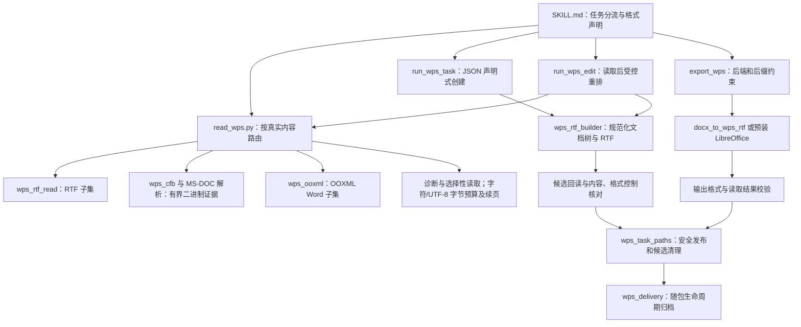
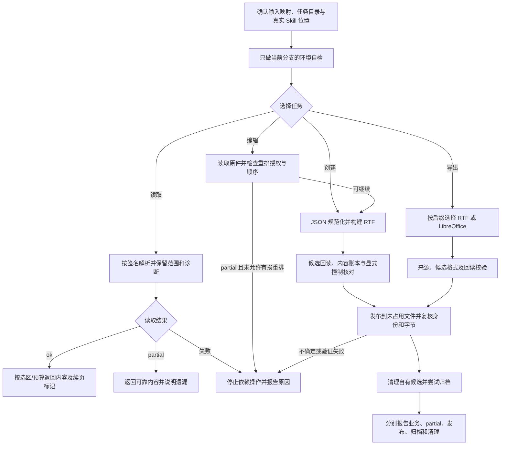

# WPS：有限文字读取、RTF 创建与内容重排

> 核对日期：2026-11-07；历史源码参考基线：[9fcf9fc](https://github.com/JohnParken/PSL-SKILLS/tree/9fcf9fca339dd0f6491f7e64e4777f9dc57e61a7)；当前 Skill 版本：`20261109.1939.2825`。本文是仓库级说明，不替代 [SKILL.md](../../skills/wps/SKILL.md) 的运行约束，也不表示本次已执行转换或客户端验收。

所有业务交付文件入口只接收裸文件名，脚本固定写入已确认任务根目录 `./`；`./文件名`、子目录、绝对/父目录及 Windows 路径均拒绝。输入路径、内部归档与受控临时工作区保持原规则，多产物分别提供不同裸文件名。旧带目录输出的 CLI/API 调用需迁移，不通过切换到输入或安装目录规避。

## 功能与格式边界

WPS Skill 面向公文、报告、段落和基础表格，提供四条任务路径：

1. **声明式创建**：JSON `blocks` 生成 RTF，默认最终文件名为“文档主题.wps”；用户明确要求 `.rtf` 时尊重该后缀。
2. **内容读取**：根据真实字节识别 RTF、CFB 内受支持的 MS-DOC 子集、OOXML Word 子集，返回正文、有限结构、诊断和读取范围。支持标题、段落范围、章节及有界输出。
3. **受控重排编辑**：文字替换、段落替换/删除/追加、单元格更新及批量操作。读取后重建整份 RTF，不是对原格式的保留式编辑。
4. **从 DOCX 兼容导出**：将 DOCX 转为 RTF，或通过实际预装 LibreOffice 转为二进制 MS-DOC；每种后端都需候选校验和回读。此路径不是 WPS 转 DOCX。

**默认 `.wps` 后缀中的内容是 RTF，不是金山原生 WPS 格式。** 新建、重排和 RTF 导出的回执为 `output_format=rtf`、`binary_doc=false`、`native_wps=false`。读取能识别某种容器，不等于支持所有该容器内格式，更不证明文件来自 WPS 软件。

| 场景 | 接受的真实内容与后缀规则 |
| --- | --- |
| 输入读取 | 按内容签名判断；历史 `.doc` 文件实际包含 RTF 或 OOXML 时可按受支持内容读取。未知原生 WPS/Works/ET 私有格式不支持。 |
| 创建与重排 | 只输出 RTF，后缀限 `.wps/.rtf`。不能将 RTF 写成 `.doc`。 |
| 兼容导出 | RTF 可写 `.wps/.rtf`；受支持的 MS-DOC/CFB 可写 `.doc/.wps`；OOXML 不能改名冒充导出成功。 |
| 电子表格 | 识别到 OOXML spreadsheet 或 CFB Workbook/Book 后转交 ET Skill；本 Skill 不继续处理单元格任务。 |

## 架构图



RTF 创建和重排共用构建器及内容账本。导出器具有自己的候选格式/回读验收，不能把创建/重排的完整计划账本能力套到导出流程。归档实现随包保存在 `_wps_artifact_runtime`，不隐式导入相邻 Skill。

## 主要模块与入口

| 入口或模块 | 主要职责 |
| --- | --- |
| [read_wps.py](../../skills/wps/scripts/read_wps.py) | 统一 CLI 及 `read(path)`、`read_bytes(data)`；格式分支路由、策略兼容检查、状态及通道输出。 |
| [wps_cfb.py](../../skills/wps/scripts/wps_cfb.py)、[wps_ooxml.py](../../skills/wps/scripts/wps_ooxml.py)、[wps_rtf_read.py](../../skills/wps/scripts/wps_rtf_read.py) | CFB 结构与流边界、OOXML 受限 ZIP/XML、RTF token 和有限结构读取。MS-DOC 正文及附加区域通过入口和专门模块组合解析。 |
| [wps_diagnostics.py](../../skills/wps/scripts/wps_diagnostics.py)、[wps_selective.py](../../skills/wps/scripts/wps_selective.py)、[wps_read_view.py](../../skills/wps/scripts/wps_read_view.py) | 读取评估、标题/范围/章节投影、与原字节和选项绑定的分页游标；不把投影结果伪装为完整格式数据。 |
| [run_wps_task.py](../../skills/wps/scripts/run_wps_task.py) | `check/create`；接收 stdin 或 `--spec`，规范化生成、候选回读、发布并输出回执。 |
| [wps_rtf_builder.py](../../skills/wps/scripts/wps_rtf_builder.py) | `RtfRun/Paragraph/Table/Document` 与 `build_document_from_spec()`；文本转义、UTF-16 代理对、页面/段落控制与有限表格合并。 |
| [run_wps_edit.py](../../skills/wps/scripts/run_wps_edit.py) | `text/structure/table/batch`；`execute_edit_task()` 读取原件、应用操作、按新主题重建 RTF，并核对源文件在发布前未变化。 |
| [export_wps.py](../../skills/wps/scripts/export_wps.py)、[docx_to_wps_rtf.py](../../skills/wps/scripts/docx_to_wps_rtf.py) | `check/inspect/convert`；RTF 映射与可选 LibreOffice 导出，保留来源/候选 partial 和 fallback 诊断。 |
| [wps_content_validation.py](../../skills/wps/scripts/wps_content_validation.py)、[wps_output_contract.py](../../skills/wps/scripts/wps_output_contract.py) | 前者核对规范化计划与候选文字、块顺序、物理单元格及有限控制；后者约束后缀/真实格式、转换候选及读取状态。 |
| [wps_task_paths.py](../../skills/wps/scripts/wps_task_paths.py)、[wps_access.py](../../skills/wps/scripts/wps_access.py) | CLI 任务目录边界、不跟随链接读取、候选身份及字节核验、不覆盖发布、内部候选清理。 |
| [wps_delivery.py](../../skills/wps/scripts/wps_delivery.py)、[run_wps_job.py](../../skills/wps/scripts/run_wps_job.py) | 前者归档已核验主文件；后者仅在确需落盘 JSON 配置时登记、执行白名单 CLI 并清理自己的配置。 |

## 任务流程图



读取与创建自检需退出 `0` 且输出 `environment-ok`；导出自检需退出 `0` 且 JSON `status=environment-ok`。读取用 `read_wps.py --check`，创建/编辑用 `run_wps_task.py check`，RTF 导出用 `export_wps.py check --backend rtf`；需要二进制后端时才检查 `libreoffice`。自检不代替输入或产物验收。

下例是调用形态而非本次执行记录。`<skill-root>` 须由本轮实际读取的主入口路径确定并整体替换；数据路径相对宿主确认的任务目录。

```sh
python -I -S -B "<skill-root>/scripts/run_wps_task.py" create "工作汇报.wps" --compact-receipt <<'JSON'
{"theme":"official","blocks":[{"type":"title","text":"工作汇报"},{"type":"paragraph","text":"本期工作有序开展。"}]}
JSON
```

## 输入输出与结果契约

### 创建输入与排版

创建输入为带非空 `blocks` 的 JSON 对象，块类型包括 `title/subtitle/heading/paragraph/list/table/callout/page_break`。主题为 `official/business/general`，默认 `official`。默认公文为 A4、上下 25.4 mm、左右 31.8 mm，正文仿宋 16 pt、固定 28 pt 行距、首行 2 字；这是一套预设，不是 GB/T 合规认证。

页面可通过 pt 字段指定宽高和四边距，须保留可打印区域。支持有界横向、纵向及矩形单元格合并，只恢复可证实的显式网格。正文默认自然分页，标题与后文尽量同页；明确新页时只选一种分页机制。WPS 生成器不支持 DOCX 的分节配置，不用分页符冒充分节。

`spec_warnings/spec_warning_count` 会揭示未知选项或显式未知字体替换等问题；即使产物可读，也不能据 `success` 宣称所有配置都已生效。字体只写名称，不安装、嵌入或保证存在。详见 [生成说明](../../skills/wps/references/generation.md)。

### 读取状态、partial 与有界输出

| 入口 | 成功、partial 与失败 |
| --- | --- |
| 读取 CLI | `status=ok` / 退出 `0`：声明子集内成功；`partial` / `3`：可靠内容伴随遗漏；读取失败 / `1`；参数错误 / `2`。 |
| 创建 CLI | 成功回执为 `status=success` / `0`，但仍可能有 `partial=true` 或 `spec_warnings`。必须同时审阅这些字段、发布及归档状态。 |
| 重排编辑 CLI | 成功通常 `0`；使用 `--allow-lossy-reflow` 且结果为 partial 时退出 `3`。回执仍需查看 `partial`、`losses` 和源诊断，不能只看退出码。 |
| 导出 CLI | `success` / `0`；来源或候选 partial、或者 `.wps` 的 auto 回退时 `partial` / `3`；失败 `1`；参数错误 `2`。 |
| 导出 `inspect` | 校验写入候选的后缀、格式及支持内容：完整声明子集 `0`、有效但 partial `3`、不符或无效 `1`。不是输入读取的替代入口。 |

默认读取 JSON 返回 `format/text/paragraphs` 及适用的 `tables/blocks/issues/diagnostics/omitted_regions`。`reading_assessment` 是范围摘要：`ok` 仅表示 `within_declared_scope`，`full_format_verified` 始终为 false。未知覆盖不表示该内容不存在。

`--format text` 成功时 stdout 仅正文；partial 的状态和 issues 摘要在 stderr。失败 JSON 写 stderr，不用空正文伪装成功。默认 JSON 模式的读取失败写 stdout；参数解析错误只有用法/错误文本。JSON 输出有 16 MiB 预算，超限失败，不输出被截断的合法性未知结果。

`read_bytes()` 可能抛 `ParseError`，也可能返回格式分支生成的失败字典；调用方既要捕获异常，也要检查 `status`。`read(path)` 捕获 `ParseError/OSError` 并返回失败结果，但不保证捕获所有编程异常。

选择性读取与有界投影不等于完整读取：

- 段落范围为 1-based、两端包含；章节按检测到的标题边界选择，重复标题可用 `--section-index` 明确定位。
- `wps_read_view_v1` 保留原状态、partial 和主要诊断，同时明确 `coverage/metadata_omitted/truncated/next_cursor`。游标绑定源 SHA-256、选项及 `projection_revision=2`，源文件或范围变化后拒绝复用。旧修订游标须重新开始；每次续读仍完整解析，不是流式读取或跨调用缓存。
- 有界视图可加 `--max-output-bytes`（512..16777216），与原字符预算同时生效，按真实 JSON 加换行的 UTF-8 字节核算，包含中文、emoji、转义及游标。仅指定字节预算也启用视图；默认字符预算仍12000。新增 `has_more` 与 next_cursor 一致，概况 has_more=false 不表示返回全文。诊断或单个输出单元放不下时完整返回 output_view_error，不裁剪；预算也约束失败 JSON，参数错误仍为 stderr/退出2。详见 [有界读取](../../skills/wps/references/bounded-reading.md)。
- MS-DOC 可选存储 CP 来源、隐藏文字证据及一级表格证据，不是页码、有效样式或完整逻辑表格。一级表格证据增加完整初始 TC80 记录的合并标志、宽度原值及有限局部宽度操作数；后续修饰未应用，merges 仍可为 unknown，不能据此推断最终网格、有效列宽或版式。见 [二进制表格证据](../../skills/wps/references/binary-tables.md)。OOXML 修订读取视图与 MS-DOC 存储文本策略不同，不能互换。
- 加密、结构损坏、安全校验或资源限制按失败契约停止；有可靠正文的 partial 不应被丢弃，但也不能自动用于无损编辑。

详细字段与例外见 [读取结果契约](../../skills/wps/references/reading-assessment.md) 和 [格式边界](../../skills/wps/references/format.md)。

## 重排编辑与导出边界

### 受控重排不等于无损编辑

`run_wps_edit` 的处理链是“读取 → 修改已恢复内容 → 构建新 RTF”。回执明确 `edit_mode=content_reflow_not_lossless`；原格式、域、对象和分页不保留。段落索引为 1-based，表格/行/列索引为 0-based。文字替换作用于段落和表格中的匹配文本，批量操作按顺序应用，应核对 `edit_stats`。

默认拒绝 partial 输入，以及无法确定段落/表格相对顺序的输入。只有显式 `--allow-lossy-reflow` 才允许将可恢复内容写入未占用的新文件；副本前置说明、回执的 `losses/source_issues/source_omitted_regions/order_status` 保留损失。读取成功也不代表重排可保留原版式。见 [受控编辑](../../skills/wps/references/editing.md)。

创建/重排在发布前用内容账本核对规范化计划与回读候选的主文字、块顺序、物理单元格和支持的合并标记；另核对页面尺寸、边距及有限正文段落控制。它不证明原始规格中所有格式被接受，也不认证空段落、相邻表格分界、字体字形、附加内容、域新鲜度或客户端分页。

### 导出后端选择

- 显式 `--backend rtf`：纯标准库映射，输出 `.wps/.rtf`；用户要 RTF 时不能仅因 `.wps` 后缀而转用二进制后端。
- `.wps` + `auto`：先尝试 LibreOffice，失败时可回退 RTF；成功回退仍标 `partial` 和 `fallback_used`，不能隐去后端变化。
- `.rtf` + `auto`：直接使用 RTF。
- `.doc`：必须实际得到受支持 MS-DOC 字节，不允许 RTF 回退；缺少 LibreOffice 或转换失败即受阻。
- `--verify-read` 调用真实读取 CLI；`readback-ok` 对应读取 `0`，`readback-partial` 对应 `3`。回读失败不能标完整成功，即使主文件已经存在。

导出验收分为转换/发布、格式/后缀、内容回读、真实客户端四层。前三层都不能替代 Word/WPS 打开、字体、分页和再次保存验收。导出不具备创建/重排同等的计划内容账本，关键金额、标题和表格仍须对照。见 [导出验收](../../skills/wps/references/export-acceptance-criteria.md)、[RTF 后端](../../skills/wps/references/export-rtf-backend.md)、[LibreOffice 后端](../../skills/wps/references/export-libreoffice-backend.md)。

## 安全发布、归档与清理

CLI 数据及配置使用任务目录内相对路径，拒绝父目录、绝对数据路径、符号链接和多重硬链接。内部脚本路径不受此数据参数规则限制。CLI 只发布到未占用的新名字，包括并发出现的目标也不覆盖；底层 API 保留自身路径/替换契约，嵌入方不能利用它绕过任务边界。

发布前后核对候选及最终文件身份和字节。必须分别解释：

- `publication_outcome=published_verified` 与 `publication_verification=identity_and_bytes_verified`：本次检查时发布文件已核验。
- `output_written=true` 只说明曾写出；若为 `published_verification_failed`，保留文件供检查，不正常交付。
- `output_written=null` / `publication_uncertain`：先检查目标与进程状态，不盲目重跑。
- `cleanup_complete=true` 只对应内部候选清理；`run_wps_job` 的配置清理由 `job_cleanup` 另行表示。

创建、编辑和导出 CLI 自动调用 `wps_delivery`；裸读取、`inspect/check` 和底层 API 不自动归档。只有发布核验及内部清理通过后才归档，归档前后再次核对主文件哈希。`delivery.archive_status` 单独表示 copied、skipped 或 failed；缺少有效宿主配置时 skipped，不能据业务退出 `0` 声称云空间成功。

归档复制成功即按 archive_user_notice 提示去云空间查看，无需等待宿主映射确认；这不宣称已验证上传完成或展示时效。失败保留主文件，不重跑生成或删除历史文件解决冲突。默认 stdin 不产生额外配置；确需落盘 JSON 时使用受控 job，创建前登记，仅清理自己的已确认文件，保护用户原配置。详见 [交付契约](../../skills/wps/references/delivery.md) 与 [公共副本来源记录](../../skills/wps/references/lifecycle-upstream.json)。

## 依赖与验证限制

- [requirements.txt](../../skills/wps/requirements.txt)：Python ≥3.10、标准库；OOXML 分支另需 Expat ≥2.6.0。保持 `-I -S -B`，禁止运行时联网或安装包。
- 纯 Python RTF 创建/编辑/导出无外部转换器依赖；二进制导出仅使用已预装 LibreOffice，不把可选能力写成零依赖。
- 安全路径与发布要求实际具备 `dir_fd`、不跟随链接及硬链接等能力；缺失时停止。Linux 容器是主要目标，macOS/Windows、实际宿主和客户端需要分别验证。
- 静态结构、内容账本和原始控制字段验收不等于视觉分页；`layout_verification=not_run`、`native_wps=false`、格式 partial 都必须如实保留。

本次工作仅在固定源码基线上审阅实现与参考契约，并编写仓库文档；未运行生成、编辑、格式转换、全量测试或 WPS/Word/LibreOffice 客户端验收。仓库历史样本记录不自动成为本次平台验证证据。

## 源码追溯

- 固定基线：[WPS 源目录](https://github.com/JohnParken/PSL-SKILLS/tree/6e4cca7a78a57acebe38448962c99cbc4814b409/skills/wps)。
- 统一入口与格式路由：[SKILL.md](../../skills/wps/SKILL.md)、[read_wps.py](../../skills/wps/scripts/read_wps.py)、[wps_output_contract.py](../../skills/wps/scripts/wps_output_contract.py)。
- 创建、编辑及计划校验：[run_wps_task.py](../../skills/wps/scripts/run_wps_task.py)、[run_wps_edit.py](../../skills/wps/scripts/run_wps_edit.py)、[wps_content_validation.py](../../skills/wps/scripts/wps_content_validation.py)。
- 新边界回归（本轮未执行）：[入口流程](../../skills/wps/scripts/test/test_wps_entry_workflows.py)、[二进制表格](../../skills/wps/scripts/test/test_wps_binary_tables.py)。
- 后端与状态传播：[export_wps.py](../../skills/wps/scripts/export_wps.py)、[wps_task_paths.py](../../skills/wps/scripts/wps_task_paths.py)、[wps_delivery.py](../../skills/wps/scripts/wps_delivery.py)。

## 归档提示更新（2026-11-07）

本节与全文均按 2026-11-07 的上述源码基线核对；历史测试记录不代表本轮重跑。

归档成功即提示“🎉 文件归档成功，请到云空间查看。 ☁️✨”，无需等待宿主云空间映射确认，不宣称已验证上传完成或展示时效。失败、部分成功、跳过、待交接和未知分别如实报告，不套用全部成功；业务与清理状态独立，主业务失败不称生成成功。隐藏归档路径、目录、ID及原始日志，保留真实主文件链接，不虚构下载。
