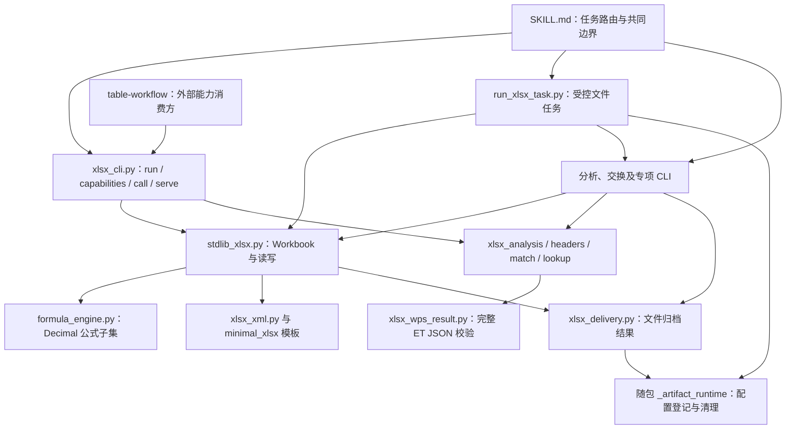
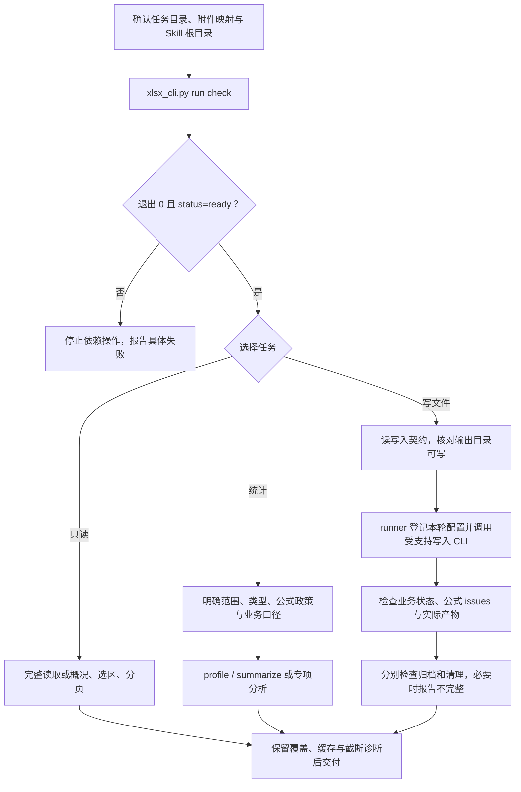

# xlsx：标准库表格读取、有限编辑与分析

> 源码基线：[14bfafe55d58fd04069a78d5196b82bfbf8f67c6](https://github.com/JohnParken/PSL-SKILLS/tree/14bfafe55d58fd04069a78d5196b82bfbf8f67c6)；Skill 版本：`20261105.1736.5039`。本文是仓库级实现导读，不替代 [SKILL.md](../../skills/xlsx/SKILL.md) 的运行约束。仅作源码与契约审查，本次未执行办公操作、业务自检或测试套件。

## 功能与适用范围

`xlsx` 是原生 XLSX/XLSM 的基础能力提供方：读取存储数据，创建 XLSX，修改既有工作簿的指定单元格，计算受支持的公式子集，并按显式范围进行类型保真的统计。主流程只使用 Python 标准库，不安装包，不启动 Office/LibreOffice，不联网。

| 任务 | 当前能力 | 重要边界 |
| --- | --- | --- |
| 读取 | XLSX/XLSM 完整读取；概况、选表、选区及分页；CSV/TSV 完整读取 | 分页只限制输出，仍完整解析原生工作簿；保存的公式缓存未经验证 |
| 新建 | 根据 sheet/cell JSON 与随包最小模板创建 XLSX；可选新表外观；可选 `--values-only` | 静态值模式须全部公式计算成功；不保证 Excel 视觉或计算等价 |
| 编辑与计算 | 指定单元格的值、公式、已有样式索引；另存新 XLSX/XLSM | 不支持任意行列/工作表结构编辑；输入不覆盖；值编辑也会触发全簿公式计算 |
| 分析 | 类型/空值/重复检查，过滤、分组、精确求和、均值；明确多级表头及类型键 | 隐藏和过滤行默认仍参与；合计行、单位、期间及业务口径需显式确定 |
| CSV/TSV 交换 | 导入为新 XLSX，按指定范围导出原始标量 | 导入默认保留文本，数值列需显式选择；导出不应用数字格式或日期显示 |
| 格式间协作 | 分析 `et` 产出的受支持完整类型化 JSON；向 `table-workflow` 提供版本化 CLI | 不直接解析 `.et/.ett/.wps` 原件，不自动转换或调用其他 Skill |

专项分析还包括期间比较、排名占比、匹配、机构汇总、日均/流量、存款与经营报表等。其入口及各自口径见 [专项目录](../../skills/xlsx/references/data-analysis.md#specialized-task-directory)，不把这些明确配置的算法理解为自动识别任意业务报表。

## 架构

`xlsx_cli.py` 是公开跨进程边界；内部复用既有算法，不另造一套解析器或公式引擎。基础 Skill 自包含；`_artifact_runtime` 是公共生命周期实现的受控副本，不依赖相邻安装目录，其来源、变换和哈希记录在 [lifecycle-upstream.json](../../skills/xlsx/references/lifecycle-upstream.json)。

### 主要模块与入口

| 模块 | 职责与入口 |
| --- | --- |
| [xlsx_cli.py](../../skills/xlsx/scripts/xlsx_cli.py) | `run` 转交标准主 CLI；`capabilities` 查询 v1 能力；`call/serve` 承载公开类型化操作与不透明句柄；格式所有方实现模板保护 `verify` |
| [stdlib_xlsx.py](../../skills/xlsx/scripts/stdlib_xlsx.py) | `check/read/create/edit/calculate`；`Workbook` 负责包校验、类型解析、创建、局部补丁、全簿计算及独占保存 |
| [formula_engine.py](../../skills/xlsx/scripts/formula_engine.py) | 解析受限公式及绑定引用；固定 Decimal 上下文；不执行宏、输入代码或外链 |
| [xlsx_analysis.py](../../skills/xlsx/scripts/xlsx_analysis.py) | `profile/summarize`；区域类型化、筛选与分组勾稽；支持显式 `reject/cached/calculate` 公式政策 |
| [xlsx_headers.py](../../skills/xlsx/scripts/xlsx_headers.py)、[xlsx_match.py](../../skills/xlsx/scripts/xlsx_match.py)、[xlsx_lookup.py](../../skills/xlsx/scripts/xlsx_lookup.py) | 重建多级表头、唯一列定位、类型化键索引，以及受控 one-to-one/many-to-one 维表补列 |
| [xlsx_read_view.py](../../skills/xlsx/scripts/xlsx_read_view.py) | 有界读取投影、输入指纹与分页游标；不是另一个流式解析器 |
| [xlsx_wps_result.py](../../skills/xlsx/scripts/xlsx_wps_result.py) | 验证完整提取 JSON 的 schema、预算、类型、覆盖诊断，恢复 Decimal；不接受预览代替源数据 |
| [xlsx_tabular.py](../../skills/xlsx/scripts/xlsx_tabular.py) | `import/export`；默认文本导入与安全文本导出，显式数值列/缓存政策 |
| [xlsx_appearance.py](../../skills/xlsx/scripts/xlsx_appearance.py) | 仅新表可选的可读外观及格式，不作为既有文件任意重排能力 |
| [run_xlsx_task.py](../../skills/xlsx/scripts/run_xlsx_task.py) | 白名单写文件 CLI；stdin 规格、具名配置、冲突版本名、子进程结果与本轮中间文件收尾 |
| [xlsx_delivery.py](../../skills/xlsx/scripts/xlsx_delivery.py)、[xlsx_lifecycle.py](../../skills/xlsx/scripts/xlsx_lifecycle.py) | 路径检查、追加 `delivery`；显式归档/登记/封存/清理入口 |

## 任务流程

运行前，从实际读取 `SKILL.md` 的真实路径确定 Skill 根目录；任务输入、输出和临时文件位于宿主已确认的任务目录内，不在安装目录生成业务文件。下图表示正常路由，引用按任务需要读取，不递归加载全部参考。

首次自检的成功标记为退出 `0`、JSON `status=ready`、`check_kind=environment`、`artifact_validation=not_run`。自检核对随包模板、导入与若干公式预期，不证明用户数据正确、输出目录可写或 Excel 兼容。文件写入前还须独占创建、读回并删除本次探针。

写文件任务优先使用 runner；只读 stdout 不建无用配置或清理清单。runner 的标准输入包含 `script`、`arguments`、`output`，以及可选 `configs/inputs`；只运行十个列明的写文件入口，不执行任意用户脚本。命名冲突时按原主题选择 `_第2版` 等新输出名，须以返回的实际 `output` 为准。直接 CLI 保持已有文件拒绝行为。具体调用见 [task-delivery.md](../../skills/xlsx/references/task-delivery.md) 与 [delivery-lifecycle.md](../../skills/xlsx/references/delivery-lifecycle.md)。

## 输入、输出与数据契约

### 标准读写与分析

- 创建/编辑规格使用 `sheets[].name` 与 `cells` 地址映射。每格恰有 `value` 或 `formula`，可附已有 `style` 索引；未知字段、重复键、非法地址/样式均拒绝。数字读为 Decimal，文本编号不转换，日期须明确使用文本或序列数。
- 读取保留原存储类型、公式与缓存来源。`xlsx_read_view_v1` 是独立视图 schema，不能代替旧完整 JSON 交给分析器。概况不含全部值；`truncated=true` 表示视图未取完，不等于源解析失败。游标绑定输入 SHA、选区及 `projection_revision=2`，输入/参数变化后须重新开始。
- 分析区域返回列 ID、类型化表头、物理行和元数据。精确求和上限为 1000 位；均值为 34 位有效数字、`ROUND_HALF_EVEN`，报告 `mean_rounded`。隐藏/过滤行默认纳入，日期序列不自动解释成日历。
- 公式策略默认 `reject`；`cached` 仅显式使用未验证的旧缓存，缺缓存或错误单元格拒绝；原生文件可 `calculate`，先在内存重算全簿，再分析，任意工作表的未支持公式/错误/循环都会阻断，不回退缓存。
- ET JSON 仅接受 `biff8_readonly_v1`、`ooxml_spreadsheet_readonly_v1` 的原始类型化提取结果，保留 `source_status/issues/coverage`。分析完成不消除源 `partial`；ET JSON 不能在此重算。
- CSV/TSV 导入默认文字，数值列显式指定且限制为 Excel 可支持的有效数字；导出默认防护可能被表格软件解释为公式的文本，记录转义计数。选择原始文本或缓存导出需按对应契约明确决定。

公式子集包括基础算术、比较、A1/区域引用、`SUM/COUNT/AVERAGE/MIN/MAX/IF/ROUND` 及受限条件汇总、`SUMPRODUCT`。**公式标量计算当前为 28 位有效数字**，不是分析均值的 34 位；精确汇总与最终舍入另有约定，详见 [formula-calculation.md](../../skills/xlsx/references/formula-calculation.md) 与 [formula_engine.py](../../skills/xlsx/scripts/formula_engine.py)。

### 版本化公开能力

接口 `interface_version=1`、协议 `psl_capabilities_v1` 与 Skill 时间戳版本相互独立。调用方先检查 `capabilities` 的协议、版本、Skill 身份及所需 operations；缺能力即停止，不自动回退私有 Python 对象。

公开操作覆盖 `open/create/extract/region`、表头与类型操作、批量筛选/表达式计算、分组/关联，以及 `patch/calculate/verify/publish/delivery`。标准 `run` 保留原 CLI 行为；`call` 单次请求，`serve` 多轮同进程会话。句柄只在当前进程有效；公开 view 只含分离的单元格/合并信息与来源诊断，不泄漏 ZIP/XML 私有对象，修改 view 不能修改工作簿。

线上使用有界 UTF-8 JSON 行，Decimal、bytes、tuple、dict 分别使用明确标签编码，禁止 pickle、动态恢复类及执行对象。帧上限 128 MiB、深度 64；最多 64 个活跃句柄、累计 `open` 输入 256 MiB、会话 200000 请求。必须同时校验协议、关联 ID、`ok` 和业务状态。`patch/calculate/publish` 出错后对应句柄失效。详见 [公开 CLI 契约](../../skills/xlsx/scripts/docs/cli-contract.md) 与 [协议编码器](../../skills/xlsx/scripts/xlsx_cli_protocol.py)。

`publish` 独占写新文件并回读 ZIP 部件，不等于业务验收或归档；编排方须先 `verify`，发布后复核文件及原件指纹，再显式 `delivery`。标准业务 CLI/runner 自动收尾，不重复归档。

## partial、失败与保护边界

各入口的退出码不同，不能把同一个数字跨入口解释。

| 入口/结果 | 含义与处理 |
| --- | --- |
| 标准业务退出 `0` | 自检 ready、读取完成或 `calculated_subset`；仍检查缓存、业务口径、归档与清理 |
| 写入计算 `incomplete` / 退出 `2` | 未支持公式保留公式文本、移除其旧缓存，可能已经写出文件；必须明确“部分公式未计算” |
| `failed/unsupported` / 退出 `1` | 失败或不支持输入，不当作计算成功；依据返回字段及实际文件状态处理 |
| argparse 参数错误 / 退出 `2` | stderr usage，不是 `incomplete` JSON，不能按部分成功交付 |
| runner `cleanup_incomplete` | 收尾未完成；业务成功时可退出 `3`，原业务非零退出码保留；不能据主文件成功忽略残留 |
| 协议 `call` 退出 `0/1` | 正常请求按 `ok` 返回；输出编码失败时可能仍退出 `0` 但实际响应为 `ok=false/OutputLimit`，必须核对实际响应；`serve` 正常 EOF 退出 `0` 不代表之前每次请求成功 |
| `delivery.archive_status` | 汇总为 `copied/skipped/failed`，逐文件 `delivery.files[].archive_status` 还可为 `already_archived`；独立于业务，配置缺失/无效为 skipped，真实复制冲突为 failed |

关键拒绝/保护规则：

上表中的 `OutputLimit` 差异来自本基线静态代码审阅：编码失败分支替换了输出 JSON，但 `call` 仍按原响应对象选择退出码。本轮未运行复现或修改实现；调用方不能仅凭退出 `0` 接受协议结果。

- 不支持签名/加密、Strict OOXML、图表工作表、XLS/XLSB；不执行宏，不刷新图表/透视/外链缓存。XLSM 编辑保留宏容器与扩展名，但不承诺宏行为验证。
- 仅局部单元格编辑；共享/数组/特殊属性公式工作表不用于编辑。未改 ZIP 成员保留内容字节；被改 XML、公式缓存及计算链元数据可变化，不承诺整个文件字节一致。
- `create --values-only` 拒绝任何部分计算；分析重算也拒绝不完整公式集。普通文件计算允许明确报告的 incomplete，两者不能混淆。
- 源包限制包括 128 MiB 解压内容、10000 ZIP 成员、200000 存储单元格；分析矩形最多 200000 格、10000 组，查询 64 KiB。达到预算时失败，不截断运算数据。
- 任务路径拒绝越界、父目录及受检路径中的符号链接；安全文件能力不足即停止相关流程。这不是针对同权限恶意并发进程的 OS 沙箱。
- 归档失败保留主文件，不为归档重跑业务，不覆盖旧交付物。只清理本轮事先登记且身份确认的中间文件；失败同样收尾，未知历史文件和用户原件受保护。清理完成只证明登记范围，不保证强杀后目录无残留。

## 依赖与验证限制

- [requirements.txt](../../skills/xlsx/requirements.txt)：主流程 Python 3.9+，无第三方依赖；完整目录包含运行时与 `assets/minimal_xlsx`。XML 解析由 [xlsx_xml.py](../../skills/xlsx/scripts/xlsx_xml.py) 拒绝 DTD/实体声明。
- 归档/清理要求实际平台支持 `dir_fd`、`O_NOFOLLOW`、`O_DIRECTORY` 等安全原语；默认归档发布需同文件系统硬链接，缺失不降级覆盖或不安全删除。
- `xlsx_reader.py`、`libreoffice_recalc.py` 等是旧工具，不是主流程：前者需 pandas/openpyxl，后者需外部软件。旧行插入/移动 CLI 已禁用；`formula_check.py` 仅启发式静态检查，不能证明已计算。见 [legacy 边界](../../skills/xlsx/references/validate.md#legacy-utilities)。
- 随包测试位于 [scripts/test](../../skills/xlsx/scripts/test)；跨 Skill/生命周期一致性测试位于仓库 `tests/`，不属于普通任务步骤。历史 [validate.md](../../skills/xlsx/references/validate.md) 和 [跨表 CLI 验证记录](../../skills/table-workflow/scripts/docs/cli-contract.md) 记录 macOS 上的合成、部分真实公开样本及隔离安装验证，不代表本次重新运行，也不能替代云端 Linux、Windows、Excel 视觉/重算或真实宿主交付验收。

本次导读只核对入口、关键实现、引用契约与基线树，不声称任何未执行的功能测试通过。

## 源码追溯

- 任务路由与边界：[SKILL.md](../../skills/xlsx/SKILL.md)、[写入与结果](../../skills/xlsx/references/write-contract.md)、[结果解释](../../skills/xlsx/references/result-boundaries.md)。
- 数据/输出范围：[数据分析](../../skills/xlsx/references/data-analysis.md)、[有界读取](../../skills/xlsx/references/bounded-reading.md)。
- 对外接口：[CLI 契约](../../skills/xlsx/scripts/docs/cli-contract.md)、[CLI 实现](../../skills/xlsx/scripts/xlsx_cli.py)。
- 交付与清理：[runner](../../skills/xlsx/scripts/run_xlsx_task.py)、[生命周期契约](../../skills/xlsx/references/delivery-lifecycle.md)、[副本来源](../../skills/xlsx/references/lifecycle-upstream.json)。
- 组合场景：[table-workflow 导读](table-workflow.md)。

## 归档提示更新（2026-11-07）

以下仅适用于本次版本 20261107.1943.5370，其余架构说明仍为上述历史基线。

归档成功即提示“🎉 文件归档成功，请到云空间查看。 ☁️✨”，无需等待宿主云空间映射确认，不宣称已验证上传完成或展示时效。失败、部分成功、跳过、待交接和未知分别如实报告，不套用全部成功；业务与清理状态独立，主业务失败不称生成成功。隐藏归档路径、目录、ID及原始日志，保留真实主文件链接，不虚构下载。
